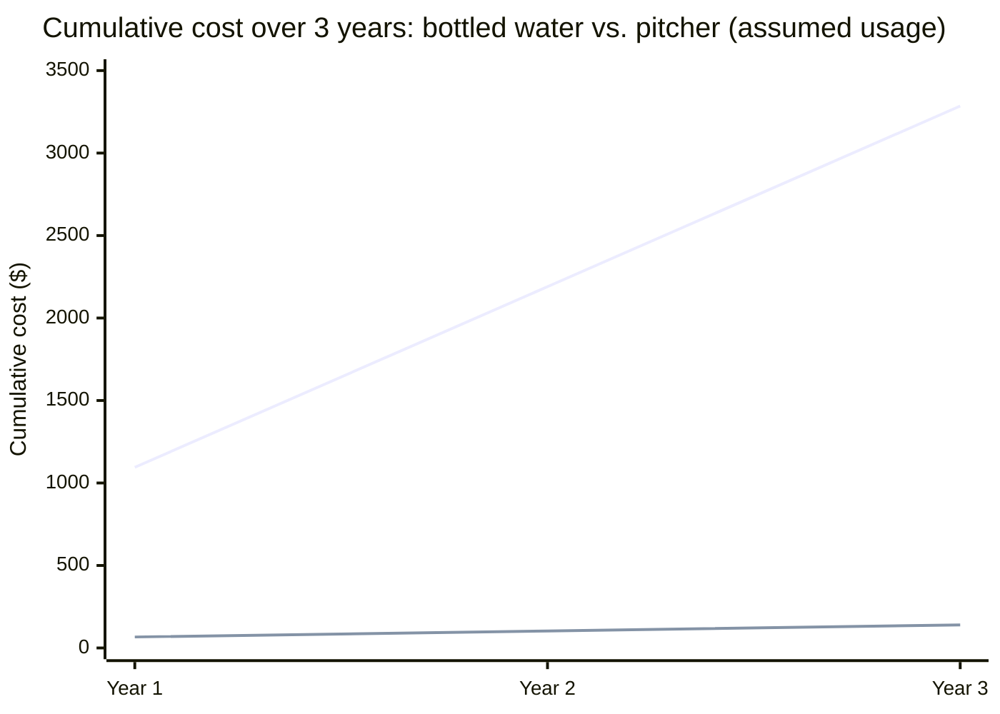

import Scenario from "../../../components/Scenario.astro";
import LevelIntro from "../../../components/LevelIntro.astro";
import Checkpoint from "../../../components/Checkpoint.astro";
import PracticeCheck from "../../../components/PracticeCheck.astro";

export const unit = {
  track: "product-domain",
  unitSlug: "value-framing-over-feature-framing",
};

<Scenario label="One pitcher, two numbers">
  <Fragment slot="facts">
    

      
🥤 Bottled water, one year: $1,095.00

      

        

      

      
🚰 Pitcher plus filters, year one: $66.50

      

        

      

      
✅ Difference: $1,028.50 (66.50 is about 6% of 1,095)

    

  </Fragment>

A friend offers you a water filter pitcher and says, "It has an activated
carbon filter, holds 10 cups, and the plastic is BPA-free." You nod and
forget it by dinner. A second friend says, "You will spend about $1,028
less this year than if you buy bottled water." You ask where to buy one.
**The product did not change between the two sentences. What did the
second friend do that the first did not?**

They did the arithmetic. The rest of this level works that arithmetic out,
writes both pitches, and then asks where the method stops being right.

</Scenario>

<LevelIntro
  items={[
    "Working the water-filter numbers to the top of the ladder",
    "The same pitch written feature-first and value-first",
    "Where value framing is the wrong move",
  ]}
/>

## What do the numbers say before either pitch is written?

**If the value pitch leads with a dollar figure, where does the figure come
from?** From a small set of facts that are the same for both pitches. The
inputs marked "assumed" are chosen for this example, not measured.

| Fact                               | Value                                           |
| ---------------------------------- | ----------------------------------------------- |
| Filter type                        | Activated carbon, removes chlorine and sediment |
| Capacity                           | 10 cups                                         |
| Material                           | BPA-free plastic                                |
| Pitcher price (one-time)           | $30                                             |
| Replacement filter (recurring)     | $8, rated for 40 gallons                        |
| Water filtered per day (assumed)   | 0.5 gallons                                     |
| Bottled water comparison (assumed) | $1.50 per bottle, 2 bottles per day             |

A one-time cost is paid once (the pitcher). A recurring cost keeps coming
back (filters, bottles). Working the figures:

1. Bottled water for a year: $1.50 x 2 x 365 = **$1,095.00**.
2. Water filtered in a year: 0.5 x 365 = 182.5 gallons. At 40 gallons per
   filter that is 4.5625 filters, costing 4.5625 x $8 = **$36.50**.
3. Pitcher plus filters in year one: $30 + $36.50 = **$66.50**.
4. Year-one difference: $1,095.00 - $66.50 = **$1,028.50**.
5. Later years: the pitcher is already bought, so the comparison is
   $1,095.00 against $36.50 per year.

<Checkpoint question="Why does year two's saving ($1,058.50) come out larger than year one's ($1,028.50)?">

Because the $30 pitcher is a one-time cost that lands entirely in year one.
From year two onward only the recurring costs remain: $1,095.00 for bottles
against $36.50 for filters. Mixing one-time and recurring costs into a
single "per year" figure is the easiest way to get this wrong.

</Checkpoint>

<PracticeCheck
  track={unit.track}
  unitSlug={unit.unitSlug}
  topicId="pitch-arithmetic"
/>

## What do the two pitches look like side by side?

**Pitch A (feature-first):** "This pitcher uses an activated carbon filter
to remove chlorine and sediment. It holds 10 cups, and the plastic is
BPA-free. Replacement filters are rated for 40 gallons each."

**Pitch B (value-first):** "If you buy bottled water now, this pitcher
makes tap water taste just as good, for about $1,028 less this year. After
that it costs about $36.50 a year to run, against roughly $1,095 for
bottles."

Every sentence in A is accurate. To turn it into a reason to buy, the
listener must already know that chlorine affects taste, that BPA is
something to avoid, that 40 gallons is large or small for their household,
and that all of this beats what they do today. B states the outcome in
taste and money, and needs no filtration background.

By year three the gap is $3,285.00 - $139.50 = **$3,145.50**, a figure
Pitch A never computes. B is not more persuasive because it is more
excited; it is more persuasive because it did the arithmetic the listener
would otherwise have to do.

<Checkpoint question="Pitch A never states a dollar figure. Why does that matter more for this pitcher than for a coffee mug's colour?">

Because the dollar figure is the entire top of this product's ladder. A mug's
colour is already near its top: you like it or you do not. The pitcher's
value depends on a calculation nobody will do alone in a shop aisle, so
omitting it leaves out the one fact that crosses the gap.

</Checkpoint>

<PracticeCheck
  track={unit.track}
  unitSlug={unit.unitSlug}
  topicId="two-pitches"
/>

## Where does value framing stop being the right move?

**If value framing works this well, why not use the $1,028.50 line on
everyone?** Because the number belongs to a listener who buys two bottles a
day. For anyone else the value changes, or disappears.

A reader can see this directly: the interactive demo for this unit moves
bottle price and bottles per day. The headline figure scales with that
habit, and at 0 bottles per day it turns into a loss of $66.50, because the
pitcher then costs money and replaces nothing.

**Try extending it yourself.** A listener makes coffee at home and never
buys bottled water. What would the top of the ladder say for them? Another
listener already owns a different filter. What would it say for them? This
worked example is a case, not the whole territory: the method is "find what
this listener is comparing against", and the pitcher is only one of many
places it applies.

<Checkpoint question="A listener already owns a competing filter and never buys bottles. Why would leading with $1,028.50 hurt the pitch?">

It cites a saving they cannot realise, since they are not buying bottles
either way, and it shows the speaker did not check who is listening. The
value for them must come from where this pitcher differs from what they
own, such as a cheaper filter per gallon, translated the same way: not "40
gallon capacity" but "you replace filters less often".

</Checkpoint>

| Failure mode                                      | What it gets wrong                                                                    |
| ------------------------------------------------- | ------------------------------------------------------------------------------------- |
| Using the generic number on a specific listener   | $1,028.50 assumes 2 bottles a day; a lighter bottle habit gives a smaller true number |
| Never answering "how does it actually work?"      | A listener curious enough to ask deserves an accurate feature answer                  |
| Treating "removes 99.9% of contaminants" as value | A percentage with no context still hands the "so what" back to the listener           |
| Asserting "saves you money" with no number        | An unquantified claim is weaker than a checkable one                                  |
| Hiding a real downside behind value language      | If it tastes worse for some people, omission sets up disappointment and lost trust    |

<PracticeCheck
  track={unit.track}
  unitSlug={unit.unitSlug}
  topicId="fit-the-listener"
/>
