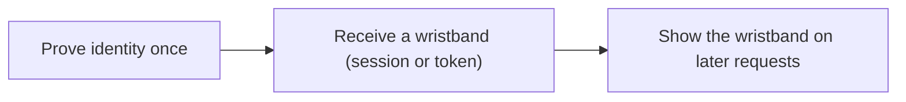

import Scenario from "../../../components/Scenario.astro";
import LevelIntro from "../../../components/LevelIntro.astro";
import PracticeCheck from "../../../components/PracticeCheck.astro";

export const unit = {
  track: "security",
  unitSlug: "authentication-fundamentals",
};

<Scenario label="Same stolen database, two very different mornings after.">
  <Fragment slot="facts">
    

      
🔓 <strong>Shop A</strong> — kept each customer's PIN as written text

      
🔒 <strong>Shop B</strong> — kept only a one-way fingerprint of each PIN

      
📋 <strong>The theft</strong> — both lost an identical copy of their customer file

    

    

      

        
Shop A thief gets

        Every real PIN, readable
      

      

        
Shop B thief gets

        Fingerprints, no PIN to read
      

    

  </Fragment>

Imagine two small shops (a made-up example, no real incident) that each let
customers log in with a PIN. Both have their customer file copied by a thief
on the same night. Shop A had written every PIN into the file as plain text.
Shop B had written only a one-way fingerprint of each PIN, computed when the
customer signed up.

| Shop | What the file stored   | What the thief can do with it straight away |
| ---- | ---------------------- | ------------------------------------------- |
| A    | The PIN itself         | Read every PIN and log in as anyone         |
| B    | A fingerprint of a PIN | Nothing directly; must guess PINs and check |

**The thief holds the same file in both cases. Why is Shop A in an emergency
while Shop B has time to think?**

The difference was decided long before the theft, by what the shop chose to
store. A PIN that is stored can be read; a fingerprint can only be compared.

</Scenario>

<LevelIntro
  items={[
    "Authentication versus authorization",
    "Three kinds of proof, and combining them",
    "Fingerprints, not copies, for passwords",
  ]}
/>

## Two questions that sound alike

| Question         | Name           | Example failure                                  |
| ---------------- | -------------- | ------------------------------------------------ |
| Who are you?     | Authentication | Anyone can log in as someone else                |
| What may you do? | Authorization  | A logged-in customer opens the admin page by URL |

A login page can reject every wrong password perfectly and the site can still
be wide open, because proving who you are says nothing about what you may
touch. Authorization has its own unit at `/security/authorization-models/`.

<PracticeCheck
  track={unit.track}
  unitSlug={unit.unitSlug}
  topicId="authn-vs-authz"
/>

## Three kinds of proof

  

    
🧠

    

      Something you know
    

    
a password, a PIN

  

  

    
📱

    

      Something you have
    

    

      a phone, a hardware key
    

  

  

    
👆

    

      Something you are
    

    

      a fingerprint, a face
    

  

**Multi-factor authentication** means combining proofs from _different_
categories. A password plus a security-question answer is still one category
(both are things you know), so it is still one factor.

<PracticeCheck
  track={unit.track}
  unitSlug={unit.unitSlug}
  topicId="factors-and-mfa"
/>

## Why the file must not hold the password

- **Plain text** can be read by anyone who gets the file.
- **Encrypted** can be reversed by anyone who also gets the key, and a system
  that encrypts passwords must keep that key somewhere it can reach.
- **Hashed** is one-way: a login only needs to _check_ a password, never
  _recover_ it, so the system stores a fingerprint and compares fingerprints.
- **Salted** means a unique random value is mixed in per user before hashing,
  so two users with the same password get different fingerprints.

<PracticeCheck
  track={unit.track}
  unitSlug={unit.unitSlug}
  topicId="hash-not-encrypt"
/>

## After the login

Checking a password on every single request would be slow and would spread the
password everywhere. Instead, a successful login hands back a **session ID** or
**token**: a temporary wristband that says "this visitor already proved
identity." Stealing the wristband can be enough to act as the user, so it needs
protecting separately from the password.

## What the next levels add

L2 follows the full chain from password to session, shows why salting defeats
precomputed lookup tables, and puts real numbers on how much a slow hash
slows a guesser. L3 works through the ways a correct-looking login still
leaks, and one end-to-end worked example.
