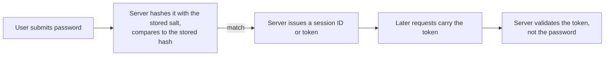
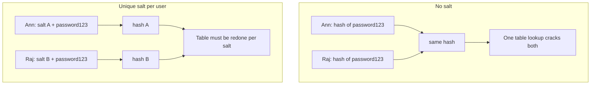

import LevelIntro from "../../../components/LevelIntro.astro";
import Checkpoint from "../../../components/Checkpoint.astro";
import PracticeCheck from "../../../components/PracticeCheck.astro";

export const unit = {
  track: "security",
  unitSlug: "authentication-fundamentals",
};

L1 said a password should be stored as a fingerprint and that a login hands
back a wristband. L2 works out the chain a login runs through, why a salt is
needed on top of a hash, and how much a deliberately slow hash changes the
guessing game for someone holding a stolen file.

<LevelIntro
  items={[
    "The chain from password to session token",
    "Why a per-user salt beats precomputed tables",
    "How hash speed sets the cost of guessing",
  ]}
/>

## What happens between "types a password" and "is logged in"?

The password is involved exactly once. Everything afterwards runs on the
token, so protecting the token is a separate problem from protecting the
password: anyone who holds a valid token is treated as the logged-in user until
it expires or is **revoked** (invalidated early by the server). Tokens travel
over the network, which connects this unit to `/security/tls-https/`.

<Checkpoint question="An attacker never learns a user's password, but copies the user's valid session token from an unprotected network connection. Does the server's careful password hashing help at that moment?">

No. Hashing protects the stored password file; it plays no part once the
user is logged in. The server only looks at the token on later requests, so
whoever presents that token is treated as the user. That is why the chain has
two separate things to defend: the stored password fingerprint and the
wristband that replaces it after login.

</Checkpoint>

<PracticeCheck
  track={unit.track}
  unitSlug={unit.unitSlug}
  topicId="login-chain"
/>

## Two users pick the same password. Should their stored hashes match?

Without a salt they match, and that is a gift to an attacker. A **rainbow
table** is a precomputed list pairing common passwords with their hashes: the
work is done once, then reused for every stolen hash.

The stored record holds the salt next to the hash. At login the server reads
that user's salt, mixes it with the entered password, hashes, and compares.
The salt is not a secret; its job is to make the attacker's saved work useless
across users.

| Design                        | Same password, two users | Precomputed table                        |
| ----------------------------- | ------------------------ | ---------------------------------------- |
| No salt                       | Identical hashes         | One table cracks every user              |
| One shared salt for all users | Identical hashes         | One table built for that salt cracks all |
| Unique random salt per user   | Different hashes         | Redone for every single user             |

<Checkpoint question="A team mixes the same fixed salt into every password before hashing. Does this stop a rainbow table?">

Only a generic one built for unsalted hashes. Because every user shares the
salt, an attacker builds one new table for that single salt and cracks every
user who chose a common password, exactly like the unsalted case. The
protection comes from the salt being unique per user, not from a salt merely
existing.

</Checkpoint>

<PracticeCheck track={unit.track} unitSlug={unit.unitSlug} topicId="salting" />

## Once the hash is stolen, what stops guessing?

One-way only means the attacker cannot run the hash backwards. They can still
guess a password, hash the guess with the stolen salt, and compare. So the real
question is how many guesses per second they can afford. A **key-derivation
function (KDF)** such as bcrypt, scrypt or Argon2 is a password hash built to
be slow on purpose; `/security/hashing/` covers the mechanics.

The model in the demo below assumes a random password drawn from 94 printable
characters, and an attacker who succeeds on average after trying half the
combinations. The speeds are assumptions to compare designs, not measurements of
any product.

| Password length | Combinations (94^n) | Fast hash, assumed 10^9 guesses/s | Slow KDF, assumed 10^2 guesses/s |
| --------------- | ------------------- | --------------------------------- | -------------------------------- |
| 6 characters    | about 6.9 × 10^11   | about 345 seconds                 | about 109 years                  |
| 8 characters    | about 6.1 × 10^15   | about 35 days                     | about 966,500 years              |
| 10 characters   | about 5.4 × 10^19   | about 854 years                   | about 8.5 billion years          |

Two levers matter, and they multiply: password length (each extra character
multiplies the work by 94) and guess speed (a slower hash divides the
attacker's rate). Real passwords chosen by people are far from random, so the
true picture is worse than the table; the table shows the best case for length.

<Checkpoint question="Using the table, which helps an 8-character random password more against a stolen file: switching the hash from the fast to the slow assumption, or adding two characters under the fast assumption?">

The slow hash. Going from 10^9 to 10^2 guesses per second multiplies the
attacker's time by 10^7, from about 35 days to about 966,500 years. Two extra
characters multiply it by 94 × 94, about 8,800, taking 35 days to roughly 854
years. Both are large, but the speed change is a thousand times bigger here,
and a system can apply it to every user's password without asking anyone to
change what they type.

</Checkpoint>

<PracticeCheck
  track={unit.track}
  unitSlug={unit.unitSlug}
  topicId="guessing-cost"
/>

## What this unit leaves for the next one

This is the _why_ behind hashing and salting. Which function to choose and how
to tune its cost belong to `/security/hashing/`; the next level shows how a
correct-looking login can still leak.
