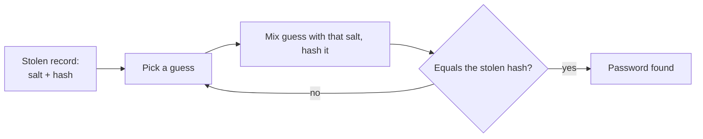

import Scenario from "../../../components/Scenario.astro";
import LevelIntro from "../../../components/LevelIntro.astro";
import Checkpoint from "../../../components/Checkpoint.astro";
import PracticeCheck from "../../../components/PracticeCheck.astro";

export const unit = {
  track: "security",
  unitSlug: "authentication-fundamentals",
};

<Scenario label="Shop B hashed and salted everything, and its customers' passwords still fell within minutes.">
  <Fragment slot="facts">
    

      
🧂 <strong>Salt</strong> — unique and random per customer, done right

      
⚡ <strong>Hash</strong> — a single fast hash, one pass per password

      
🔢 <strong>Passwords</strong> — random, 6 characters, from 94 symbols

    

    

      
Average time to crack one customer (assumed speeds)

      
Fast hashabout 345 seconds

      
Slow KDFabout 109 years

    

  </Fragment>

Shop B from L1 did the textbook things: a fresh random salt for every
customer, then a hash. A thief copies the file. Each customer still has a
random 6-character password. The thief ignores the login page entirely and
guesses offline on their own machine, hashing each guess with the customer's
stored salt. Under the assumption that the hash runs at 10^9 guesses per
second, the average customer falls in about 345 seconds.

**Salting was done right, so why did it not save them?**

Because salting only stops guesses being _shared_ across users. It does nothing
about how fast each single guess runs, and that speed is a separate choice.

</Scenario>

<LevelIntro
  items={[
    "One stolen record, step by step",
    "Four ways correct-looking logins leak",
    "Where each defence starts and stops",
  ]}
/>

## What exactly does the attacker do with one stolen record?

No contact with the shop is needed, so no lockout, rate limit or alarm ever
triggers. Salting makes this loop run once per customer instead of once for
everybody; the hash speed sets how long each loop takes. With 94^6, about
6.9 × 10^11, combinations and half of them tried on average, the model gives
about 3.4 × 10^11 guesses. At 10^9 per second that is about 345 seconds; at 10^2
per second it is about 3.4 × 10^9 seconds, around 109 years.

<Checkpoint question="The shop wants the average 6-character customer to survive at least a year of offline guessing. What must the guess rate be at or below, and does that change if the thief steals the file twice?">

About 3.4 × 10^11 guesses divided by roughly 3.15 × 10^7 seconds in a year is
about 11,000 guesses per second. Stealing the file a second time changes
nothing: the stolen record is the same, and the work needed to guess it
depends only on the combinations and the speed per guess.

</Checkpoint>

<PracticeCheck
  track={unit.track}
  unitSlug={unit.unitSlug}
  topicId="crack-time-code"
/>

## Where do correct-looking logins still leak?

| Failure                                 | What looks fine                 | What actually leaks                                       | Fix                                  |
| --------------------------------------- | ------------------------------- | --------------------------------------------------------- | ------------------------------------ |
| Fast general-purpose hash               | Hash is one-way, salt is unique | Offline guessing runs at the hash's top speed             | Use a deliberately slow, tunable KDF |
| Ordinary equality when comparing hashes | The right login succeeds        | Time to reject reveals how many leading bytes matched     | Use a constant-time comparison       |
| One hardcoded salt for every user       | A salt is present               | One precomputed table cracks all users sharing a password | A fresh random salt per user         |
| A homemade scheme instead of a library  | Each piece looks simple         | A small slip silently removes a protection                | Use a maintained, audited library    |

Three of these four cannot be seen by running the happy path: logging in with the
right password works, and logging in with a wrong one fails, in all of them.
That is why a code reviewer has to ask how each piece _fails_, not whether it
passes.

<Checkpoint question="A reviewer sees a login that salts per user, uses a slow KDF, and compares with a plain equality check on the hash. Which row of the table applies, and could an attacker use it without ever stealing the database?">

The equality row applies. Plain comparison can stop at the first differing
byte, so a guess sharing more leading bytes with the real hash may take
fractionally longer to reject. An attacker sending very many attempts and
measuring response times precisely enough can, in principle, learn the hash a
piece at a time through the login endpoint alone, without stealing anything.
Salting and the slow KDF are unaffected; this is a separate leak in how the
comparison is done.

</Checkpoint>

<PracticeCheck
  track={unit.track}
  unitSlug={unit.unitSlug}
  topicId="implementation-failures"
/>

## A case, not the whole territory

The worked example fixed one weakness (hash speed) for one kind of attacker
(offline guessing from a stolen file). Try extending it yourself:

- **What changes if a customer's password is not random?** A 6-character word
  from a short list falls to a guess list of thousands of entries, not 10^11
  combinations. Which defence still helps, and which no longer matters?
- **What changes during a password reset?** A locked-out customer cannot
  supply the old password, so the new fingerprint must be created without it.
  A fresh salt is generated and the new hash replaces the old record; nothing is
  derived from the old hash. What new weakness does the reset path itself add?
- **What changes if the attacker is online instead of offline?** Guesses go
  through the login page, one request at a time. Which protections become
  relevant that were irrelevant here?
