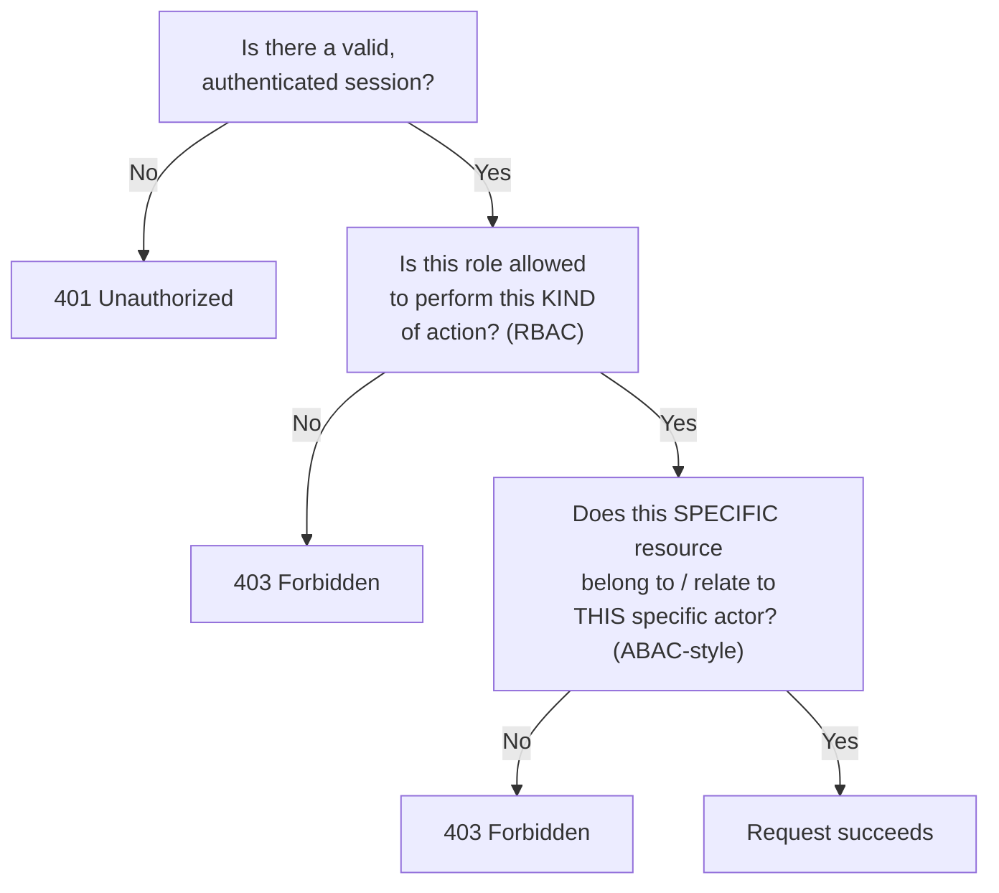
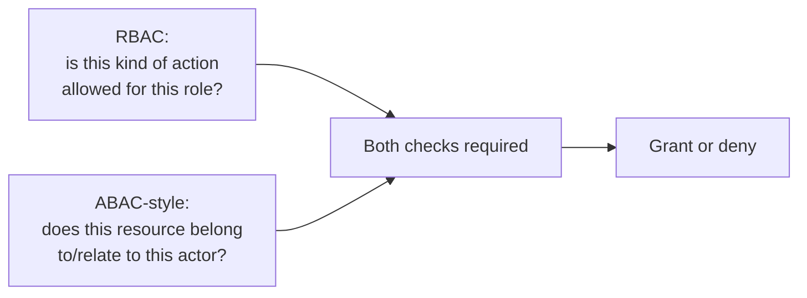

import LevelIntro from "../../../components/LevelIntro.astro";
import Checkpoint from "../../../components/Checkpoint.astro";
import PracticeCheck from "../../../components/PracticeCheck.astro";

export const unit = { track: "security", unitSlug: "authorization-models" };

L1 named the invoice bug (a valid login, no ownership check) and the two models,
RBAC and ABAC. L2 works out the order a well-built system runs its checks in, and
exactly where the invoice endpoint's check went missing.

<LevelIntro
  items={[
    "The three checks and their status codes",
    "What a role can and cannot express",
    "RBAC and ABAC combined in one endpoint",
  ]}
/>

## Three questions, checked in order

**Given a request, what sequence of checks decides whether it succeeds, and what does
the caller see when each one fails?**

The invoice endpoint passed A, effectively treated every logged-in customer as
allowed to view invoices (B), and never reached C: whether _this_ invoice belongs to
_this_ customer.

| Status | Meaning                                        | Where in the flow        |
| ------ | ---------------------------------------------- | ------------------------ |
| `401`  | "We do not know who you are"                   | Fails check A            |
| `403`  | "We know who you are, and you may not do this" | Fails check B or check C |

For the HTTP foundation, see `/web/http-request-response-basics/`.

<Checkpoint question="A request passes check A and check B, then gets denied. Which HTTP status code does it get, and what does that code tell the caller that a 401 would not?">

It gets a `403 Forbidden`, not a `401`. By the time a request has passed A and B,
the server knows exactly who is asking and has confirmed their role may perform
this kind of action, so a `401` ("I don't know who you are") would be wrong. The
`403` says identity is established and the role is broadly permitted, but this
specific resource is off-limits to this specific actor. That also helps debugging:
a `401` on a previously working request usually points at an expired session, while
a `403` in this position points at the ownership check itself, either correctly
denying or, as in the invoice bug, never running at all.

</Checkpoint>

<PracticeCheck
  track={unit.track}
  unitSlug={unit.unitSlug}
  topicId="check-order"
/>

## What does a role say, and what can't it say?

**If RBAC is clean and auditable, why can't it fix the invoice bug on its own?**
A role is a named bucket of permissions, and a user's request is allowed when
their role includes the needed permission:

| Role             | view-invoice | view-billing-history | edit-invoice | refund-invoice |
| ---------------- | :----------: | :------------------: | :----------: | :------------: |
| `billing-viewer` |     yes      |         yes          |      no      |       no       |
| `billing-admin`  |     yes      |         yes          |     yes      |      yes       |

A `billing-viewer` asking to `refund-invoice` is denied: the role lacks the
permission. That is RBAC doing its job. But look at what the table cannot contain: a
column for _which_ invoice. Every `billing-viewer` has the same row regardless of
whose invoice is on screen, so RBAC answers "can billing-viewers view invoices at
all" and never "can this billing-viewer view this invoice."

ABAC answers the second question by evaluating a rule over attributes:

| Requester      | Invoice `ownerId` | Rule: `user.id == invoice.ownerId` OR role is `billing-admin` | Result  |
| -------------- | ----------------- | ------------------------------------------------------------- | ------- |
| user 42        | 42                | ids match                                                     | allowed |
| user 42        | 99                | ids differ, not an admin                                      | denied  |
| user 1 (admin) | 99                | role clause                                                   | allowed |

Context is the optional third input: "only during work hours" or "only from the
company network" are facts about the situation, not about the user or the resource.

<Checkpoint question="A billing-admin role is granted view-invoice, edit-invoice and refund-invoice. Does giving a user that role, by itself, let them view every invoice in the system, or is something else still deciding that?">

By itself, the role only grants the RBAC-level permission to perform those _kinds_ of
actions. It says nothing about which specific invoices. In the rule above,
`billing-admin` reaches every invoice only because the rule explicitly writes a
second clause, "OR role is billing-admin", that bypasses the ownership comparison for
that one role. Without that clause an admin would pass the role check and still fail
the ownership check on invoices they do not own. "Admins see everything" is not
automatic: it is a visible line of authorization logic that someone has to write on
purpose.

</Checkpoint>

<PracticeCheck
  track={unit.track}
  unitSlug={unit.unitSlug}
  topicId="rbac-limits-and-combo"
/>

## Combining both, correctly

**Does fixing the bug mean abandoning RBAC for ABAC?** No. They answer complementary
questions, and a real endpoint needs both:

| Design         | Gets right                            | Gets wrong                                                  |
| -------------- | ------------------------------------- | ----------------------------------------------------------- |
| RBAC only      | Which kinds of action a role may do   | Per-resource access: reproduces the invoice bug             |
| ABAC only      | Per-resource rules                    | Role-like logic gets re-derived inside every ownership rule |
| RBAC then ABAC | Both questions, each in its own place | Nothing, provided both run on every ID-accepting endpoint   |

## The pattern worth checking everywhere

**Is the invoice endpoint a one-off, or a shape to look for elsewhere?** Any endpoint
that takes an ID from the request (URL parameter or body field) and fetches a
specific resource is a candidate, unless an explicit comparison between resource and
requester runs before data is returned. The audit question: **for every endpoint
that accepts a resource identifier, is there a line that compares an attribute of the
resource against an attribute of the requester, or is authentication quietly standing
in for it?**
