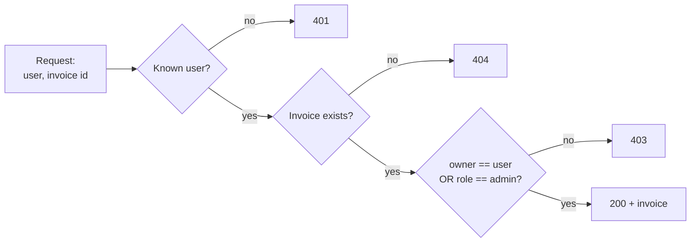

import Scenario from "../../../components/Scenario.astro";
import LevelIntro from "../../../components/LevelIntro.astro";
import Checkpoint from "../../../components/Checkpoint.astro";
import PracticeCheck from "../../../components/PracticeCheck.astro";

export const unit = { track: "security", unitSlug: "authorization-models" };

<Scenario label="One missing comparison, traced exactly">
  <Fragment slot="facts">
    <div class="not-prose flex flex-col gap-2 text-sm text-slate-700 dark:text-slate-300">
      <div class="flex items-center gap-1.5"><span>👤</span> <strong>User 42</strong> — role `billing-viewer`, owns invoice `48213` ($340)</div>
      <div class="flex items-center gap-1.5"><span>👤</span> <strong>User 7</strong> — role `billing-viewer`, owns invoice `48212` ($120)</div>
      <div class="flex items-center gap-1.5"><span>🛡️</span> <strong>User 1</strong> — role `billing-admin`, owns nothing</div>
    </div>
    <div class="not-prose mt-3 grid grid-cols-2 gap-2 text-xs">
      <div class="rounded border border-rose-300 bg-rose-50 p-1.5 dark:border-rose-800 dark:bg-rose-950">
        <p class="font-semibold text-rose-600 dark:text-rose-400">Vulnerable handler</p>
        6 of 6 requests succeed
      </div>
      <div class="rounded border border-emerald-300 bg-emerald-50 p-1.5 dark:border-emerald-800 dark:bg-emerald-950">
        <p class="font-semibold text-emerald-600 dark:text-emerald-400">Fixed handler</p>
        4 of 6 succeed, 2 return 403
      </div>
    </div>
  </Fragment>

Three users and two invoices give six possible requests (every user asking for every
invoice). Only some of those requests are legitimate. **Before reading on, predict:
how many of the six should succeed, and does the fix need to change any stored data, or
only the decision made when a request arrives?**

</Scenario>

<LevelIntro
  items={[
    "The incident as a six-row decision table",
    "The ownership-or-admin check itself",
    "Teams, sharing and context as richer relationships",
  ]}
/>

## The incident, request by request

The vulnerable handler looks up the user (else `401`), looks up the invoice (else
`404`), and returns the invoice. It never compares anything between the two. Writing
out all six requests shows what that means:

| Requester        | Invoice (owner) | Should succeed? | Vulnerable handler | Fixed handler |
| ---------------- | --------------- | :-------------: | :----------------: | :-----------: |
| user 42 (viewer) | 48213 (user 42) |       yes       |        200         |      200      |
| user 42 (viewer) | 48212 (user 7)  |       no        |      **200**       |    **403**    |
| user 7 (viewer)  | 48212 (user 7)  |       yes       |        200         |      200      |
| user 7 (viewer)  | 48213 (user 42) |       no        |      **200**       |    **403**    |
| user 1 (admin)   | 48212 (user 7)  |       yes       |        200         |      200      |
| user 1 (admin)   | 48213 (user 42) |       yes       |        200         |      200      |

The two bold rows are the incident: a valid user reads an invoice that is not theirs.
The vulnerable handler is right on 4 of 6 rows only by accident, because it allows
everything. The `users` and `invoices` data are identical in both columns. Only the
decision changed.

This also matches the unit's interactive demo: with 2 users owning 1 invoice each,
there are exactly 2 cross-user paths, which is the two bold rows. The demo shows how
that count grows as users and invoices multiply.



The vulnerable handler is this same flow with the last diamond deleted.

## What is the smallest correct check?

**How much code is the fix, and what does it reuse?** One guard before the return:

```js
const isOwner = invoice.ownerId === user.id;
const isAdmin = user.role === "billing-admin";
if (!isOwner && !isAdmin) throw new Error("403 Forbidden");
```

Two boolean facts and one guard that stops the function before private data can leave.
The guard throws only when both facts are false, so either one alone is enough to
allow. This is the OR-shaped rule from L2 written down.

<Checkpoint question="User 1 (billing-admin) requests invoice 48212, owned by user 7, and succeeds. Which part of the guard lets that through, and why doesn't it need isOwner to be true?">

For user 1, `isOwner` is `false` (the invoice's `ownerId` is 7), but `isAdmin` is
`true`. The guard only throws when _both_ are false, so a true `isAdmin` alone lets
execution continue to the return. Ownership and admin role are two independent paths
to the same allow decision, not two conditions that both must hold. A common slip is
to write `!isOwner || !isAdmin`, which throws for almost everyone, including owners
who are not admins.

</Checkpoint>

<PracticeCheck
  track={unit.track}
  unitSlug={unit.unitSlug}
  topicId="ownership-check-code"
/>

## Where do richer relationships fit?

**What changes if an invoice belongs to a whole team, or is shared with named
coworkers, instead of having one owner?** Ownership was an equality between two IDs.
Team access is a membership test against a list, and sharing is a membership test
against a different list. Context adds a third input that is about neither side.

| Relationship          | Rule written as                        | Compared sides                                |
| --------------------- | -------------------------------------- | --------------------------------------------- |
| Owns                  | `invoice.ownerId == user.id`           | one user attribute, one resource attribute    |
| Is on the owning team | `invoice.teamId in user.teamIds`       | a list on the user, one value on the resource |
| Was shared with       | `user.id in invoice.sharedWithUserIds` | one value on the user, a list on the resource |
| Business hours only   | `now` between 09:00 and 17:00          | the context only                              |

Each row is still "an attribute of one side compared against an attribute of the
other (or of the situation)". Only the relationship changed. What none of them
changes is the obligation: the check has to be written explicitly, because neither a
login nor a role implies it.

<Checkpoint question="A new feature lets an invoice be shared with a list of individual coworkers. Does the attribute-vs-attribute shape still apply, or does sharing need a fundamentally different check?">

The same shape applies. Ownership was a single-ID equality, team access widened it to
a membership test on a list, and per-user sharing is the same membership test against
a different list: whether `invoice.sharedWithUserIds` contains `user.id`. The function
still compares something about the requester with something about the resource. A
genuinely different kind of input only appears for rules like "only during business
hours", which depend on neither side and so need context as a separate input.

</Checkpoint>

<PracticeCheck
  track={unit.track}
  unitSlug={unit.unitSlug}
  topicId="relationship-shapes"
/>

## Failure modes, and how far the fix reaches

| Failure mode                                           | What it gets wrong                                                                         |
| ------------------------------------------------------ | ------------------------------------------------------------------------------------------ |
| Assuming a valid login implies access to any resource  | Authentication passed perfectly in the incident and still leaked private data              |
| Using only RBAC for per-resource access                | The role is the same for every invoice, so the check is true for all of them               |
| Fixing only the endpoint that was reported             | Every endpoint that accepts an ID is a candidate for the same bug                          |
| Checking the ID in the URL but not in the request body | The same resource can be named in two places, and an attacker edits whichever is unchecked |
| Treating the fix as the one changed line               | The durable fix is the audit question, applied to every ID-accepting endpoint              |

<PracticeCheck
  track={unit.track}
  unitSlug={unit.unitSlug}
  topicId="audit-scope"
/>

## This is a case, not the whole territory

The six-row table used two invoices, three users, one owner per invoice and one admin
role. Real systems differ on every axis. Try extending the example yourself:

- What changes if invoices can be soft-deleted, and a deleted invoice should return
  `404` to everyone except an admin? Which of the three checks does that touch?
- What if returning `403` for someone else's invoice, versus `404` for a missing one,
  lets an attacker learn which invoice numbers exist? When would you return `404` for
  both?
- If one endpoint lists invoices rather than fetching one, where does the ownership
  check go, and is "check each row after fetching" the same as "only fetch rows the user
  owns"?
