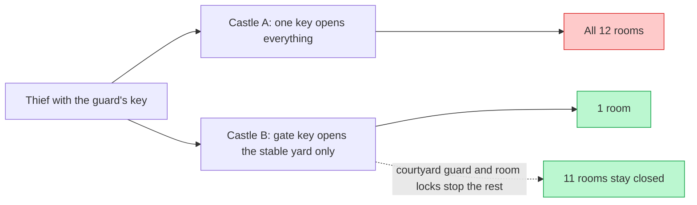

import Scenario from "../../../components/Scenario.astro";
import LevelIntro from "../../../components/LevelIntro.astro";
import PracticeCheck from "../../../components/PracticeCheck.astro";

export const unit = { track: "security", unitSlug: "defense-depth" };

<Scenario label="The same stolen key, two castles">
  <Fragment slot="facts">
    

      
🗝️ <strong>The theft</strong> — a thief steals the front-gate guard's key at both castles, identically

      
🏰 <strong>Castle A</strong> — one gate, and that same key opens every door inside

      
🛡️ <strong>Castle B</strong> — a gate, a courtyard guard, and a separate lock on every room; the gate key opens only the stable yard

    

    

      

        
Castle A: 12 of 12 rooms reachable

        

      

      

        
Castle B: 1 of 12 rooms reachable

        

      

    

  </Fragment>

Two castles each have twelve rooms: a treasury, an armoury, a kitchen,
stables, and so on. One night a thief steals the key from the front-gate
guard at both castles. At Castle A, that single key also opens every door
inside, so the thief walks through all twelve rooms and empties the
treasury. At Castle B, the same key only opens the gate and the stable
yard. A guard in the courtyard challenges anyone heading deeper, and every
other room has its own lock and its own key.

**Both castles lost a key to the same thief. Only one lost its treasury.
What was different, given that the theft itself was identical?**

The theft was not the difference. The difference was decided long before
that night, in how each castle answered a question nobody asked on the day
of the theft: _if one key is stolen, how much can it open?_ Castle A never
asked. Castle B built every door as if the last one had already failed.

</Scenario>

<LevelIntro
  items={[
    "Defense in depth: several independent doors",
    "Least privilege: each key opens as little as possible",
    "Zero trust: every door checks you, even from inside",
  ]}
/>

## The castle, translated to software

Software teams make the same choice every day, just with servers instead of
stone walls. The twelve rooms below stand for parts of a system, and the
stolen key stands for any credential or foothold an attacker obtains.

| In the castle                 | In a software system                                              |
| ----------------------------- | ----------------------------------------------------------------- |
| The castle wall and gate      | The network edge: firewall, load balancer, login page             |
| A key                         | A credential: password, API token, service account                |
| A room                        | A table, a service, a storage bucket                              |
| The courtyard guard           | A check that runs between internal services                       |
| A separate lock on every room | A separate permission scope on every resource                     |
| The thief with the stolen key | Any breached component: a 0-day, a leaked token, a bad dependency |

## The shape of the problem

Most security work is about making one door hold: proving who someone is,
checking a permission, encrypting a channel. This unit starts from the
opposite premise. **Assume one door eventually fails anyway** — a 0-day, a
misconfiguration, a stolen credential — and ask what stops that one failure
from becoming total compromise.

- **Defense in depth** — several independent controls in a row, each built
  on the assumption that the one before it has already been bypassed.
  Three copies of the same lock are not three layers.
- **Least privilege** — every key, account, and process gets only the access
  its job needs. The size of the damage a stolen key can do is called its
  **blast radius**.
- **Zero trust** — being inside the walls grants no automatic trust. Every
  request is checked on its own merits, whatever side of the wall it came
  from.
- **The trade-off** — every door costs money, time, and maintenance. A castle
  with unlimited doors is unbuildable; a castle with none is Castle A. The
  skill is deciding where the doors go.

<PracticeCheck
  track={unit.track}
  unitSlug={unit.unitSlug}
  topicId="layers-independent"
/>

## Why "it's logged in" is not the finish line

Authentication asks whether this person is who they claim to be.
Authorization asks whether that person may do this one thing. Both run at
the moment of a request. Neither one limits what happens **after** a
component has been taken over and is no longer making honest requests on
anyone's behalf. That is a design-time question, not a request-time one, and
it is the one this whole unit exists to ask.

| Question                                               | Where it is answered   |
| ------------------------------------------------------ | ---------------------- |
| Is this one request allowed right now?                 | `authorization-models` |
| What specific bug let the attacker in?                 | `owasp-top-10`         |
| If this component is breached, what can it reach next? | This unit              |

L2 builds the model for each of the three ideas in turn. L3 turns them into a
design-review exercise with a real permission check and a blast-radius
calculation.
