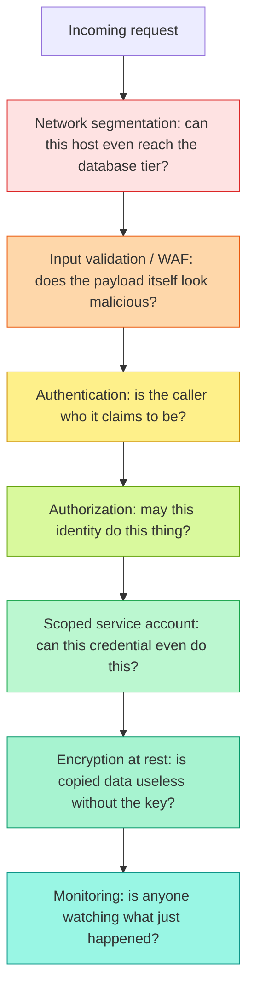
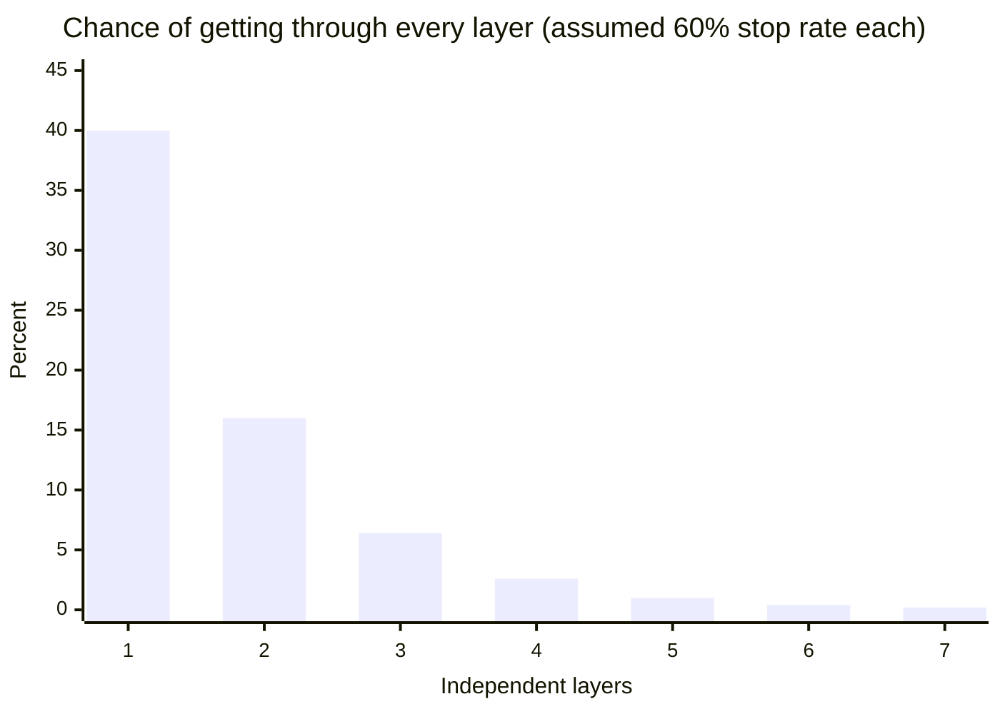
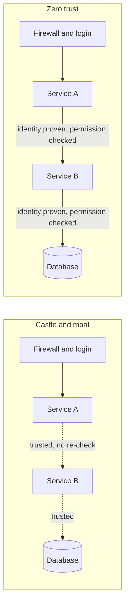

import LevelIntro from "../../../components/LevelIntro.astro";
import Checkpoint from "../../../components/Checkpoint.astro";
import PracticeCheck from "../../../components/PracticeCheck.astro";

export const unit = { track: "security", unitSlug: "defense-depth" };

L1 showed two castles robbed by the same stolen key, with very different
results. This level builds the model behind Castle B, and moves it into
software using two retailers, Meridian and Castellan, hit by the same
0-day in the same image-resizing library on the same weekend.

<LevelIntro
  items={[
    "Layers that are independent, not redundant",
    "Least privilege as blast-radius containment",
    "Zero trust versus castle-and-moat trust",
  ]}
/>

## What makes a set of controls layers instead of just more security?

Imagine Castle B hires three more gate guards, all trained by the same
person, all fooled by the same forged letter. Is the castle three times
safer? No: whatever fools one guard fools all three. A layer only earns its
place if it asks a **different question** from the layers around it, so that
whatever defeats one does not automatically defeat the next.

Each box can say "no" even when every box above it said "yes". The scoped
service account is the clearest case: the attacker at Castellan had already
beaten everything upstream of it, because they had real code execution on
the web server, not a forged request. The layer that still stopped them
asked only "can this specific credential do this at all?", which does not
depend on who is holding it.

Why does stacking pay off so quickly? If each layer independently stops an
attacker 60% of the time, the chance of getting through all of them is the
product of the 40% pass rates. This is an **assumed** per-layer rate chosen
to show the shape, not a measured figure.

| Independent layers | Chance of getting through all of them |
| ------------------ | ------------------------------------- |
| 1                  | 40%                                   |
| 2                  | 16%                                   |
| 3                  | 6.4%                                  |
| 5                  | about 1.0%                            |
| 7                  | about 0.16%                           |

The multiplication only holds when the layers really are independent. Two
identical WAFs share a blind spot, so their pass rates are not independent
and the product badly understates the real risk. The interactive demo for this level lets you drag both knobs: more layers, or
stronger layers.

<Checkpoint question="A company puts a second WAF from a different vendor in front of its first one, and both scan for the same attack signatures. Is this a genuine second layer?">

Not really. It is redundancy, not depth. Both products ask the same
question about the same kind of input, so an attack clever enough to evade
the first has a good chance of evading the second, because their signatures
overlap. A genuine second layer asks a different question: a scoped database
account asks "can this credential do this at all?", and that stays effective
even against an attack the WAF never recognised as malicious. Two WAFs make
the first checkpoint harder to pass, which has some value, but they do not
give the attacker a different kind of problem to solve.

</Checkpoint>

## Least privilege: why is "just give it admin" the actual vulnerability?

Back at Meridian, the web server held a shared admin database account. Nobody
wanted a breach. Scoping an account down is ongoing work: someone has to
list exactly which tables and operations the app needs, and keep that list
current as the app changes. "Use admin, it's simpler" is the path of least
_effort_, which is why it keeps happening, even though it is the opposite of
least _privilege_.

The question least privilege answers is not "is this account convenient?" It
is: **if this exact credential is stolen right now, what is the smallest set
of things that can go wrong?** That set is the blast radius.

| Account design                                  | Tables reachable | Operations allowed                   | Blast radius if stolen                   |
| ----------------------------------------------- | ---------------- | ------------------------------------ | ---------------------------------------- |
| Meridian: shared admin account                  | all 47           | select, insert, update, delete, drop | Whole database: read, write, and destroy |
| Castellan: scoped read account for the web tier | 2                | select only                          | 2 non-sensitive tables, read-only        |

Scoping is not a one-time setting. It has to be re-derived whenever a
service's real needs change, and it has to survive the temptation to widen
it "just for now" under deadline pressure. The L3 demo shows how
directly the grant decision, rather than the theft technique, sets the
number: at an average of 4,270 records per table, a 2-table grant exposes
8,540 records and a 47-table grant exposes 200,690. The 4,270 average is a scenario value, not a statistic.

<PracticeCheck
  track={unit.track}
  unitSlug={unit.unitSlug}
  topicId="least-privilege-blast"
/>

## Zero trust: does being inside the network mean anything?

A castle-and-moat design puts its serious checks at the edge (firewall, VPN,
login page) and treats everything inside as roughly trusted. Service A can
call service B without proving anything, because both are "inside". Zero
trust removes that assumption: **no request is trusted because of where it
came from.** Every request, including one between two services in the same
cluster, is authenticated and authorised on its own merits, every time.

Meridian was not "no security": it very likely had a firewall and a login
page. What it lacked was any checkpoint **inside** the perimeter. Once the
attacker's foothold on the web server was itself inside, nothing asked it to
prove anything before it talked to the database.

<PracticeCheck
  track={unit.track}
  unitSlug={unit.unitSlug}
  topicId="zero-trust-verify"
/>

<Checkpoint question="Two services on the same private network still check each other's identity and permissions on every call. Isn't that pointless, since outsiders cannot reach that network?">

The pointless-looking part is exactly the gap zero trust closes. It is true
that an outsider cannot address the private network directly, but the threat
this unit assumes is a component already inside, taken over through some
other route such as a 0-day or a leaked token. Once that is the premise,
"on the internal network" describes the attacker's position just as well as
it describes a legitimate service. The network location can no longer tell
them apart. An identity check and a permission check do, because they verify
the caller itself rather than where the packet came from.

</Checkpoint>

Least privilege and zero trust are two angles on one discipline. Least
privilege bounds what a component **can** do once trusted. Zero trust bounds
how **easily** anything becomes trusted at all. L3 puts both into a
design review: which layer stops which failure, a small permission check,
and a blast-radius number.
