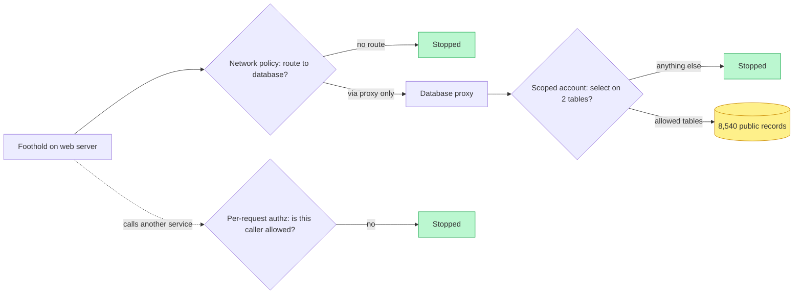
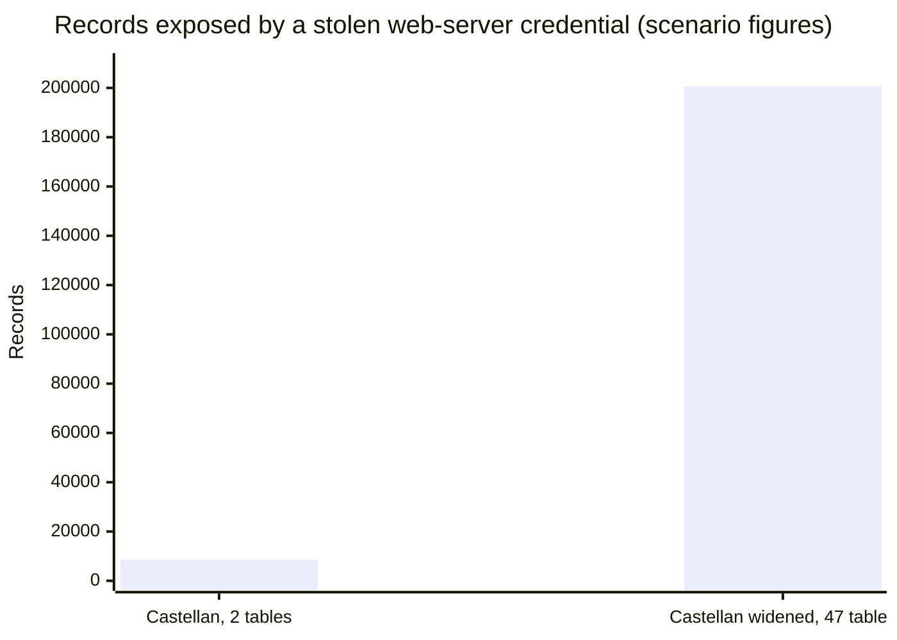

import Scenario from "../../../components/Scenario.astro";
import LevelIntro from "../../../components/LevelIntro.astro";
import Checkpoint from "../../../components/Checkpoint.astro";
import PracticeCheck from "../../../components/PracticeCheck.astro";

export const unit = { track: "security", unitSlug: "defense-depth" };

<Scenario label="One new service, one afternoon of review time">
  <Fragment slot="facts">
    <div class="not-prose flex flex-col gap-2 text-sm text-slate-700 dark:text-slate-300">
      <div class="flex items-center gap-1.5"><span>🆕</span> <strong>The change</strong> — Castellan wants to ship an order-export service next week</div>
      <div class="flex items-center gap-1.5"><span>⏱️</span> <strong>The budget</strong> — enough time to harden one layer properly, not four</div>
      <div class="flex items-center gap-1.5"><span>❓</span> <strong>The question</strong> — which layer is worth building first?</div>
    </div>
    <div class="not-prose mt-3 grid grid-cols-2 gap-2 text-xs">
      <div class="rounded border border-rose-300 bg-rose-50 p-1.5 dark:border-rose-800 dark:bg-rose-950">
        <p class="font-semibold text-rose-600 dark:text-rose-400">Guessing</p>
        Add whatever sounds strongest
      </div>
      <div class="rounded border border-emerald-300 bg-emerald-50 p-1.5 dark:border-emerald-800 dark:bg-emerald-950">
        <p class="font-semibold text-emerald-600 dark:text-emerald-400">Measuring</p>
        Count what a stolen credential reaches, then spend there
      </div>
    </div>
  </Fragment>

Castellan is about to add an order-export service, and the review meeting
has time to harden exactly one layer properly. Someone says "put a better
firewall in front of it". Someone else says "encrypt everything". A third
person says "lock down the service account". All three sound sensible, and
nobody can say which one removes the most risk. **How do you choose between
good ideas without guessing?**

You choose by asking, for each layer, which realistic failure it stops that
the others do not, and by turning the exposure into a number you can compare.
This level does both, using Meridian's and Castellan's figures from L2.

</Scenario>

<LevelIntro
  items={[
    "Which layer stops which failure mode",
    "A default-deny permission check, in code",
    "Blast radius as a number, and its limits",
  ]}
/>

## Which layer stops which failure?

Suppose the attacker already has code execution on a Castellan web-tier
server. Four different things could happen next, and each is stopped by a
different layer. Reading the table row by row is the design review.

| What the attacker tries                                              | Layer that stops it             | Why the other layers do not                             |
| -------------------------------------------------------------------- | ------------------------------- | ------------------------------------------------------- |
| Connect straight to the database with the stolen password            | Network policy: no route exists | The password is valid; credential scoping never sees it |
| Reach the database through the proxy and read payment data           | Scoped database account         | The route is legitimate; the network layer allows it    |
| Call another internal service and ask it for data it should not give | Per-request authorization       | The caller is inside; neither network nor account helps |
| Quietly read the allowed data over weeks                             | Monitoring and alerting         | Every individual request is permitted                   |



The network layer in Kubernetes is a `NetworkPolicy`. It switches a group of
pods from "anything can talk to anything" to **default-deny**, then allows
only named paths. In Castellan's cluster that means three rules and nothing
else:

| Rule                  | Applies to                              | Allows                                 |
| --------------------- | --------------------------------------- | -------------------------------------- |
| default-deny          | every pod in the `storefront` namespace | nothing in or out                      |
| web-tier egress       | web pods                                | the database proxy, TCP port 8443      |
| database-tier ingress | database pods                           | the database proxy only, TCP port 5432 |

This is why the attacker at Castellan had "nowhere useful to go": the stolen
password was useless without a route to use it on, and the only route ran
through a proxy the web tier could reach only as a read-only account.

<PracticeCheck
  track={unit.track}
  unitSlug={unit.unitSlug}
  topicId="layer-failure-modes"
/>

<Checkpoint question="Suppose Castellan deployed the network rules above but left the database account as a shared admin login. Would a breach still be contained to 2 tables?">

No. The network layer contained this particular attacker because it left no
route from the web tier to the database, which is a real, independent win.
But the proxy has to carry legitimate traffic, since the app must serve
product data, and a shared admin credential behind that proxy is reachable by
anything that can reach the proxy: a compromised proxy, a future
misconfiguration, or an attack path this 0-day did not use. The two layers
protect against different failures. The network policy answers "should this
component reach that tier at all?" and the scoped account answers "once it
legitimately does, what can it do there?" Skipping either leaves a real gap.

</Checkpoint>

## A default-deny permission check, in code

The scoped account is the layer that is easiest to get subtly wrong, so it is
worth seeing in miniature. In SQL, the whole idea is a couple of lines:

```sql
CREATE ROLE web_catalog_reader LOGIN;
GRANT SELECT ON products TO web_catalog_reader;
GRANT SELECT ON product_categories TO web_catalog_reader;
```

Anything not granted is denied. The same rule, as a function that a service
could run on every call:

```js
// grants: { role: { table: ["SELECT", "INSERT"] } }
function canAccess(grants, role, table, operation) {
  const ops = grants[role]?.[table];
  return Array.isArray(ops) && ops.includes(operation);
}
```

Two details carry the lesson. An unknown role, an unlisted table, and a
listed table with the wrong operation all fall through to `false`: the check
is **default-deny**, so forgetting a rule fails closed instead of open. And
the function does not consult any "is this caller trusted?" flag: the only
question is whether this exact role holds this exact grant for this exact
operation. The inverse design, which returns `true` unless a deny rule
matches, fails open the first time someone forgets to list something.

<PracticeCheck
  track={unit.track}
  unitSlug={unit.unitSlug}
  topicId="default-deny-check"
/>

## Blast radius as a number

Every layer above can now be compared with one question: **given everything
currently granted, what does this one compromised component reach?** For
direct grants that is addition, using the figures from the scenario.

| Design                                | Resources reached                       | Records exposed                      |
| ------------------------------------- | --------------------------------------- | ------------------------------------ |
| Castellan web-server account          | products 8,200 + product_categories 340 | 8,540                                |
| Meridian web-server account           | every table                             | 14,000,000 (assumed scenario figure) |
| Castellan if widened to all 47 tables | 47 tables x 4,270 average (assumed)     | 200,690                              |

The 14,000,000 and the 4,270 average are scenario assumptions, not
measurements. The 8,540 is exact for the two tables named, and it is also the
second demo's default, so dragging the "tables granted" slider away from 2
shows what each extra grant costs.



<Checkpoint question="The blast-radius table counts only the compromised component's own grants. A real attacker might then take over a second service reachable from the first. Does the table account for that?">

No, and that is a limitation worth naming. It measures the blast radius of
one component's own credentials, not movement through a chain of services.
A fuller version walks the graph: if the order service can call the billing
service, and that call is not independently authorised, the real radius
includes billing's grants as well. This is the gap zero trust closes. When
every hop re-authorises the caller, a compromised order service cannot ride
on billing's grants merely by calling it; it must pass billing's check as
itself, and its own permission row does not include those tables. The
single-hop table is the right first tool in a review, and a multi-hop walk is
the natural extension once a system has several internal hops.

</Checkpoint>

## Where does the budget actually go?

None of this is free. A design review has to weigh each layer's cost against
what it buys, not assume that more security is always better.

| Layer                             | What it costs                                            | What it buys                                          |
| --------------------------------- | -------------------------------------------------------- | ----------------------------------------------------- |
| Network segmentation              | Extra hops and proxy services to build and run           | Stops a component that has no legitimate network path |
| Least-privilege database accounts | Ongoing upkeep as schemas and features change            | Bounds exactly what a stolen credential can do        |
| Per-request service authorization | A little latency per internal call, certificate rotation | Removes "inside the network" as a trust signal        |
| Monitoring and alerting           | Storage, noise, time spent triaging false alarms         | Shortens how long a breach runs undetected            |

A team with unlimited time would build all four for every service. A team
that is honest about its constraints builds first where the component's blast
radius is largest, and the table above is how you find out where that is. For
the order-export service, a read-only export of public data and a service that
can update payment records deserve very different spending, even though both
are "one more internal service".

The Castellan walkthrough is a case, not the whole territory. Try extending
it yourself. What changes if the stolen credential belongs to the database
proxy instead of the web server? What changes if the attacker is a
well-meaning employee with legitimate access rather than an outsider with a
0-day? And if a service is read-only versus one with insert and update
grants, does that change which layer is worth building first for each?
