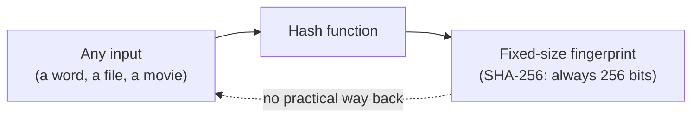
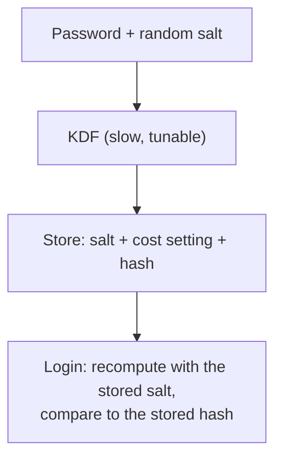

import Scenario from "../../../components/Scenario.astro";
import LevelIntro from "../../../components/LevelIntro.astro";

export const unit = { track: "security", unitSlug: "hashing" };

<Scenario label="Did the download arrive exactly as published?">
  <Fragment slot="facts">
    

      
📄 <strong>Input A</strong> — <code>hello</code> → <code>2cf24dba…9824</code>

      
✏️ <strong>Input B</strong> — <code>hellp</code> (one letter changed) → <code>fdd7585e…4ce7</code>

      
🔍 <strong>The use</strong> — compare two short strings instead of two whole files

    

  </Fragment>

A download page prints a short string next to the link. You download the
file, compute the same kind of string from your copy, and compare the two.
If they match, your copy is the published one, and you never had to
compare a single byte of the file against anything. **How can a short
string stand in for an entire file, and why does changing one letter
produce an unrelated-looking string instead of a slightly different one?**

</Scenario>

<LevelIntro
  items={[
    "What a hash is and what makes it cryptographic",
    "The avalanche effect",
    "Why a password needs a slow hash and a salt",
  ]}
/>

## The shape of the answer

| Term                 | Plain meaning                                                          |
| -------------------- | ---------------------------------------------------------------------- |
| **Hash**             | A fixed-size fingerprint of some input                                 |
| **Deterministic**    | Same input, same fingerprint, on any machine, every time               |
| **Avalanche effect** | A tiny input change scrambles the whole fingerprint                    |
| **Preimage**         | An input that produces a given fingerprint; finding one should be hard |
| **Collision**        | Two different inputs with the same fingerprint                         |
| **Salt**             | A random value stored beside a password hash, different per user       |
| **KDF**              | A key derivation function: a deliberately slow, tunable password hash  |

## The twist: fast is a feature for files and a bug for passwords

| Job                          | Who is guessing?                                     | Fast hash is...                  |
| ---------------------------- | ---------------------------------------------------- | -------------------------------- |
| Check a download's integrity | Nobody; you hash one file once                       | Good: less waiting               |
| Store a password for later   | An attacker with a stolen database, guessing offline | Bad: every guess becomes cheaper |

A real login hashes one password once. An attacker with a stolen
database hashes billions of guesses. A function that is slow enough to be
invisible to the first and painful for the second is exactly what a KDF
is built to be, and a per-user salt makes sure the attacker cannot reuse
one round of guessing against every account at once.

If you arrived from passwords, `/security/authentication-fundamentals/`
covers the login flow this unit builds on.

## What this unit covers

L2 explains the properties a hash needs, why collisions must exist yet
stay out of reach, why a KDF is slow on purpose, and what a salt does.
L3 measures the avalanche effect and a collision search with real
numbers, then works through tuning a KDF's cost setting.
