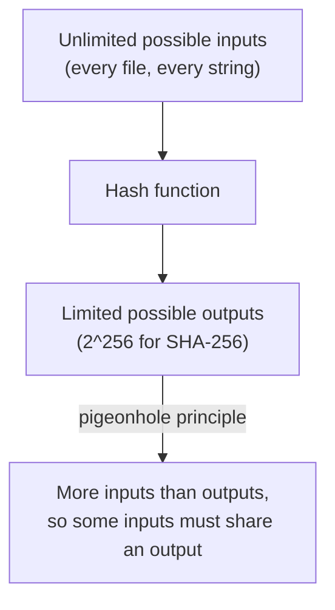
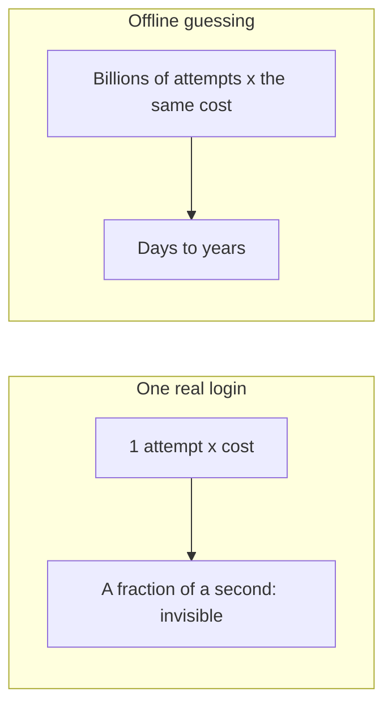
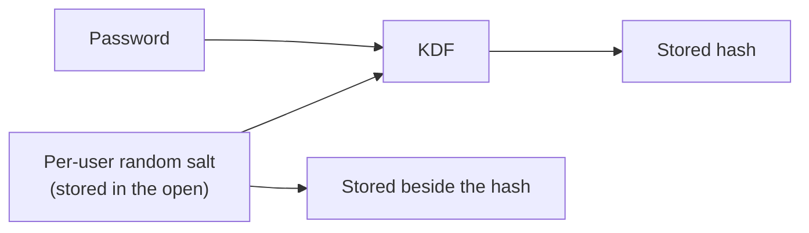

import LevelIntro from "../../../components/LevelIntro.astro";
import Checkpoint from "../../../components/Checkpoint.astro";
import PracticeCheck from "../../../components/PracticeCheck.astro";

export const unit = { track: "security", unitSlug: "hashing" };

L1 gave hashes a job (a short fingerprint) and split it in two: fast for
files, slow for passwords. L2 works out why each property exists and what
exactly a KDF and a salt change.

<LevelIntro
  items={[
    "Properties a cryptographic hash must have",
    "Why collisions exist but stay out of reach",
    "What a KDF and a salt each add",
  ]}
/>

## What separates a cryptographic hash from a simple checksum?

**Isn't any function that shrinks data to a fixed size a hash?** It is a
hash in the loose sense, but a cheap checksum fails under pressure.
Add up the byte values of a word, and `AB` (65 + 66) and `BA` (66 + 65)
both give `131`: two different inputs, one output, and an attacker can
build such pairs on purpose.

| Property             | What it requires                                                       |
| -------------------- | ---------------------------------------------------------------------- |
| Deterministic        | Same input gives the same output, always                               |
| Fixed-length output  | A one-byte input and a ten-gigabyte input give the same-size output    |
| Avalanche effect     | Flipping one input bit flips about half the output bits, unpredictably |
| Preimage resistance  | Given a hash, finding any input that produces it is infeasible         |
| Collision resistance | Finding two different inputs with the same hash is infeasible          |

**Why does avalanche matter for tamper detection?** If a small edit moved
the hash only a little, a tamperer could search for an edit that lands
"close enough" to slip past a careless glance. With avalanche there is no
"close": the only useful comparison is exact equality.

<Checkpoint question="A friend says a function that is deterministic and fixed-length is already good enough to detect tampering. What is missing?">

Those two properties describe a checksum, and the `AB`/`BA` example shows
the gap: different inputs can land on the same output, and nothing stops
someone from constructing such a pair. Tamper detection also needs
avalanche, so a small change cannot hide as "nearly the same", and
collision resistance, so a second file cannot be engineered to carry the
same fingerprint as the first. Determinism and fixed size only make the
function usable; they say nothing about whether it resists someone who is
actively trying to fool it.

</Checkpoint>

<PracticeCheck
  track={unit.track}
  unitSlug={unit.unitSlug}
  topicId="fingerprint-and-avalanche"
/>

## If collisions must exist, why isn't every hash broken?

Put 100 objects in 10 boxes and some box holds several. Hashes are the
same shape on a huge scale, so collisions are guaranteed to exist.
Collision _resistance_ only claims that finding one on purpose is
infeasible. A hash is "broken" when someone finds a way to locate
collisions faster than the generic baseline, which is what eventually
happened to MD5 and SHA-1.

The generic baseline is not "try every output". By the birthday effect, a
hash with `k` possible outputs yields a collision after roughly
`sqrt(k)` tries, so an `n`-bit hash gives about `n/2` bits of collision
resistance. Preimage resistance is the harder-to-beat property: finding an
input for one given hash takes on the order of the full output space.

| Output size | Tries before a collision becomes likely | Tries to find a preimage (order) |
| ----------- | --------------------------------------- | -------------------------------- |
| 8 bits      | about 2^4 = 16                          | about 2^8 = 256                  |
| 64 bits     | about 2^32 (about 4.3 billion)          | about 2^64                       |
| 256 bits    | about 2^128                             | about 2^256                      |

<Checkpoint question="Why does shrinking a hash's output from 256 bits to 64 bits hurt collision resistance far more than the size ratio suggests?">

Collision resistance follows the square root of the output space, so it
is measured in half the bits. Cutting 256 bits to 64 does not leave a
quarter of the security: it takes the collision cost from about 2^128 down
to about 2^32, which is a few billion tries and entirely within reach. The
square-root effect is why output size has to be generous, not merely
"big enough that guessing one specific value is hopeless".

</Checkpoint>

<PracticeCheck
  track={unit.track}
  unitSlug={unit.unitSlug}
  topicId="collisions-and-preimages"
/>

## Why would a password hash be deliberately slow?

**If speed is usually a hash's selling point, why not store a password
as plain SHA-256?** Because the threat is different. A stolen database
lets an attacker guess offline, with no rate limit and no lockout, as
fast as their hardware allows. The faster the hash, the cheaper each
guess. A key derivation function adds two levers that an everyday hash
has no reason to have:

| Lever           | What it does                                        | Why it hurts the attacker more than the user                            |
| --------------- | --------------------------------------------------- | ----------------------------------------------------------------------- |
| Time cost       | Repeats internal work many times per hash           | One login pays it once; a billion guesses pay it a billion times        |
| Memory hardness | Needs a large block of memory for every single hash | Cheap specialised chips cannot run huge numbers of guesses side by side |

<Checkpoint question="Two systems both say passwords are hashed: one with plain SHA-256, one with a tuned KDF. Both databases are stolen. Why does the shared word hide a large difference?">

"Hashed" names a mechanism (a fingerprint is stored instead of the
password), not a guarantee about how expensive a guess is. SHA-256 was
designed to be fast, so an attacker can try guesses at enormous speed.
The KDF spends deliberate time and memory on every single guess, so the
same attacker pays far more per attempt and cannot cheaply parallelise.
Same word, opposite fit to the actual threat of offline guessing.

</Checkpoint>

<PracticeCheck
  track={unit.track}
  unitSlug={unit.unitSlug}
  topicId="fast-vs-slow-hashing"
/>

## What does a salt fix that a slow hash does not?

**Two users picked the same password. Without more, what does a stolen
database reveal?** Their stored hashes are identical, so the attacker
learns the two accounts share a password, and cracking one cracks both.
A table of precomputed hashes for common passwords (a rainbow table or
a simple lookup list) also works against every account at once.

A salt is a random value generated for each user and stored next to the
hash. The KDF mixes it into the input, so:

| Without a salt                                 | With a per-user random salt                              |
| ---------------------------------------------- | -------------------------------------------------------- |
| Same password gives the same hash for everyone | Same password gives a different hash for each user       |
| One precomputed table cracks every account     | A table would be needed per salt, so it stops paying off |
| Guessing one password can match many accounts  | Each account must be attacked separately                 |

A salt is not a secret and it does not make a single targeted guess any
slower. It removes shared work. Slowness comes from the KDF's cost; the
salt makes sure that cost has to be paid per account.

<Checkpoint question="An attacker has the salt and the hash for one user. Has the salt failed?">

No. A salt was never meant to be secret, and it is stored in the open
next to the hash. Its job is to make the attack account-specific:
precomputed tables no longer apply, and matching hashes no longer reveal
shared passwords. The attacker can still guess passwords for this one
account, which is why the slow KDF is a separate and necessary defence.

</Checkpoint>

<PracticeCheck track={unit.track} unitSlug={unit.unitSlug} topicId="salting" />

## The generalisable lesson

"Hash it" is not a complete design decision. A fast hash fits integrity
checks and content addressing, where nothing secret is guarded. A slow,
memory-hard KDF with a per-user salt fits secrets an attacker can guess
offline. Picking the wrong one does not fail loudly; it quietly gives
the wrong security properties. How to pick the KDF's cost setting is the
last question, and L3 answers it with measured numbers.
