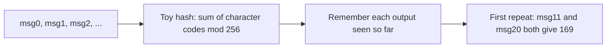
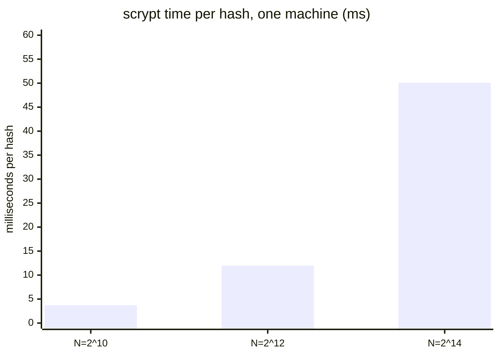

import Scenario from "../../../components/Scenario.astro";
import LevelIntro from "../../../components/LevelIntro.astro";
import Checkpoint from "../../../components/Checkpoint.astro";
import PracticeCheck from "../../../components/PracticeCheck.astro";

export const unit = { track: "security", unitSlug: "hashing" };

<Scenario label="One letter, measured in bits">
  <Fragment slot="facts">
    

      
🔤 <strong>Change made</strong> — one letter in a 43-character sentence

      
🎯 <strong>Ideal</strong> — about half of 256 bits flip (128)

    

    

      

        
Bits flipped (measured)122 of 256

        

      

    

  </Fragment>

L2 said a tiny input change scrambles about half the output. **Is that a
real measurement or just a comforting phrase, and how close to "random
looking" does one letter actually get?**

</Scenario>

<LevelIntro
  items={[
    "Avalanche and a collision search, with real numbers",
    "Tuning a KDF's cost setting against attacker time",
    "Upgrading cost for users who already have hashes",
  ]}
/>

## The avalanche effect, measured

Take `The quick brown fox jumps over the lazy dog` and the same sentence
ending in `dof`. Hash both with SHA-256 and count the output bits that
differ (XOR the two hashes and count the ones: the Hamming distance).

| Input ending | SHA-256 (hex)                                                      |
| ------------ | ------------------------------------------------------------------ |
| `...dog`     | `d7a8fbb307d7809469ca9abcb0082e4f8d5651e46d3cdb762d02d0bf37c9e592` |
| `...dof`     | `a1cbac0e93075ab66ad59ff54c32c8abcaeb533f0568e109281ed57eb5196855` |

The two hashes differ in **122 of 256 bits (47.7%)**, close to the 50% a
random-looking output would give. No "mostly matching" fingerprint exists.

<Checkpoint question="A tamperer changes one byte deep inside a large download. Could the published hash still look close enough to pass a quick glance?">

No. The measurement shows a one-letter change flipping nearly half of
all output bits, not a few at the end. A tampered file produces a hash
with no visible relationship to the original, so the only meaningful
check is exact equality, and "close enough" is not a state the output
space contains.

</Checkpoint>

## A collision found by brute force, against a toy

A real SHA-256 collision search is far out of reach, which is the point of
collision resistance. The mechanism can still be shown against a toy
8-bit "hash" that sums character codes modulo 256 and is deliberately
weak. Do not use anything like it for real.

You can check it by hand: `msg11` sums to 109 + 115 + 103 + 49 + 49 = 425
and `msg20` to 109 + 115 + 103 + 50 + 48 = 425; 425 mod 256 is 169 for
both. Counting from `msg0`, the repeat appears on the **21st candidate**,
not the 256th: with `k` outputs a collision is likely after about
`1.25 * sqrt(k)` tries, and `1.25 * sqrt(256) = 20`.

<Checkpoint question="A teammate truncates SHA-256 to 64 bits to save space when fingerprinting uploaded files for duplicate detection. What does the square-root rule predict?">

A 64-bit output has about 2^64 values, so a collision becomes likely
after roughly 2^32, about 4.3 billion files. That is reachable for a
large service, and the collision would happen by accident, silently
treating two different files as duplicates. Keep the full output, or
truncate far less aggressively.

</Checkpoint>

## Tuning a KDF's cost setting

scrypt's `N` parameter sets its time and memory cost and must be a power
of 2. One login pays the cost once; an attacker pays it for every guess.
On one machine (a single measurement, your hardware will differ):

| Cost `N` | Time per hash | One attacker core, 1 billion guesses |
| -------- | ------------- | ------------------------------------ |
| 2^10     | 3.7 ms        | about 43 days                        |
| 2^12     | 12.0 ms       | about 139 days                       |
| 2^14     | 50.1 ms       | about 580 days                       |

Each step of two in the exponent cost roughly 3x and then 4x here; the
demo below uses a clean doubling-per-step model (3.7 ms at 2^10), so its
numbers are a smooth approximation, not the measurements. The arithmetic
is days = (milliseconds per hash x guesses) / 86,400,000. Real attackers
use many cores, which divides these totals, so the table shows relative
shape, not a safe-time guarantee. Memory hardness is the reason that
parallel speed-up is more expensive than for a pure-CPU hash.

The cost setting is a budget decision: raise it until a real login is
still comfortably fast, because every legitimate user pays it too.

<PracticeCheck
  track={unit.track}
  unitSlug={unit.unitSlug}
  topicId="cost-tuning"
/>

## Extend it: what if hardware improves after users have registered?

**The cost was tuned once, at registration. Years later faster hardware
weakens it, yet millions of hashes are stored at the old setting. What
now?** The system never keeps plaintext passwords, so it cannot re-hash
everyone at once. The usual fix: store the cost setting (and salt) next to
each hash, and at each user's next successful login, when the plaintext
is briefly in hand, re-hash with the current setting. Active accounts
migrate quickly; accounts that never return stay at the old cost.

This is one case, not the whole territory. Work it further:

- What changes if a breach is discovered today and you cannot wait for each user to log in?
- What if the same hashes were used for file integrity instead of passwords? Which advice flips?
- How would you pick a login-time budget for a device much slower than your server?

## Failure modes

| Failure mode                                          | What it gets wrong                                                              |
| ----------------------------------------------------- | ------------------------------------------------------------------------------- |
| Treating "hashed" as a security guarantee             | A fast hash and a slow KDF are both "hashed" but fit opposite threats           |
| Reading collision resistance as "collisions can't be" | They must exist; resistance means finding one on purpose is infeasible          |
| Setting a KDF cost once and never revisiting it       | Hardware keeps improving, so a fixed cost weakens on its own                    |
| Using a small output where collisions matter          | The birthday effect halves the bits: 21 tries for 256 outputs, 2^32 for 64 bits |
| Using a fast hash for passwords, or a KDF for files   | Each is the right tool for the other job                                        |
