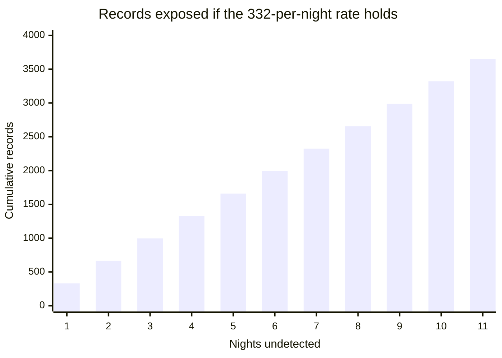

import Scenario from "../../../components/Scenario.astro";
import LevelIntro from "../../../components/LevelIntro.astro";
import PracticeCheck from "../../../components/PracticeCheck.astro";

export const unit = { track: "security", unitSlug: "incident-response" };

<Scenario label="2:14am — one decision, made alone, before anyone else even knows there is a breach">
  <Fragment slot="facts">
    

      
📟 <strong>The page</strong> — Dana, the only engineer on call, sees a database replica pulling unusually large batches overnight

      
🕵️ <strong>What she finds</strong> — an admin service account has been exporting records in small nightly batches for <strong>11 nights</strong>

      
⚖️ <strong>The fork</strong> — cut the connection now, or watch it first

    

    

      

        
Cut it now

        Data stops leaving, but live evidence such as memory and open connections may vanish
      

      

        
Watch first

        Cleaner evidence, but every extra hour more records leave
      

    

  </Fragment>

Picture a night guard who notices the same person carrying boxes out of a
warehouse every night for eleven nights. She can stop the person at the door
right now, or follow quietly to see where the boxes go. Stopping them protects
the stock but may lose the trail. Following keeps the trail but lets more boxes
leave.

Dana is that guard, and the boxes are customer records. There is no incident
commander on the call, no legal team and no prepared statement. **What she does
in the next five minutes, before her manager is awake and before anyone has
decided whether to tell a single customer, already has legal, forensic and
financial consequences that cannot be undone. How is one person at 2am meant to
get that right?**

</Scenario>

Every other unit in this track is about keeping this moment from happening.
This one starts after the defenses failed: someone is already inside, and the
question is what to do in the next five minutes, the next five hours and the
next five weeks, and who is told what, and when.

<LevelIntro
  items={[
    "The six phases of an incident response",
    "Dwell time and blast radius",
    "Disclosure clocks and blameless reviews",
  ]}
/>

## What happens, in what order?

Dana's fork is one decision inside a repeatable sequence. This unit uses the
NIST SP 800-61 phases as its reference model.

| Phase                  | Its one job                                                     |
| ---------------------- | --------------------------------------------------------------- |
| Preparation            | Runbooks, contacts and logging in place before anything happens |
| Detection and Analysis | Confirm it is real and scope how big it is                      |
| Containment            | Stop it getting worse                                           |
| Eradication            | Remove the attacker's real foothold, not just the symptom       |
| Recovery               | Return to normal operation with monitoring turned up            |
| Post-Incident Activity | A blameless review that feeds back into Preparation             |

<PracticeCheck
  track={unit.track}
  unitSlug={unit.unitSlug}
  topicId="lifecycle-phases"
/>

## Why does speed matter so much?

Think of the nightly boxes again: the longer the person is left alone, the more
leaves. Northlake Benefits, the company in this unit's worked example, lost about
3,650 records over 11 nights, which is roughly 332 per night. The chart assumes
an even rate, which is a simplification of one real post-mortem figure.

Every night saved removes one night of leakage. That is why **dwell time**, the
stretch between compromise and containment, is the biggest lever on damage.

## Key terms

- **Dwell time** — how long an attacker has undetected access before containment.
  This unit's scenario runs on an 11-night dwell time.
- **IoC (indicator of compromise)** — a concrete, observable artifact such as an
  unfamiliar IP address or an unusual login pattern, as opposed to a hunch.
- **Blast radius** — everything the compromise could plausibly have touched, not
  just what is proven touched. Scoping starts wide and narrows as evidence comes in.
- **Material breach** — one significant enough, by scale, sensitivity or legal
  definition, to trigger a disclosure obligation. Assuming one is not material
  without checking is how deadlines get missed.
- **Blameless post-mortem** — a review that names decisions and system gaps,
  never people's character.

<PracticeCheck
  track={unit.track}
  unitSlug={unit.unitSlug}
  topicId="dwell-blast"
/>

## What this unit covers

L2 builds the containment decision and the three disclosure clocks, internal,
regulator and customer, that start once a breach is confirmed. L3 walks the
whole Northlake incident from detection to a published blameless review.
