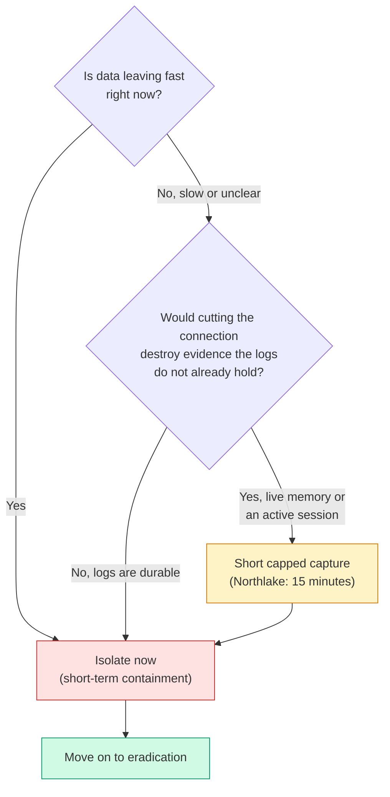
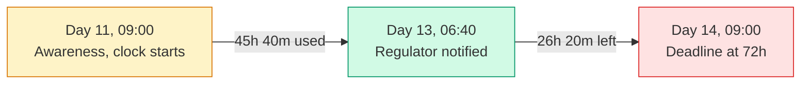

import LevelIntro from "../../../components/LevelIntro.astro";
import Checkpoint from "../../../components/Checkpoint.astro";
import PracticeCheck from "../../../components/PracticeCheck.astro";

export const unit = { track: "security", unitSlug: "incident-response" };

L1 left Dana at 2:14am with a connection she could cut or watch. That single
decision is one branch of a larger structure. This level lays out how the
containment choice is made and the clocks that start running the moment she is
sure the breach is real.

<LevelIntro
  items={[
    "The containment decision tree",
    "Why preserving evidence needs a time cap",
    "Three audiences, three clocks",
  ]}
/>

## How does Dana decide between cutting and watching?

**If she had a rule to follow at 2am, what would it be?** The answer depends on one
question: what would be lost by cutting the connection that the team cannot get
any other way?

Northlake's case was a slow nightly trickle, and the request logs had already
captured what the account touched. So the runbook said to contain at once:
revoke the credentials and block the network address. The team accepted losing a
live memory image of the attacker's tools, because one more night of watching
was not worth one more night of confirmed leakage. A fast, unbounded dump would
also end in isolation, even sooner.

Notice the cap on the preserve branch. Without a fixed limit, a sensible short
capture quietly stretches into an open-ended delay while records keep leaving.

<Checkpoint question="A different incident: an attacker has a foothold on a build server but has touched no customer data, and every action they take is already captured in a tamper-evident audit log. Does the tree point toward isolating immediately or preserving the session a while longer?">

Isolate immediately. The preserve branch exists to capture evidence that would
otherwise be lost, and here none would be, because the audit log is already
durable. Meanwhile every extra minute of foothold is a minute in which the
attacker might move toward something more sensitive than a build server. Waiting
only pays when cutting the connection genuinely destroys evidence, not as a
default.

</Checkpoint>

<PracticeCheck
  track={unit.track}
  unitSlug={unit.unitSlug}
  topicId="containment-tradeoff"
/>

## Who needs to hear what, and by when?

Once the team confirms this is a real, material breach, three clocks start at
once. **If Dana learns something at 03:15, who should hear it first, and who must
wait until it is certain?**

| Audience                  | What they need                                                           | Timing pressure                                                                 |
| ------------------------- | ------------------------------------------------------------------------ | ------------------------------------------------------------------------------- |
| Internal (leaders, legal) | Full technical detail and scope, including what is not known yet         | Immediately: this is the first call                                             |
| Regulator                 | Facts enough to meet the legal standard, even if investigation continues | A fixed deadline: GDPR is 72 hours from awareness                               |
| Customers                 | What happened, what of theirs was involved, what to do now               | Without undue delay once individual risk is confirmed, later than the regulator |

This is the audience discipline of `business-communication/audience-awareness`
sharpened by hard deadlines. Telling customers too early, before scope is
confirmed, can be as damaging as telling them too late, because a message that
must be retracted costs trust. **A fact is ready to share when disclosing it will
not need walking back,** and confirming it takes time the legal clock does not pause for.

The regulator's clock starts at awareness, not at the start of the compromise.
Northlake's team treated Day 11, 09:00 as awareness and filed on Day 13 at 06:40:

<Checkpoint question="The compromise began 11 days before Dana's page. Does GDPR's 72-hour window run from Day 1, when the attacker got in?">

No. The window runs from the moment the organization becomes aware of the breach,
so it started around Day 11, not Day 1. But awareness is not a switch the team
can delay by staying vague. A regulator can ask when the team reasonably knew, so
time spent in "probably nothing" is not time the clock is guaranteed to ignore.
This is a teaching model, not legal advice.

</Checkpoint>

<PracticeCheck
  track={unit.track}
  unitSlug={unit.unitSlug}
  topicId="disclosure-clocks"
/>

## What comes after the clocks?

Evidence has to be handled so it can be trusted, and the review afterwards has
to be run so people keep reporting. L3 works through both with the full Northlake
incident, ending in a blameless post-mortem.
