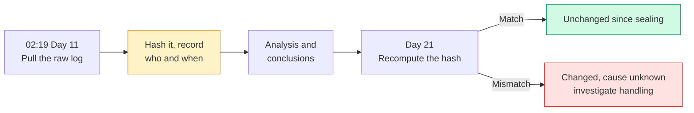

import Scenario from "../../../components/Scenario.astro";
import LevelIntro from "../../../components/LevelIntro.astro";
import Checkpoint from "../../../components/Checkpoint.astro";
import PracticeCheck from "../../../components/PracticeCheck.astro";

export const unit = { track: "security", unitSlug: "incident-response" };

<Scenario label="Three weeks later, someone asks: how do you know this log is what it was on the night?">
  <Fragment slot="facts">
    

      
📄 <strong>The log</strong> — the only record of what the account exported on each of 11 nights

      
🔏 <strong>The seal</strong> — hashed and stamped with who and when at 02:19 on Day 11

      
📝 <strong>The review</strong> — published on Day 21, naming gaps, not people

    

  </Fragment>

Imagine finding a note in a shared notebook and being asked whether anyone has
altered it since. Without anything fixed at the time, you can only say "I think
not". With a fingerprint taken the moment it was written, you can check.

Northlake's team faced the same question about the log that reconstructed the
attacker's 11 nights, and a second one about how to write up the incident
without making the next engineer afraid to raise a doubt. **How do you make
evidence defensible and a review honest at the same time?**

</Scenario>

L2 gave Dana's decision a place in the lifecycle and gave the clocks a shape.
This level follows one incident from first anomaly to published review.

<LevelIntro
  items={[
    "Reading a timeline out of raw logs",
    "Sealing evidence with a chain of custody",
    "Writing a blameless post-mortem",
  ]}
/>

## The incident, end to end

**Northlake Benefits** runs HR and benefits enrollment software for mid-size
employers, including EU-based ones, so GDPR applies. The admin service account
`svc-enrollment-export` could read every enrollment table although its one
recurring job needed a single report. That over-broad scope, a least-privilege
gap, is the kind of fact a blameless review states plainly without turning it
against whoever approved the scope originally.

| Time (UTC)           | Event                                                                                       |
| -------------------- | ------------------------------------------------------------------------------------------- |
| Day 1, 02:10         | Attacker uses a reused password from an unrelated outside breach to sign in as the account  |
| Day 1 to 11, nightly | Small exports of roughly 300 to 400 records, from an unfamiliar IP, inside the usual window |
| Day 11, 02:14        | Page: replica load anomaly, one batch larger than the rest                                  |
| Day 11, 02:19        | Analysis begins, logs pulled and sealed                                                     |
| Day 11, 02:41        | Containment: credentials revoked, source IP blocked                                         |
| Day 11, 03:15        | Scope confirmed: 11 nights, about 3,650 records, all enrollment data, some EU residents     |
| Day 11, 09:00        | Escalation to legal and executives, treated as awareness                                    |
| Day 13, 06:40        | Regulator notified                                                                          |
| Day 14               | Customers notified once scope and remediation were confirmed                                |
| Day 21               | Blameless review published                                                                  |

From page to containment took 27 minutes (02:14 to 02:41). The 11 nights before
it are what drove the exposure. Dividing 3,650 by 11 gives about 332 records per night.

## How does a pile of log lines become a timeline?

Dana's first question at 02:19 was not "who did this" but **how much happened,
and when.** A raw log is a flat list. A timeline needs related lines grouped.
The lines below are illustrative, not real data, but they show the reasoning:

| Actor                   | Source IP   | Time  | Records | Reading                                      |
| ----------------------- | ----------- | ----- | ------- | -------------------------------------------- |
| `svc-enrollment-export` | known range | 02:00 | 40      | The normal job: small, known origin          |
| `svc-enrollment-export` | 203.0.113.9 | 02:08 | 340     | Same account, a new origin, larger batch     |
| `svc-enrollment-export` | 203.0.113.9 | 02:21 | 330     | Same origin, same session, inside 30 minutes |

Grouping by actor and origin, with a gap threshold such as 30 minutes between events,
turns those lines into sessions. The unfamiliar origin plus overnight timing makes
the second session worth a look. Both signals together are what stand out, and
both can be bypassed.

<Checkpoint question="Suppose the attacker had used a machine already inside Northlake's trusted network range, at the usual hour. Would flagging on overnight timing plus an unfamiliar IP still catch it?">

No. Both signals would look normal, so the session would blend in. What would
differ is volume: this session returns more records than that account's own
history. A per-account baseline of export size is a second, independent signal,
and it is exactly what the review later recommends. Fleet-wide thresholds were
too coarse, which is why 11 nights passed before one tripped.

</Checkpoint>

<PracticeCheck
  track={unit.track}
  unitSlug={unit.unitSlug}
  topicId="evidence-custody"
/>

## Chain of custody: making the log defensible, not just informative

Knowing what happened is not the same as being able to show it. Right after pulling
the logs at 02:19, Dana's team recorded:

| Field        | Example                                           |
| ------------ | ------------------------------------------------- |
| Fingerprint  | A cryptographic hash (digest) of the raw log file |
| Collected by | The engineer who pulled it                        |
| Collected at | The UTC time of collection                        |
| Size         | The byte length of the file                       |

Three weeks later, recomputing the hash and comparing answers one question: are
these the same bytes? A match means yes. A mismatch means something changed, but
not who or why. **A matching hash proves the file is unchanged since sealing. It
does not prove the log was complete or truthful before that.** That limit is why
sealing happens first, before anyone starts drawing conclusions.

## The containment runbook, as an artifact

L2's tree becomes an on-call entry Dana could have opened at 02:19.

| Step | Action                                                                                                                   |
| ---- | ------------------------------------------------------------------------------------------------------------------------ |
| 1    | Confirm the activity is real: compare source IPs and export volumes against baseline                                     |
| 2    | Classify: fast dump, isolate now. Slow and durably logged, isolate now. Unclear with live evidence, short capped capture |
| 3    | Contain: revoke credentials, block the source IP, do not delete or modify what the attacker touched                      |
| 4    | Seal evidence: hash and stamp every log pulled before drawing conclusions                                                |
| 5    | Escalate internally: legal decides materiality and the regulator clock's start                                           |
| 6    | Eradicate: rotate everything the account could read, audit for planted persistence                                       |
| 7    | Recover: restore service with monitoring aimed at the same pattern                                                       |

## The blameless post-mortem, filled in

Compare two ways of saying the same thing:

| Blame sentence                          | System sentence                                     |
| --------------------------------------- | --------------------------------------------------- |
| Dana should have noticed sooner         | No per-account export baseline alert existed        |
| Whoever scoped the account got it wrong | The scope was never revisited after the job changed |

The first column teaches the next engineer to stay quiet about ambiguous signals.
The second can be fixed and owned. Northlake's review, in short:

- **Summary** — a reused credential gave access to a service account whose read
  access was broader than its job. Small exports blended into the normal schedule
  until a size anomaly paged on-call. About 3,650 enrollment records were exposed,
  some belonging to EU residents.
- **Root cause** — not "an attacker had a working password". Passwords get
  compromised. The structural cause is standing read access to every enrollment
  table when the job needed one. That is what turned one credential into 3,650 records.
- **Contributing factors** — the scope was never revisited after the job changed,
  and there was no per-account volume baseline, only a fleet-wide threshold.
- **What went well** — retained logs allowed full reconstruction, the runbook's
  contain-now default avoided live debate, and the 72-hour window was met with time to spare.
- **Action items, owner not blame** — scope the account to one table (Platform
  team, this sprint); add per-account export baselines (Security team, next
  sprint); rehearse this scenario quarterly (Security team).

<Checkpoint question="A reviewer asks to add the name of the engineer who approved the account's scope, 'for accountability'. Does it help?">

It works against the review. The document's value is that it turns what happened
into fixable system facts that anyone can act on whoever was involved. A name adds
no new fixable information, since the action items already say what changes and who
owns it, but it adds a real cost: the next person who sees something slightly off now
has a reason to hesitate, and that delay is how an 11-night dwell time becomes
longer. Accountability for a system gap is the action item getting done.

</Checkpoint>

<PracticeCheck
  track={unit.track}
  unitSlug={unit.unitSlug}
  topicId="blameless-postmortem"
/>

## Where this could go differently

This worked example is one case, not the whole territory: one containment answer,
one regulatory regime, one kind of account. Try extending it before reading on.

- What changes if the data left in a single large dump with no durable request log?
  Which branch of the tree applies, and what is lost?
- What if every customer were US-based, with no single 72-hour deadline but a
  patchwork of state rules? Is "no single clock" easier to get right, or harder?
- Counting awareness from 03:15, when scope was confirmed, instead of 09:00, the
  filing at Day 13, 06:40 lands at 51 hours 25 minutes. Would the conclusion
  survive? Which reading would you defend to a regulator?
