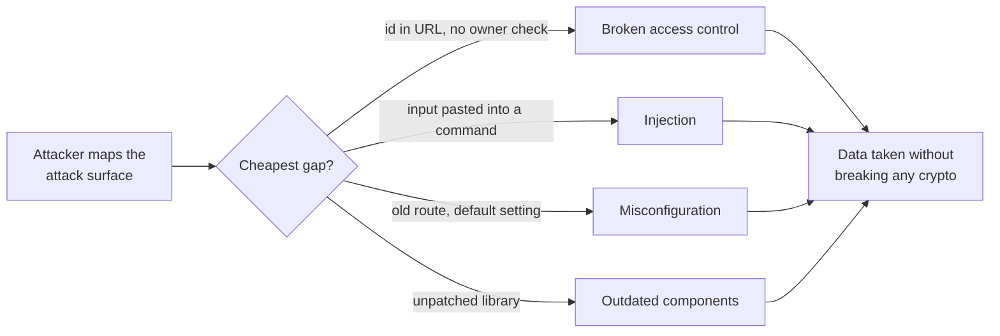
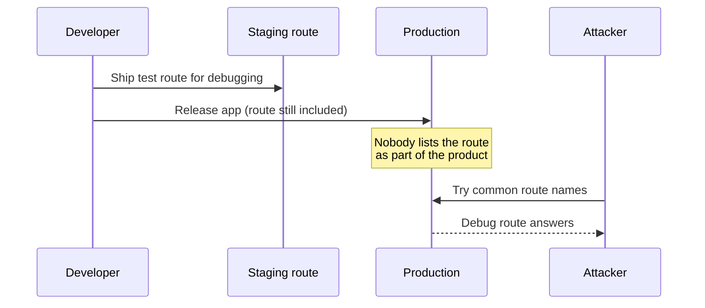

import LevelIntro from "../../../components/LevelIntro.astro";
import Checkpoint from "../../../components/Checkpoint.astro";
import PracticeCheck from "../../../components/PracticeCheck.astro";

export const unit = { track: "security", unitSlug: "owasp-top-10" };

L1 gave the attacker's habit (take the cheapest gap) and a grouping of the ten
categories into five families. L2 shows how those families connect to the rest
of this track, why being strong in one does not help another, and why the
"setup and upkeep" family fails with no faulty line of code.

<LevelIntro
  items={[
    "Which categories other units already cover",
    "Why strength in one category does not transfer",
    "Gaps that come from setup, not code",
  ]}
/>

## If crypto, TLS and login are solid, which categories are still open?

**A team finishes the units on hashing, encryption and authentication. How
much of the list have they closed?** Two categories at most (cryptographic failures, and identification and authentication failures). The table maps
each category to where this track treats it.

| #   | Category                                   | Family                       | Where it is covered                                 |
| --- | ------------------------------------------ | ---------------------------- | --------------------------------------------------- |
| 1   | Broken access control                      | Who may do what              | L3 here; `authorization-models` for the models      |
| 2   | Cryptographic failures                     | Protecting data              | `hashing`, `symmetric-asymmetric-encryption-basics` |
| 3   | Injection                                  | Input that becomes a command | L3 here                                             |
| 4   | Insecure design                            | Design and visibility        | Later: secure-by-design unit                        |
| 5   | Security misconfiguration                  | Setup and upkeep             | This level                                          |
| 6   | Vulnerable and outdated components         | Setup and upkeep             | Later: supply-chain unit                            |
| 7   | Identification and authentication failures | Who may do what              | `authentication-fundamentals`                       |
| 8   | Software and data integrity failures       | Protecting data              | Later: supply-chain unit                            |
| 9   | Security logging and monitoring failures   | Design and visibility        | Later: incident-response unit                       |
| 10  | Server-side request forgery (SSRF)         | Input that becomes a command | L3 here                                             |

Hashing, encryption and TLS all sit inside category 2, and login sits in
category 7, so "we did those units" closes at most 2 of 10. Eight categories
are untouched.

<Checkpoint question="A team swaps in a stronger password-hashing setting, then loses data through an old staging route with no ownership check. Did the hashing work fail?">

No. The hashing work did exactly what it was meant to do: it closed part of
the "protecting data" family. The data left through a different family, because
an old route (setup and upkeep) met a missing ownership check (who may do
what). The categories are independent doors, so strength behind one tells you
nothing about the others, and an attacker simply uses whichever is open.

</Checkpoint>

<PracticeCheck
  track={unit.track}
  unitSlug={unit.unitSlug}
  topicId="independent-doors"
/>

## Why do setup and upkeep fail even when the code is correct?

**Suppose every function in the app does what its author intended. Can the app
still be breached?** Yes, because a running system is code plus its settings,
its dependencies, and its surroundings, and all three change after the code is
written.

| Gap                 | Nothing is wrong with the code, but...                             | What closes it                                 |
| ------------------- | ------------------------------------------------------------------ | ---------------------------------------------- |
| Misconfiguration    | a debug page, default password or old route is still switched on   | a baseline checklist, removing what is unused  |
| Outdated components | a library you did not write has a public, known flaw               | an inventory of dependencies, regular updates  |
| Integrity failures  | an update or data file is trusted without checking its source      | verify signatures or checksums before trusting |
| Missing logging     | the breach happens and nothing records or flags it                 | log security events and alert on the odd ones  |
| Insecure design     | the rules themselves allow abuse, such as unlimited password tries | threat-model before building, not after        |

Notice the pattern: none of these is fixed by editing one function. They are
fixed by habits (review the setup, track dependencies, watch the logs), which
is why they survive code review untouched.

<Checkpoint question="A dependency has a public flaw and the app never calls the broken function directly. Is the app safe?">

Not necessarily, and the reason is that the reader cannot see every path into a
library. The flaw may be reachable through code the library runs on its own,
so "we never call it" is a guess, not a check. The dependable answer is the
upkeep habit: know which versions you ship, and update when a fix exists,
instead of arguing about reachability for each flaw.

</Checkpoint>

<PracticeCheck
  track={unit.track}
  unitSlug={unit.unitSlug}
  topicId="setup-and-upkeep"
/>

## Failure modes in how teams reason about this

- **Treating "secure" as a yes/no.** A system is secure against named kinds of
  attack, to a degree. "We had a review" says little without the categories it covered.
- **Expecting exotic attacks.** Most incidents are boring: a missing check, a
  leftover route, a stale library. A previously unknown flaw (a zero-day) is not required.
- **Fixing what demos well.** A compliance badge is visible; an untested
  ownership check is not. Effort tends to drift toward the visible one.
