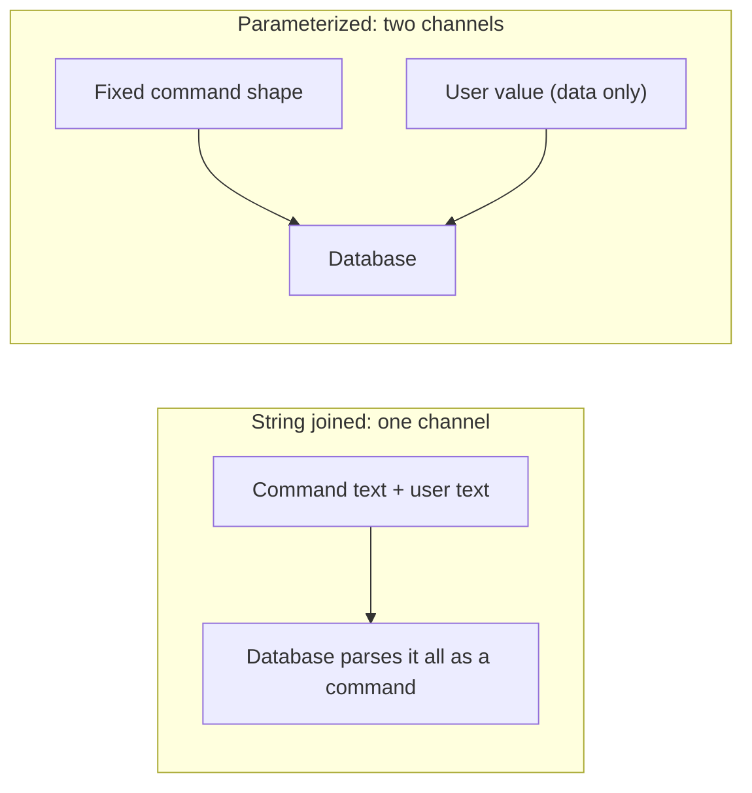
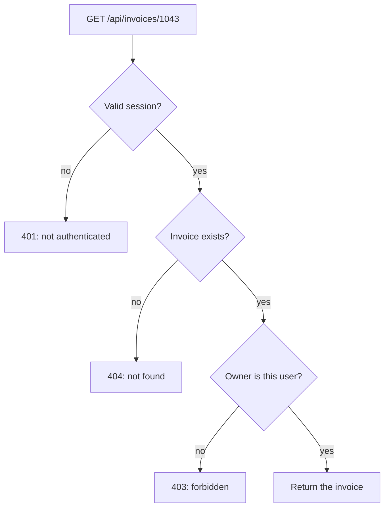
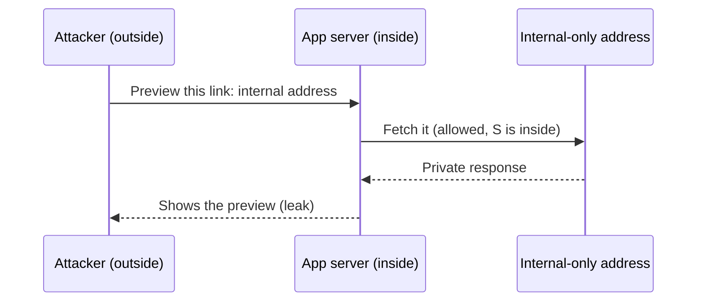

import Scenario from "../../../components/Scenario.astro";
import LevelIntro from "../../../components/LevelIntro.astro";
import Checkpoint from "../../../components/Checkpoint.astro";
import PracticeCheck from "../../../components/PracticeCheck.astro";

export const unit = { track: "security", unitSlug: "owasp-top-10" };

<Scenario label="Three requests reach the same shop app. One carries a strange search word, one asks for someone else's invoice, one hands over a web address. None of them breaks a password.">
  <Fragment slot="facts">
    <div class="not-prose flex flex-col gap-2 text-sm text-slate-700 dark:text-slate-300">
      <div class="flex items-center gap-1.5"><span>🔎</span> <strong>Search box</strong> — the text is pasted into a database command</div>
      <div class="flex items-center gap-1.5"><span>🧾</span> <strong>Invoice number</strong> — the number is trusted, the owner is never checked</div>
      <div class="flex items-center gap-1.5"><span>🔗</span> <strong>Link preview</strong> — the server fetches any address it is given</div>
      <div class="flex items-center gap-1.5"><span>🧩</span> <strong>Common thread</strong> — each request supplies something the server trusts without a boundary</div>
    </div>
  </Fragment>

Each request does something ordinary: search, open an invoice, preview a link.
Each one is answered by code that works exactly as written. **If every line
does what its author intended, where does the security failure live?**

It lives in a missing boundary. In each case the server accepted a value from
outside and let that value decide something it should never have decided: what
the database runs, whose record is returned, or which machine gets contacted.

</Scenario>

<LevelIntro
  items={[
    "Injection: keeping data from becoming a command",
    "Access control: the ownership check authentication skips",
    "SSRF: stopping the server being sent somewhere private",
  ]}
/>

## Injection: how does search text change the database command?

**The search endpoint builds its database command by joining strings. What is
wrong, mechanically?** The database receives one finished sentence and cannot
tell which words the developer wrote and which the user typed.

```js
const sql = "SELECT name FROM products WHERE name = '" + term + "'";
```

With `term` equal to `widget`, the command is harmless. With the textbook
input `' OR '1'='1`, the quote closes the value early and the extra text
becomes part of the command, which now matches every row. The user's text
changed the structure of the command, which is what **injection** means.

**How does a parameterized query fix that?** It sends the command shape and
the value separately, so the value can never become structure.

```js
db.query("SELECT name FROM products WHERE name = ?", [term]);
```



<Checkpoint question="A customer searches for the company name O'Brien Hardware. Does the parameterized query break on the apostrophe, and would a character-stripping filter?">

The parameterized query handles it with no special case, because the apostrophe
travels in the value channel and is only ever data. A filter that strips or
escapes quote characters has to guess every dangerous spelling in advance, and
it also risks mangling real names like this one. That is why parameterizing is a
structural fix and filtering is a guess: one removes the ambiguity, the other
tries to list every way it could be exploited.

</Checkpoint>

<PracticeCheck
  track={unit.track}
  unitSlug={unit.unitSlug}
  topicId="injection"
/>

## Broken access control: what does a valid session not tell you?

**The invoice endpoint checks that the request has a valid session. Is that the
same as checking the user may see this invoice?** No. Two different questions
are in play.

| Question         | Name           | Answered by                        | Missing here? |
| ---------------- | -------------- | ---------------------------------- | ------------- |
| Who are you?     | Authentication | the session                        | No            |
| May you do this? | Authorization  | comparing the user to the resource | Yes           |

When the second question is skipped, any signed-in customer can change the
number in the address and read another customer's invoice. This is the classic
**IDOR** (insecure direct object reference): the app exposes a direct handle to
a record and never checks who is holding it.

The whole fix is one comparison, shown here because the comparison itself is
the lesson:

```js
if (invoice.ownerId !== session.userId) throw new Error("forbidden");
```



<Checkpoint question="The same API also has GET /api/invoices, which lists the caller's own invoices. Is the single owner comparison enough there?">

Not in that form. The single comparison works when there is one record to test.
A list endpoint has no record yet, so the rule has to be applied while choosing
the rows: only select invoices whose owner is the caller. The principle is the
same (the request's claim about itself never replaces a check against the data's
real owner), but here it is expressed as a filter, and filtering afterwards in
application code is easy to forget on a single path.

</Checkpoint>

<PracticeCheck
  track={unit.track}
  unitSlug={unit.unitSlug}
  topicId="access-control"
/>

## SSRF: why can the server reach what the attacker cannot?

**A feature fetches a pasted web address from the server to build a link
preview. What goes wrong if any address is accepted?** The server sits inside
the company network. The attacker sits outside. A browser outside cannot reach
internal addresses, but the server can, so the attacker uses the server as a
messenger.



A well-known target is the cloud metadata address `169.254.169.254`, which is
reachable only from inside the provider's network and can hand out temporary
credentials. Defences check the address before fetching:

| Check                 | Blocks                                                      |
| --------------------- | ----------------------------------------------------------- |
| Protocol allowlist    | `file:` and other non-web schemes, allowing only http/https |
| Loopback range        | `127.0.0.0/8` and `localhost`, the server itself            |
| Private ranges        | `10.0.0.0/8`, `172.16.0.0/12`, `192.168.0.0/16`             |
| Link-local range      | `169.254.0.0/16`, where cloud metadata lives                |
| Check after resolving | A public-looking name that points to a private address      |

The last row matters most: check the address the name resolves to at fetch
time, not the text the user typed. Better still, prefer an **allowlist** of
known destinations over a blocklist of bad ones.

<Checkpoint question="A filter rejects any address whose text starts with 10. or 192.168. Why can a hostname still reach a private machine?">

Because the filter inspects the typed text, not where the name leads. An
attacker can register a normal-looking name that points to a private address,
so the text passes while the connection lands inside. The check has to run on
the resolved address, right before connecting, and ideally against an allowlist
of destinations the feature actually needs.

</Checkpoint>

<PracticeCheck track={unit.track} unitSlug={unit.unitSlug} topicId="ssrf" />

## What generalizes, and what does not?

All three cases share one shape: the server trusted a value from the request
and had no boundary making that trust conditional. Injection lacks a
data-versus-command boundary, access control lacks an ownership boundary, SSRF
lacks a reachable-destination boundary.

The fixes do not transfer. A parameterized query does nothing for an IDOR, and
an ownership comparison does nothing for a hostile URL. Each worked example here
is a case, not the whole territory.

**Try extending it yourself.** The invoice fix covers reading. If the API also
offered `DELETE /api/invoices/1043`, would the same ownership check be enough,
or does a destructive action need more? And what would change in the SSRF case
if the preview feature only needed three known partner sites?

| Failure mode                                           | What it gets wrong                                                    |
| ------------------------------------------------------ | --------------------------------------------------------------------- |
| Filtering characters instead of parameterizing         | Filters guess at dangerous spellings; parameters remove the ambiguity |
| Treating "logged in" as "allowed to see this record"   | Confuses authentication with authorization, the heart of every IDOR   |
| Checking the typed hostname instead of the resolved IP | A harmless-looking name can resolve to a private address              |
| Thinking SSRF only affects internal tools              | Any server-side fetch of a user-supplied address can be abused        |
