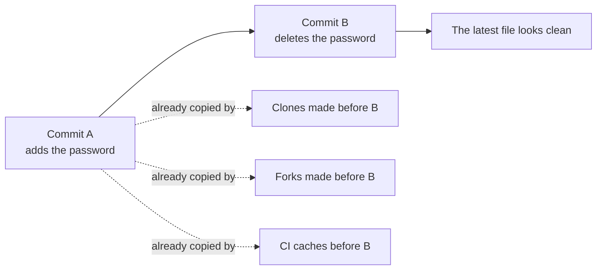
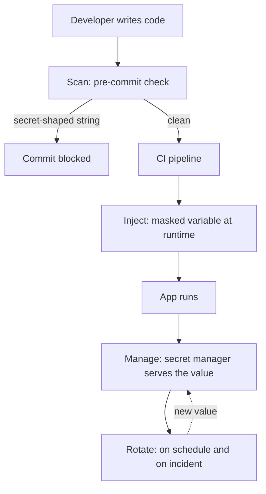

import LevelIntro from "../../../components/LevelIntro.astro";
import Checkpoint from "../../../components/Checkpoint.astro";
import PracticeCheck from "../../../components/PracticeCheck.astro";

export const unit = { track: "security", unitSlug: "secrets-management" };

L1 ended on one claim: deleting a leaked secret does not stop it working,
only changing it does. L2 shows why that is true mechanically, then lays
the four defenses out as one pipeline instead of four separate tools.

<LevelIntro
  items={[
    "Why a delete commit keeps the secret",
    "The inject, manage, scan, rotate pipeline",
    "One narrow credential per purpose",
  ]}
/>

## Why does deleting a line not delete the secret?

Git stores a chain of changes. Commit B does not erase commit A, it adds
a new state on top of it, so `git log -p` can still print A's diff in
full. Rewriting history can remove A from the main repository, but every
copy made before the rewrite keeps its own A.

The longer the password stays valid, the more copies can accumulate.
The relationship is simple multiplication. Assume, purely for
illustration, that background activity (CI runs, clones, forks) makes 4
new copies per hour:

| Hours until rotation | Copies made (4 per hour, assumed) |
| -------------------- | --------------------------------- |
| 0.75 (45 minutes)    | 3                                 |
| 6                    | 24                                |
| 72                   | 288                               |

Only the shape matters, the rate is an assumption: the exposure grows in
proportion to how long the old value stays valid. The interactive demo on
this page lets you move both numbers.

<Checkpoint question="A teammate proposes force-pushing a rewritten history with the secret removed from every commit. Does that, by itself, end the exposure?">

No. A rewrite cleans the canonical repository going forward, but it does
not reach into clones, forks, or caches that already hold the original
history, and it does not change what the database accepts. Only changing
the value at the system that checks it ends the exposure. The rewrite is
tidy-up that happens after rotation, not instead of it.

</Checkpoint>

<PracticeCheck
  track={unit.track}
  unitSlug={unit.unitSlug}
  topicId="git-history"
/>

## How do the four defenses fit together?

**If rotation is the only fix after a leak, why bother with the other
three?** Because each one removes friction or catches a leak earlier, and
they act at different moments:

| Defense | When it acts                     | What it buys                                      |
| ------- | -------------------------------- | ------------------------------------------------- |
| Scan    | Before a commit is shared        | The only step that can stop a leak from happening |
| Inject  | At deploy or start-up            | The source tree holds a name, never the value     |
| Manage  | Whenever the app needs the value | An audit trail and one place to change it         |
| Rotate  | On a schedule, and after a leak  | Makes any old copy useless, whether found or not  |

<Checkpoint question="Kelvin Metrics moves all new services to a secret manager. An older service still has a hardcoded password and has never been scanned. Is it protected by the rollout?">

No. The architecture only protects what flows through it. A password
hardcoded before the migration, in a repository nobody has scanned, is
exactly as exposed as before. Scanning and rotation have to be run
backwards over existing repositories, not only wired in for new code.

</Checkpoint>

<PracticeCheck
  track={unit.track}
  unitSlug={unit.unitSlug}
  topicId="pipeline-order"
/>

## Why not one shared credential for everything?

Rotation limits how long a leak is useful. Scoping limits how much a leak
can reach. Suppose, for illustration, Kelvin Metrics has 12 services:

| Design                             | Services exposed by one leaked credential |
| ---------------------------------- | ----------------------------------------- |
| One admin credential shared by all | 12 of 12                                  |
| One credential per service         | 1 of 12                                   |
| Per service and per environment    | 1 service, in 1 environment only          |

A secret manager makes the narrow design practical, because minting and
rotating twelve credentials by hand is a chore nobody keeps up with.

<PracticeCheck
  track={unit.track}
  unitSlug={unit.unitSlug}
  topicId="least-privilege"
/>

## What L3 adds

L3 separates two things that look alike (log masking and commit scanning),
walks the order of an incident response, and has you write the small
start-up check that refuses to run with a missing secret.
