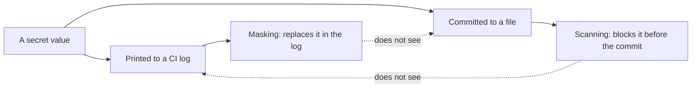

import Scenario from "../../../components/Scenario.astro";
import LevelIntro from "../../../components/LevelIntro.astro";
import Checkpoint from "../../../components/Checkpoint.astro";
import PracticeCheck from "../../../components/PracticeCheck.astro";

export const unit = { track: "security", unitSlug: "secrets-management" };

<Scenario label="The CI log shows asterisks where the password should be. So is the password safe?">
  <Fragment slot="facts">
    <div class="not-prose flex flex-col gap-2 text-sm text-slate-700 dark:text-slate-300">
      <div class="flex items-center gap-1.5"><span>🙈</span> <strong>The log</strong> — prints three asterisks instead of the password</div>
      <div class="flex items-center gap-1.5"><span>🛡️</span> <strong>The tool</strong> — the CI system replaces known secret values in output</div>
      <div class="flex items-center gap-1.5"><span>🤔</span> <strong>The gap</strong> — it hides the value in the log, nothing more</div>
    </div>
  </Fragment>

Kelvin Metrics now injects the database password into CI as a masked
variable. A new teammate sees `***` in the build log and concludes the
secret is protected everywhere. **A separate step also commits a
`.env.backup` file to the repo. Does the masking help with that one?**

It does not. Masking rewrites text on its way into the log. It has no
view of what gets committed, written to disk, or sent somewhere else.
Two controls that look similar guard different doors.

</Scenario>

<LevelIntro
  items={[
    "Masking versus scanning",
    "The order of an incident response",
    "A start-up check that refuses missing secrets",
  ]}
/>

## Masking and scanning guard different doors



| Control  | Stops                               | Does not stop                                                         |
| -------- | ----------------------------------- | --------------------------------------------------------------------- |
| Masking  | A trusted step printing the value   | A commit, a file write, a deliberate exfiltration                     |
| Scanning | A secret-shaped string being pushed | A value printed at runtime, or a novel format that matches no pattern |

Masking is log hygiene, not an access boundary: a compromised job that
reads the variable can send it anywhere. Scanning is pattern-based, so a
secret with an unusual shape can slip through. Neither replaces rotation.

A related trade-off sits in secret managers: an app that caches a fetched
secret for 5 minutes asks the manager 12 times per hour instead of once
per request, but a rotated value can take up to 5 minutes to reach it.
(12 comes from 60 minutes divided by 5.) A shorter cache means faster
propagation of a rotated value and more requests to the manager.

<Checkpoint question="A pipeline masks its CI variables and also runs a commit scanner. A developer base64-encodes the password and prints it to the log. Which of the two controls is more likely to miss it, and why?">

Masking is the likelier miss. It replaces the exact stored value, and a
base64 form is a different string, so it passes through untouched. A
scanner would not help either: it only watches commits, and the encoded
text matches no known key shape. This is why the controls
are layered and why rotation remains the answer once a value has escaped.

</Checkpoint>

<PracticeCheck
  track={unit.track}
  unitSlug={unit.unitSlug}
  topicId="masking-vs-scanning"
/>

## In what order should an incident response run?

**Kelvin Metrics learns the password was exposed. Which step goes first,
and which can wait?** Order by what ends the harm soonest:

| Step | Action                                                      | Why here                                               |
| ---- | ----------------------------------------------------------- | ------------------------------------------------------ |
| 1    | Rotate the exposed secret                                   | Ends the exposure now, so later steps run with it dead |
| 2    | Rotate anything stored beside it or derived from it         | Leaks rarely travel alone                              |
| 3    | Audit access logs for the exposure window                   | Tells you whether the old value was actually used      |
| 4    | Scan the full history for other secrets                     | One leak suggests a habit, not an accident             |
| 5    | Add pre-commit scanning                                     | Closes the door the incident used                      |
| 6    | Notify affected people, if their data may have been reached | A separate obligation from the technical fix           |

Steps 3 to 6 are valuable, but none of them stops an attacker who holds
the old value. Only step 1 does. Step 3 depends on logs existing: the
audit can only answer what was recorded.

<Checkpoint question="A team spends the first hour of an incident auditing logs to see whether the leaked password was used, and rotates it afterwards. What did that ordering cost them?">

It left the old password valid for the whole hour of investigation, so
every extra minute was more exposure. The audit would have given the same
answer after rotation, because it reads logs of the past window. Rotating
first costs nothing in what you learn and shortens the window you are
trying to measure.

</Checkpoint>

<PracticeCheck
  track={unit.track}
  unitSlug={unit.unitSlug}
  topicId="incident-response"
/>

## A start-up check that refuses missing secrets

Here the code is the point. A service that starts with a missing or empty
secret fails later and confusingly. A fail-fast check reports every
missing name at start-up. This is the whole idea in a few lines:

```js
function missingKeys(env, requiredKeys) {
  return requiredKeys.filter((key) => !env[key]);
}
```

Two details matter: an empty string counts as missing (`!env[key]`), and
the function returns all missing names so one run shows the whole list.

<PracticeCheck
  track={unit.track}
  unitSlug={unit.unitSlug}
  topicId="fail-fast-config"
/>

## This is a case, not the whole territory

The incident table above is one incident: a database password on a public
repository. **What would change if the leaked secret were a private SSH
deploy key instead? What does "rotate" mean for it, and does an access log
exist to audit? And what if the leak were found six months later rather
than after 45 minutes?** Rework the table for your own version, then
compare which steps moved and which stayed in place.
