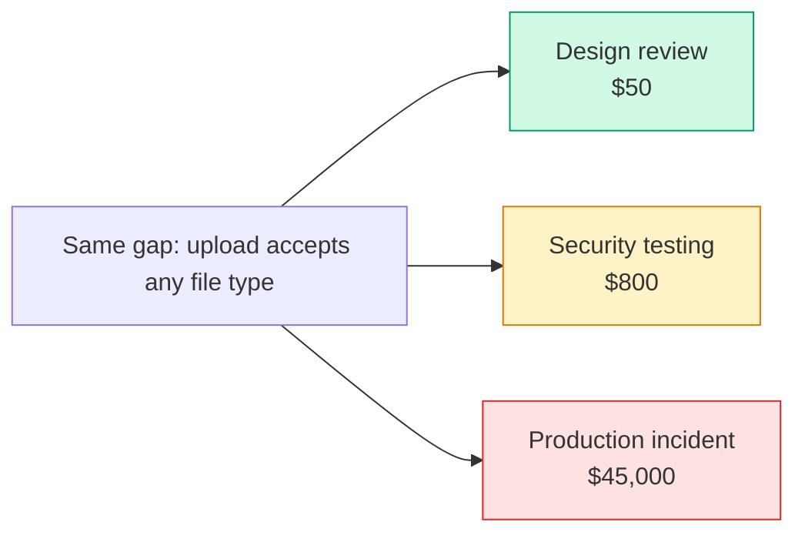

import Scenario from "../../../components/Scenario.astro";
import LevelIntro from "../../../components/LevelIntro.astro";
import PracticeCheck from "../../../components/PracticeCheck.astro";

export const unit = { track: "security", unitSlug: "secure-by-design" };

<Scenario label="Two teams, one feature, one 30-minute difference">
  <Fragment slot="facts">
    

      
📄 <strong>Same ticket</strong> — both teams build "let students upload a PDF assignment" for an ed-tech platform, same sprint

      
⏱️ <strong>The only difference</strong> — Meridian spends 30 minutes asking "what could go wrong?" before writing the design doc; Halcyon goes straight to the doc

      
📆 <strong>When it shows</strong> — not on day one; on day one the two features look identical

    

    

      

        
Meridian

        Design doc has a file-type allowlist, random storage names and a private bucket by default
      

      

        
Halcyon

        Design doc has no security section; ships faster, nothing visibly wrong for four months
      

    

  </Fragment>

Both design docs get approved the same week and both features ship on
schedule. For four months Halcyon looks like it made the better trade:
no time spent on a section nobody asked for. Then a routine penetration
test finds that Halcyon's upload endpoint accepts any file extension,
stores each file under the name the browser sent, and serves it back
from the same web address as the logged-in app. An attacker can upload
an `.html` file disguised as a PDF and have it run inside other users'
sessions.

**Meridian's 30 minutes bought nothing visible on day one either. So
what did they actually buy, and why can't a team simply buy the same
thing later?**

</Scenario>

Every other unit in this track covers a specific defense: a hash
function, a permission model, a scanner that runs after code exists.
This unit covers the decision that comes first, which defenses a system
needs at all, made while the design is still a diagram and changing it
costs a conversation instead of a rewrite.

<LevelIntro
  items={[
    "Threat modeling at design time",
    "STRIDE as a checklist of questions",
    "Secure by default",
  ]}
/>

## Why does the same gap cost so much more later?

The gap Halcyon's pentest found is the same gap Meridian closed on day
one. Only the stage at which someone noticed it changed. The figures
below are the assumptions used in this unit's own demo (illustrative
numbers, not industry statistics):

| Stage where the gap is caught   | Assumed cost | Multiple of the design-time cost |
| ------------------------------- | ------------ | -------------------------------- |
| Design: a threat-model session  | $50          | 1x                               |
| Security testing or code review | $800         | 16x                              |
| Production incident             | $45,000      | 900x                             |

Most of the later cost is not the code change, which can be an
afternoon. It is the coordination, the emergency, and the customer
conversation that surround a fix once the feature is live.

<PracticeCheck
  track={unit.track}
  unitSlug={unit.unitSlug}
  topicId="design-time-cost"
/>

## What does "secure by default" add?

A threat model produces a list of protections. A protection that every
future engineer must remember to switch on will eventually be forgotten.
**Secure by default** means the behavior when nobody configures anything
is already the restrictive one:

| Area         | Permissive default (fails open)                  | Restrictive default (fails closed)                   |
| ------------ | ------------------------------------------------ | ---------------------------------------------------- |
| Upload field | Accepts any file type until a blocklist is added | Accepts nothing until an allowlist is added          |
| New role     | Broad read access until narrowed                 | Zero permissions until a named grant is added        |
| New endpoint | Public until auth is added                       | Requires login unless it is explicitly marked public |

A forgotten step is common; it is the normal state of most settings
most of the time. The only question is which way the forgotten step
fails.

<PracticeCheck
  track={unit.track}
  unitSlug={unit.unitSlug}
  topicId="secure-by-default"
/>

## Key terms

- **Threat modeling** — asking "what could go wrong here?" about a
  design, in a structured way, while it can still be changed cheaply.
- **STRIDE** — six threat categories used as questions: Spoofing,
  Tampering, Repudiation, Information disclosure, Denial of service,
  Elevation of privilege.
- **Data-flow diagram (DFD)** — a drawing of how data moves between the
  parts of a system, with trust boundaries marked.
- **Trust boundary** — a line where data passes between parts that
  trust each other differently, such as a browser and a server.
- **Shift-left** — catching a class of problem at an earlier stage of
  the lifecycle.

## What this unit covers

L2 builds the method: draw the diagram, ask the six questions at every
boundary, and write the answers into the design document so the review
gate can enforce them. L3 runs that method end to end on the upload
feature, including the one place where a few lines of code are worth
reading.
