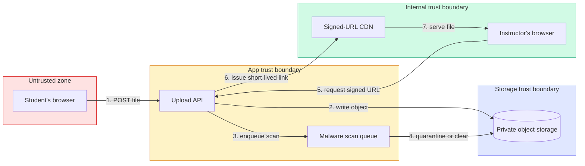
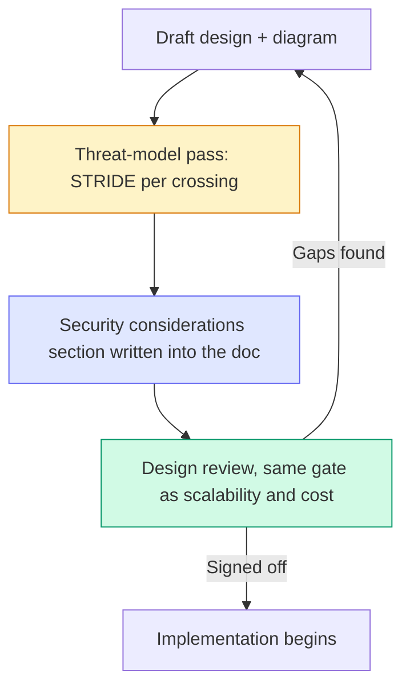

import LevelIntro from "../../../components/LevelIntro.astro";
import Checkpoint from "../../../components/Checkpoint.astro";
import PracticeCheck from "../../../components/PracticeCheck.astro";

export const unit = { track: "security", unitSlug: "secure-by-design" };

L1 left Meridian's 30 minutes as a fact without a method. They did not
stare at the design and hope threats occurred to them. This level builds
the walkthrough that turns a design into a reviewable list of threats,
and shows where that list lives so it cannot be skipped on a busy day.

<LevelIntro
  items={[
    "Data-flow diagrams and trust boundaries",
    "Six STRIDE questions per crossing",
    "The design-review gate",
  ]}
/>

## What are we even looking at?

**Before asking what could go wrong, how does a team agree on what the
system is?** By drawing it. Here is Meridian's upload feature as a
data-flow diagram, with each trust zone shaded:

Every arrow that crosses into a different shaded zone is a trust
boundary crossing, and threats cluster there rather than in the middle
of one zone. Arrow 1 is the riskiest in the whole picture: it is the
only place where the system must accept bytes from someone it does not
yet fully trust.

<PracticeCheck
  track={unit.track}
  unitSlug={unit.unitSlug}
  topicId="trust-boundaries"
/>

## Six questions, asked at every crossing

**Given the diagram, how does a team get a concrete list instead of a
vague sense of unease?** STRIDE supplies six specific questions to ask
at each element and crossing:

| Category                   | The question it asks                                     | Example against arrow 1 (student to upload API)                           |
| -------------------------- | -------------------------------------------------------- | ------------------------------------------------------------------------- |
| **S**poofing               | Can someone pretend to be a legitimate user or service?  | Could a student upload as a different student?                            |
| **T**ampering              | Can data be changed in a way the system does not expect? | Can the filename or content-type be forged to disguise a script as a PDF? |
| **R**epudiation            | Can an action happen with no proof of who did it?        | If a malicious file arrives, can the team tell which account sent it?     |
| **I**nformation disclosure | Can data reach someone who should not see it?            | Could one student guess the address of another's file?                    |
| **D**enial of service      | Can the system be made unusable for others?              | Can thousands of huge uploads fill storage or the scan queue?             |
| **E**levation of privilege | Can an action gain more access than intended?            | Can an uploaded file run with the upload service's own privileges?        |

Not every category bites every element equally. The point of asking all
six is that a real threat is not missed just because nobody happened to
think of that angle unprompted.

<Checkpoint question="Meridian stores every file under a random, unpredictable name and serves files only through short-lived signed links. Which STRIDE category does that pair of decisions mainly defend against?">

Information disclosure. A predictable or attacker-chosen storage name
(for instance reusing the filename the browser sent) lets someone guess
or enumerate other students' files, and a long-lived link keeps working
after it leaks. Random names plus short-lived links close both paths.
It is a different concern from Tampering (can the content be altered)
or Spoofing (can someone impersonate a user), even though all three
questions are asked against the same upload flow.

</Checkpoint>

<PracticeCheck
  track={unit.track}
  unitSlug={unit.unitSlug}
  topicId="stride-questions"
/>

## From threat list to design document

**The team now holds a filled-in table. Where does it live, and who has
to look at it before anything ships?** It becomes a "Security
considerations" section of the design document, held to the same review
gate as scalability or cost:

This is the mechanical difference between the two teams. Meridian's
engineers were not individually more careful. Their design-document
template required a security section before a reviewer could approve it,
the same way it required a rollout plan. Halcyon's template did not, so
nothing enforced the habit on a day when the team was in a hurry, which
for most teams is most days.

To keep the gate from becoming a tax, the ask must stay proportionate:

| Practice              | What it looks like                                                             | Why it matters                                                  |
| --------------------- | ------------------------------------------------------------------------------ | --------------------------------------------------------------- |
| Time-box it           | One focused session, about 30 minutes for a feature this size                  | A process that cannot be time-boxed gets skipped under deadline |
| Scope it              | Run it when a change adds a new input, data flow or trust boundary             | A copy tweak crosses no boundary and needs no pass              |
| Price the alternative | Compare 30 minutes now with an emergency fix and a customer conversation later | The honest comparison is the one a product owner can weigh      |

<PracticeCheck
  track={unit.track}
  unitSlug={unit.unitSlug}
  topicId="review-gate"
/>

## Secure by default, revisited

A threat model yields mitigations, and a mitigation that depends on
future engineers opting in will eventually be forgotten.

| Question                              | Permissive default           | Restrictive default                     |
| ------------------------------------- | ---------------------------- | --------------------------------------- |
| What happens if nobody configures it? | It stays open                | It stays closed                         |
| What does a forgotten step cost?      | A breach waiting to be found | An annoyed teammate and a quick fix     |
| Which case must be typed out loud?    | The safe one                 | The unusual one, such as `public: true` |

<Checkpoint question="A teammate says secure by default only moves the same configuration work from 'add a restriction later' to 'add a permission now', so it does not reduce effort. Is that a fair description of what it buys?">

The total work may not shrink, but that is not the claim. The claim is
about what happens when nobody does the work, which is the realistic
failure rather than a hypothetical. Under a permissive default a
forgotten step leaves something open. Under a restrictive default a
forgotten step leaves something closed: irritating and worth fixing, but
not a breach. Secure by default does not remove configuration; it
changes the direction a missed step fails in, and failing closed is a
far cheaper mistake to live with than failing open.

</Checkpoint>
