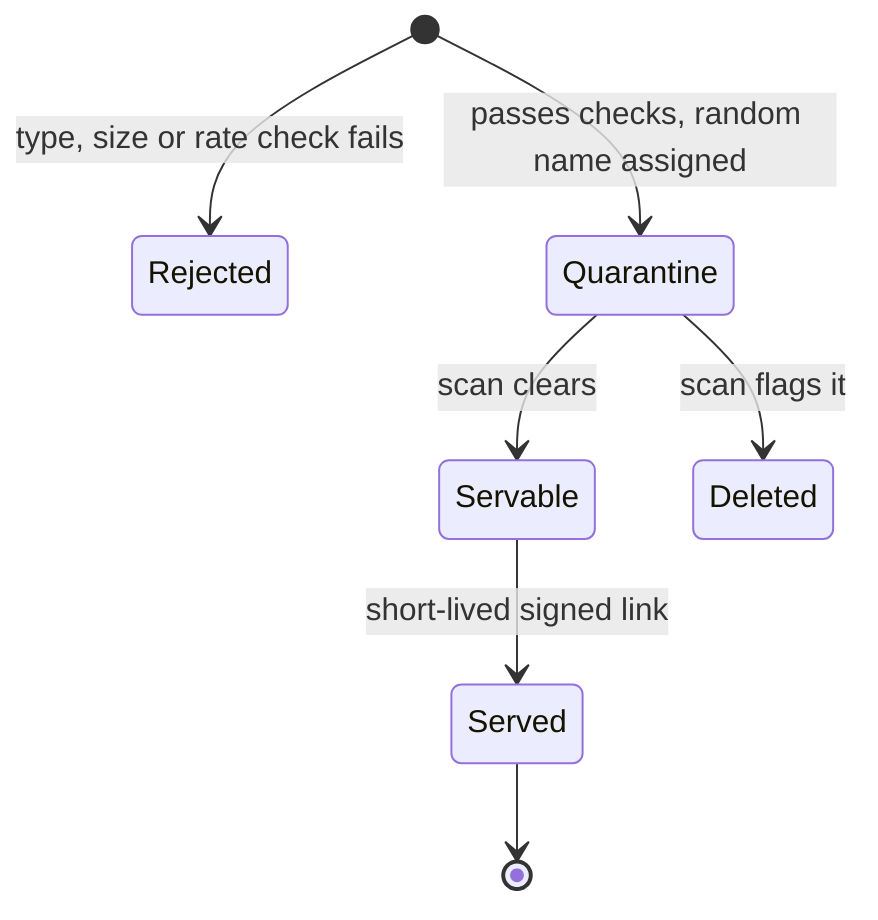

import Scenario from "../../../components/Scenario.astro";
import LevelIntro from "../../../components/LevelIntro.astro";
import Checkpoint from "../../../components/Checkpoint.astro";
import PracticeCheck from "../../../components/PracticeCheck.astro";

export const unit = { track: "security", unitSlug: "secure-by-design" };

<Scenario label="Three months later, a one-line change request">
  <Fragment slot="facts">
    <div class="not-prose flex flex-col gap-2 text-sm text-slate-700 dark:text-slate-300">
      <div class="flex items-center gap-1.5"><span>✅</span> <strong>Shipped</strong> — Meridian's upload feature passed design review with eight mitigations</div>
      <div class="flex items-center gap-1.5"><span>📝</span> <strong>The request</strong> — "let instructors upload syllabi as HTML pages too"</div>
      <div class="flex items-center gap-1.5"><span>❓</span> <strong>The question</strong> — one new entry in an allowlist; is that a quick approval or a new threat model?</div>
    </div>
  </Fragment>

The upload code is already restrictive by default, so adding a file type
is a one-word change in a list. **Does the safe default make this change
safe, or did the one word just reopen the exact hole from Halcyon's
story?** Answering that needs the full threat table in front of you.

</Scenario>

L2 gave the method. This level runs it end to end on Meridian's feature,
shows the single small piece of code where reading it is the point, and
then tests the result against a change.

<LevelIntro
  items={[
    "The full eight-row threat table",
    "The deny-by-default check",
    "How a change reopens a closed threat",
  ]}
/>

## What does the full table look like?

Working through every arrow of the L2 diagram, not just arrow 1, produced
the table attached to Meridian's design document:

| Element or flow                 | STRIDE category        | Threat                                                         | Mitigation baked into the design                                                             |
| ------------------------------- | ---------------------- | -------------------------------------------------------------- | -------------------------------------------------------------------------------------------- |
| Student to upload API           | Tampering              | Forged content-type or extension disguises a script as a PDF   | Deny-by-default extension allowlist; content checked on the server, not trusted from headers |
| Student to upload API           | Denial of service      | Unbounded size or rate exhausts storage or the scan queue      | Per-request size cap; per-account rate limit                                                 |
| Upload API to storage           | Information disclosure | Predictable storage name lets one student guess another's file | Random, non-sequential storage names, never derived from the filename                        |
| Upload API to storage           | Elevation of privilege | An uploaded file runs with the service's own privileges        | Bucket has no execute permission; files never served from an executable path                 |
| Scan queue to storage           | Tampering              | A file is served before the malware scan finishes              | Files land in a quarantine prefix and are promoted only after the scan clears                |
| Instructor to upload API        | Spoofing               | A user not assigned to a course asks for its file's link       | Course-assignment check runs before any signed link is issued                                |
| Upload API to CDN to instructor | Information disclosure | A leaked signed link keeps working forever                     | Links expire after 10 minutes and are scoped to one object                                   |
| Any upload action               | Repudiation            | No record of which account sent a file later found malicious   | Every upload logged with account, time, source address and storage name                      |

Nothing here needed exotic tooling. It is the same six questions asked
patiently at every edge, with a mitigation written down for each one
before a line of the handler existed.

The mitigations also line up as a pipeline. A file moves through states,
and only one state is servable:



<PracticeCheck
  track={unit.track}
  unitSlug={unit.unitSlug}
  topicId="threat-to-mitigation"
/>

## Where is code the clearest way to show the idea?

**Most of the table is architecture, but one rule is about behavior in a
case nobody thought about: what happens for a role or action the system
has never heard of?** Here the code is three lines, and reading it is
the point:

```js
function isAllowed(grants, role, action) {
  return (grants[role] ?? []).includes(action);
}
```

An unknown role has no entry, so the lookup falls back to an empty list
and the answer is `false`. Nothing had to be remembered; silence means
no. The permissive version of the same function would return `true`
when it found no rule, and every forgotten rule would be an open door.
The same shape applies to the extension allowlist, the signed-link
expiry check and the visibility setting: the code path nobody wrote must
land on the closed side.

<PracticeCheck
  track={unit.track}
  unitSlug={unit.unitSlug}
  topicId="deny-by-default-check"
/>

## What does a change do to a finished threat model?

<Checkpoint question="Fenwick wants syllabi as embeddable HTML pages, so '.html' is added to the allowlist and the same upload handler is reused. The structure is deny-by-default. Is this a quick approval or does it need its own look?">

It needs its own look, though a small one. Secure by default lowers the
baseline risk of a change; it does not remove the need to ask what the
change touched. Adding `.html` reopens the stored-XSS path from
Halcyon's story: an HTML file served from the app's own address can run
script inside a logged-in user's session. The content check in the
design has no entry for `.html`, so such a file would pass unchecked.
The restrictive structure helps the reviewer, because only this one new
branch needs reasoning about instead of the whole handler, but "the
framework is secure by default" never means "any change made inside it
is automatically safe."

</Checkpoint>

<PracticeCheck
  track={unit.track}
  unitSlug={unit.unitSlug}
  topicId="change-reopens-threat"
/>

## Writing down what is out of scope

The threat table lives inside a section of the design document:

| Section line               | Meridian's entry                                                                                                  |
| -------------------------- | ----------------------------------------------------------------------------------------------------------------- |
| Trust boundaries crossed   | Student browser to upload API; scan queue to servable storage                                                     |
| Threats identified         | The eight-row table above                                                                                         |
| Mitigations in this design | Extension allowlist, content check, random names, quarantine then promote, 10-minute links, rate limit, audit log |
| Explicitly out of scope    | A compromised instructor account with legitimate access to a course                                               |
| Reviewed by                | The design-review gate, in the same session as scalability and rollout                                            |

<Checkpoint question="A reviewer asks why 'compromised instructor account' is listed as out of scope instead of adding a ninth row to this feature's table. What is the argument for drawing the boundary there?">

That threat is not specific to uploads. It is a threat against the
authorization model itself, and every feature an instructor can touch
(grading, roster changes, uploads) shares the same exposure the moment
the account is compromised. Solving it inside the upload feature would
mean re-solving it separately in every other feature, each time slightly
differently, instead of once in the layer that owns it. A good threat
model knows which threats belong to the feature in front of it and which
belong to a shared layer beneath it. Writing the exclusion down matters
too: a risk silently ignored looks identical to a risk considered and
correctly assigned elsewhere.

</Checkpoint>

## Where this could go differently

This is one feature with one set of mitigations: a case, not the whole
territory. Try the same diagram-plus-STRIDE method on a variation.

- What if the uploaded files were videos transcoded on the server? Does
  the biggest risk move from "what gets served back" to "what the
  transcoder can be tricked into doing", for example fetching internal
  addresses or consuming unbounded compute?
- What if the endpoint were internal-only, used by trusted employees? Which
  of the eight rows could be dropped, and does "internal" shrink the
  blast radius or only move it from one student's data to the whole
  institution's?
- What would you change in the design-document template so that the
  review gate catches an allowlist edit like the `.html` request without
  turning every edit into a full threat model?
