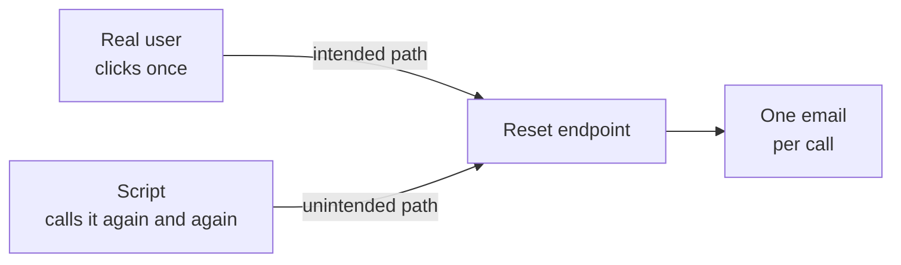

import Scenario from "../../../components/Scenario.astro";
import LevelIntro from "../../../components/LevelIntro.astro";
import PracticeCheck from "../../../components/PracticeCheck.astro";

export const unit = {
  track: "security",
  unitSlug: "security-mindset",
};

<Scenario label="The door that worked perfectly">
  <Fragment slot="facts">
    

      

        🔑 <strong>The test</strong> — the key opens the front door and the door locks again
      

      

        🪟 <strong>The gap</strong> — the back window latch is broken
      

      

        ❓ <strong>The unasked question</strong> — can anyone get in without a key?
      

    

    

      

        
Checked

        The intended way in
      

      

        
Never checked

        Every other way in
      

    

  </Fragment>

A homeowner fits a new front door lock and tests it carefully. The key turns,
the door opens, the door locks again. Every check passes. That night the
house is entered through the back window, whose latch was broken all along.

| Question asked                   | Answer                     |
| -------------------------------- | -------------------------- |
| Does my key open it?             | Yes, tested three times    |
| Can anyone get in without a key? | Nobody asked this question |

**The lock worked exactly as designed. So why was the house still not safe?**

</Scenario>

The test only walked the path the owner had in mind. A burglar does not use
that path. Software has the same gap, and it is the whole subject of this unit.

| In the house story      | In software                                     |
| ----------------------- | ----------------------------------------------- |
| Front door and key      | A feature used the intended way                 |
| The test of the key     | A functional test of the happy path             |
| The broken window latch | A route or input nobody planned for             |
| The burglar             | Someone who uses the feature on purpose to harm |

<LevelIntro
  items={[
    "Correctness questions versus adversary questions",
    "Threat modeling and its six STRIDE lenses",
    "Trust boundaries where data crosses in",
  ]}
/>

## What does a test never ask?

Take a "resend password reset email" button. The expected test is: click once,
one email arrives. Now picture the same button pressed by a small script, many
times a minute, for the same address. Nothing in the first test touched that.

This is an invented illustration, not a measured incident. The point is the
shape: one endpoint, two ways to reach it, and only one of them was tested.

- Correctness testing asks "does this do what it should for the inputs I expect?" Security asks "what can this do if someone deliberately sends inputs I did not expect?"
- The **security mindset** is thinking like an adversary: "how would I break this?" instead of "does this work?". It takes practice because normal engineering optimises for the happy path.
- **Threat modeling** is the structured version: who might attack, what do they want, and what is the easiest path. It is done before something breaks, while changing the design is cheap.

<PracticeCheck track={unit.track} unitSlug={unit.unitSlug} topicId="mindset" />

## What are the names for the common ways things get abused?

A simple durable framework is **STRIDE**. Each letter is a category of "what
could go wrong", not a specific bug.

  

    
🎭

    
Spoofing

  

  

    
✏️

    
Tampering

  

  

    
🙅

    

      Repudiation
    

  

  

    
🔓

    

      Info disclosure
    

  

  

    
🐘

    

      Denial of service
    

  

  

    
👑

    

      Elevation of privilege
    

  

In the house story: wearing a fake delivery uniform is spoofing, swapping the
lock for a dud is tampering, and walking into the employees-only room is elevation
of privilege. L2 gives all six a proper table.

## Where must trust be re-earned?

**Trust boundaries** matter more than any single line of code. The moment data
crosses from something you do not control (user input, a third-party service, a
file upload) into something you do, every assumption about it has to be earned
again, not inherited. In the house: a note pushed through the letterbox is not
as trustworthy as a note you wrote yourself.

## What does this unit take with it?

- A passing test shows the intended paths work, and says nothing about the unintended ones.
- "We are too small to be targeted" does not hold: much real exploitation is automated and untargeted, a script trying a known weakness on millions of hosts.
- The aim is not memorising specific vulnerabilities (later units cover those) but the reflex of asking "what is the worst someone could do here?" as part of every design review.
