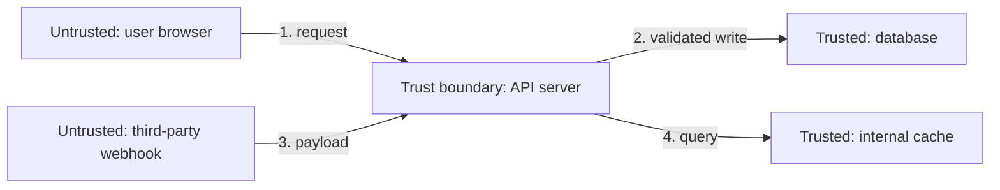
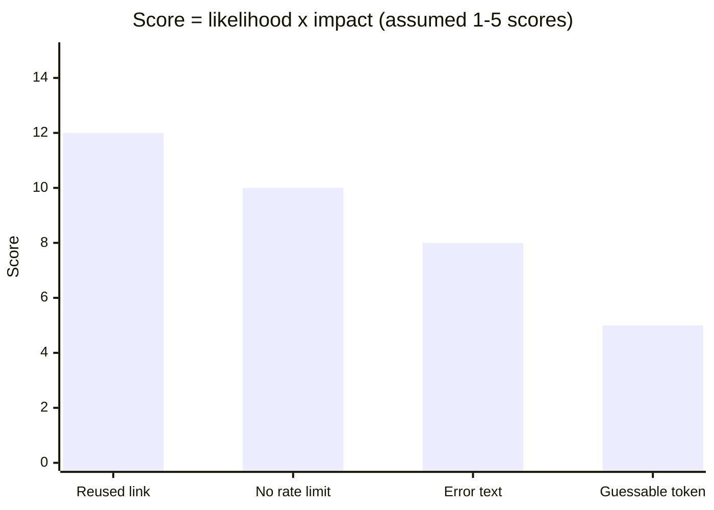

import LevelIntro from "../../../components/LevelIntro.astro";
import Checkpoint from "../../../components/Checkpoint.astro";
import PracticeCheck from "../../../components/PracticeCheck.astro";

export const unit = {
  track: "security",
  unitSlug: "security-mindset",
};

L1 gave the reflex of asking "how could this be abused?". This level turns the
reflex into three reusable tools: a diagram of where trust starts and stops, six
questions to run against any component, and a way to rank the answers so the
list does not become a pile.

<LevelIntro
  items={[
    "Trust boundaries: where re-verification is required",
    "The STRIDE six-question review",
    "Ranking threats by likelihood and impact",
  ]}
/>

## Which of these four arrows actually needs to be questioned?

Arrows 1 and 3 cross from something outside your control into something inside
it. Arrows 2 and 4 stay within components you already own. In the house story:
a stranger at the front door is arrows 1 and 3; a family member passing you
the salt in the kitchen is arrows 2 and 4. Many real vulnerabilities come from
code that treats an outside value as if it had already crossed safely: trusting
a client-supplied "isAdmin" field, a webhook's claimed sender, or a file's
declared type.

  

    

      Untrusted side (1, 3)
    

    Anything the caller controls: re-verify every time
  

  

    

      Trusted side (2, 4)
    

    Data your own system produced or validated: no new outside claim
  

"Trusted" does not mean "never check again". It only means no outside actor is
handing you a claim at this moment. Your own system can still hold stale data
or bugs.

<Checkpoint question="The API server queries its own internal cache (arrow 4) for data it validated and wrote earlier. Does that hop need the same re-verification as a client request?">

No, and that is what "trust boundary" means. Arrow 4 never leaves what you
control, and no outside actor is asserting anything in that hop. That is not the
same as saying it is risk-free: the cache could still hold stale or buggy data.
The specific risk a boundary protects against, an outsider supplying a value and
hoping you accept it, simply is not present there.

</Checkpoint>

<PracticeCheck
  track={unit.track}
  unitSlug={unit.unitSlug}
  topicId="trust-boundary"
/>

## If you had five minutes with a component, which six questions cover the most ground?

| Category                   | The adversary's goal                     | Concrete example                                             | Plain words                            |
| -------------------------- | ---------------------------------------- | ------------------------------------------------------------ | -------------------------------------- |
| **S**poofing               | Pretend to be someone or something else  | Forging a header so a request looks internal                 | Wearing a fake badge                   |
| **T**ampering              | Alter data or code in transit or at rest | Changing a price in a request before the server sees it      | Changing the number before the cashier |
| **R**epudiation            | Deny an action, with nothing to prove it | An admin action with no audit log                            | "Prove I did it" with no receipt       |
| **I**nformation disclosure | Read data they should not                | An error page that prints internal file paths                | A private detail printed on the page   |
| **D**enial of service      | Make the system unusable for real users  | Oversized payloads that exhaust memory                       | Blocking the doorway                   |
| **E**levation of privilege | Gain access beyond what was granted      | A regular user calling an admin action the screen only hides | A visitor finding the back office open |

STRIDE is a set of lenses, not a checklist of bugs. Running all six on a
component surfaces risks a functional review never asks about, because a
functional review only asks "does the intended flow work?".

<Checkpoint question="A reviewer runs the six STRIDE questions on a component, finds nothing plausible under Repudiation, and marks it safe. What is wrong with stopping there?">

A clean answer on one category says that category does not apply, and says
nothing about the other five. Each letter is an independent lens, not one
pass-or-fail verdict. A component can be fine on Repudiation and still have a
real Tampering or Elevation of privilege problem next to it. "Safe" only
follows from having asked all six questions and being satisfied with each answer.

</Checkpoint>

<PracticeCheck track={unit.track} unitSlug={unit.unitSlug} topicId="stride" />

## Once you hold ten plausible threats, what do you do with the list?

You rank it, the way you would triage bugs rather than fix them alphabetically.
The procedure in plain steps:

1. List what is valuable in the component: data, access, availability.
2. List where outside input enters it.
3. For each entry point, ask the six STRIDE questions and keep the plausible answers.
4. Give each kept threat a **likelihood** (how easy or common the attack seems) and an **impact** (how much damage it would do).
5. Sort by likelihood times impact and work from the top.

Here is the resend-reset-email endpoint from L1, with scores on a 1-5 scale.
These scores are assumptions made for the illustration, not measurements.

| Threat                                             | Likelihood | Impact | Score |
| -------------------------------------------------- | ---------- | ------ | ----- |
| Reset link can be reused after it was already used | 3          | 4      | 12    |
| No rate limit on the resend button                 | 5          | 2      | 10    |
| Error text reveals whether an email is registered  | 4          | 2      | 8     |
| Reset token is guessable                           | 1          | 5      | 5     |

The ranking decides where limited effort goes first. It does not claim to
remove all risk, and the scores are judgments: two teams may rate the same
threat differently, which is why the assumptions behind a score are worth writing
down. A low score with a catastrophic impact and a cheap fix, like the guessable
token, can still deserve early attention.

<PracticeCheck
  track={unit.track}
  unitSlug={unit.unitSlug}
  topicId="threat-ranking"
/>

## What changes in the reviewer's head?

A functional reviewer asks: "if a user does X, is the result right?" A
security-minded reviewer changes one word: "if an **adversary** does X,
deliberately and perhaps a million times by script, does the system still behave
safely?" Same code, same review, a different question, and it is the second one
that would have caught the broken window latch before the house was built.
