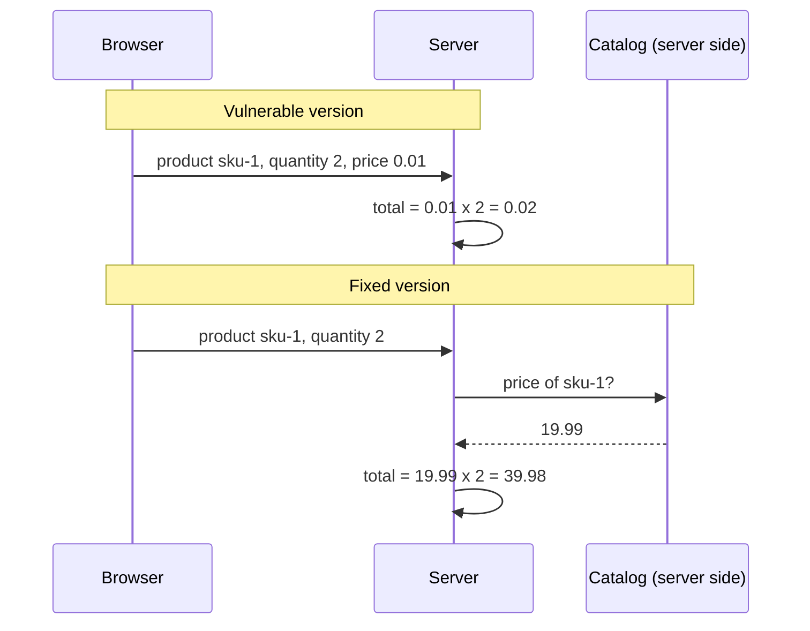
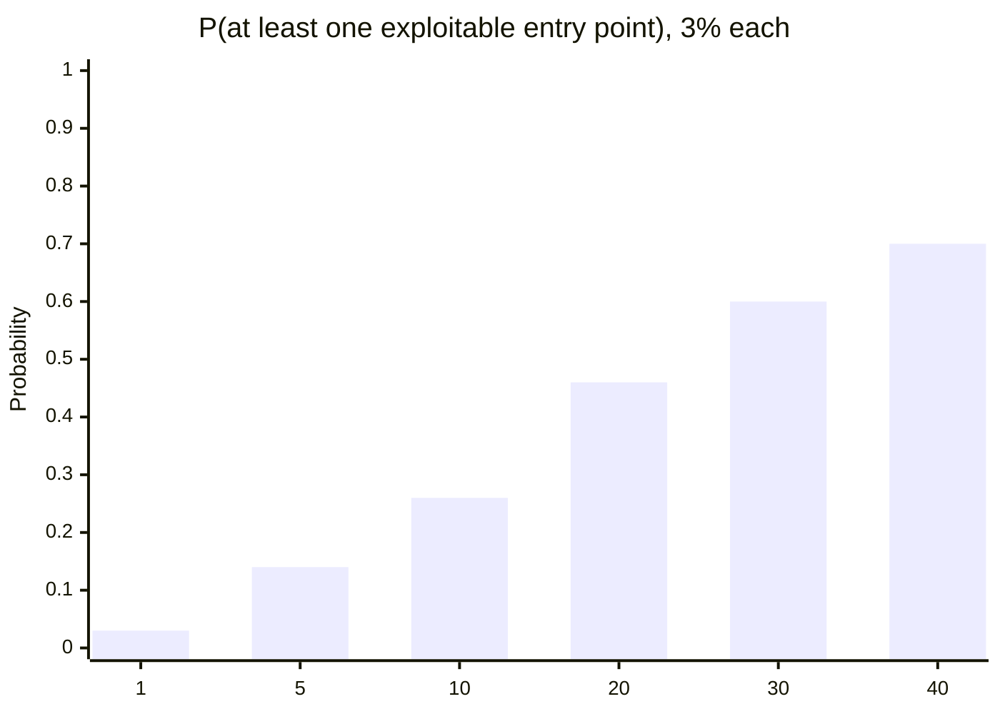

import Scenario from "../../../components/Scenario.astro";
import LevelIntro from "../../../components/LevelIntro.astro";
import Checkpoint from "../../../components/Checkpoint.astro";
import PracticeCheck from "../../../components/PracticeCheck.astro";

export const unit = {
  track: "security",
  unitSlug: "security-mindset",
};

<Scenario label="The shopper who wrote their own price">
  <Fragment slot="facts">
    <div class="not-prose flex flex-col gap-2 text-sm text-slate-700 dark:text-slate-300">
      <div class="flex items-center gap-1.5">
        <span>🏷️</span> <strong>Shelf label</strong> — 19.99 per item, two items
      </div>
      <div class="flex items-center gap-1.5">
        <span>✍️</span> <strong>Slip</strong> — the shopper writes the price per item on the slip
      </div>
      <div class="flex items-center gap-1.5">
        <span>💰</span> <strong>Till</strong> — charges whatever the slip says
      </div>
    </div>
    <div class="not-prose mt-3 grid grid-cols-2 gap-2 text-xs">
      <div class="rounded border border-emerald-300 bg-emerald-50 p-1.5 dark:border-emerald-800 dark:bg-emerald-950">
        <p class="font-semibold text-emerald-600 dark:text-emerald-400">Honest slip</p>
        19.99 x 2 = 39.98
      </div>
      <div class="rounded border border-rose-300 bg-rose-50 p-1.5 dark:border-rose-800 dark:bg-rose-950">
        <p class="font-semibold text-rose-600 dark:text-rose-400">Rewritten slip</p>
        0.01 x 2 = 0.02
      </div>
    </div>

  </Fragment>

A shop lets shoppers fill in a slip: item, quantity, and price per item. The
till multiplies and charges. On an ordinary day every slip says 19.99 and
every sale is correct. One shopper writes 0.01 instead and walks out paying two
cents for two items.

| Slip              | Charged | Does the shop notice? |
| ----------------- | ------- | --------------------- |
| 19.99 per item, 2 | 39.98   | Nothing to notice     |
| 0.01 per item, 2  | 0.02    | Only on the books     |

**The slip was neatly filled in and the arithmetic was right. Whose job was it to decide the price?**

</Scenario>

An online checkout that reads the price from the browser has exactly this bug.
This level works that bug through, runs STRIDE on one ordinary endpoint, and
puts a number on why risk grows faster than the endpoint count.

<LevelIntro
  items={[
    "Who decides a value: client-chosen price",
    "STRIDE run end to end on a file upload",
    "Why risk compounds with entry point count",
  ]}
/>

## A tampering bug: who decides the price?



The whole difference between the two versions is one line. The vulnerable total
takes the price from the request; the fixed total takes it from the catalog:

```js
// vulnerable: the client chose the price
const total = cartItem.price * cartItem.quantity;
// fixed: the server owns the price
const total = catalog[cartItem.productId].price * cartItem.quantity;
```

An honest customer sees 39.98 either way. The versions only differ under
adversarial input, which is why "it passed QA" said nothing about safety.

| Check type            | What it proves                          | What it does not prove                 |
| --------------------- | --------------------------------------- | -------------------------------------- |
| Validate format       | `price` is a number                     | The client was allowed to choose it    |
| Check source of truth | Price came from the server-side catalog | Nothing the browser sends can lower it |

<Checkpoint question="A teammate proposes fixing checkout by rejecting any price below 1.00. Why does that not close the hole, even though it stops the 0.01 example?">

Because the bug was never that the number was too small; it was that the number
came from the wrong place. A minimum rule blocks one narrow range, so an
attacker sends 18.00 and still undercharges, passing the new rule looking
perfectly reasonable. The real fix removes the client's ability to set the
charged price at all by re-deriving it from the server's own catalog. Any check
that still lets the client supply the number leaves the same boundary crossing
in place.

</Checkpoint>

<PracticeCheck
  track={unit.track}
  unitSlug={unit.unitSlug}
  topicId="server-truth"
/>

## STRIDE on a real component: the profile-picture upload

| STRIDE category        | Plausible here?                                                   | Mitigation                                                                               |
| ---------------------- | ----------------------------------------------------------------- | ---------------------------------------------------------------------------------------- |
| Spoofing               | Upload as another user if the auth check is missing on this route | Verify auth on every route independently                                                 |
| Tampering              | A non-image file passes if only the extension is checked          | Verify real file content, not the claimed extension                                      |
| Repudiation            | Low relevance: profile pictures are not accountability-sensitive  | Note it and move on; not every category fits every component                             |
| Information disclosure | Predictable or client-chosen names can expose other users' files  | Store under a random, user-scoped key, never the client's filename                       |
| Denial of service      | Huge files uploaded repeatedly exhaust storage and bandwidth      | Enforce a maximum size and a per-user rate limit                                         |
| Elevation of privilege | An "image" that is really a script gets served and run            | Serve from a separate domain or bucket with no execute rights and a correct content type |

A boring feature, "let users upload a picture", still raises five real
categories and one honest "low relevance", none of which the functional spec
("accepts an image, saves it, returns a URL") would mention. Later units cover
authorization models, why scripts in a browser are dangerous, and the common
attack categories in depth.

## How much does adding entry points compound risk?

Assume each of N entry points independently has a 3% chance of being
exploitable. The chance that none are exploitable is 0.97 raised to the power
N, and the chance that at least one is exploitable is one minus that.

| Entry points | Chance none are exploitable | Chance at least one is |
| ------------ | --------------------------- | ---------------------- |
| 1            | 97.0%                       | 3.0%                   |
| 5            | 85.9%                       | 14.1%                  |
| 10           | 73.7%                       | 26.3%                  |
| 20           | 54.4%                       | 45.6%                  |
| 40           | 29.6%                       | 70.4%                  |



Going from 5 to 40 entry points multiplies the entry point count by 8 and the
risk by about 5. Two caveats keep this honest: the 3% is an assumed figure, not
a measurement, and real flaws are rarely independent (one shared mistake can
sit behind many entry points). The shape is what matters: risk climbs faster
than the count. Try it below with your own numbers.

<Checkpoint question="Going from 5 to 40 entry points, each with an independent 3% chance, raises system-wide risk about five-fold while the count grew eight-fold. What does that imply about reviewing once at launch versus as the system grows?">

A one-time pass does not scale with the system. Treating a STRIDE review done at
5 entry points as still valid at 40 badly understates the risk, because the
chance of at least one gap climbs quickly as entry points are added. Each new
entry point is another independent chance for the whole system to fail,
multiplying against all those before it. That is why STRIDE belongs to each
component as it is added, rather than being an audit performed once.

</Checkpoint>

<PracticeCheck
  track={unit.track}
  unitSlug={unit.unitSlug}
  topicId="risk-compounding"
/>

## Failure modes

- **Validating shape, not trust.** Checking that `price` is a number or a filename ends in `.jpg` confirms the input is well formed. It says nothing about whether the value should be trusted for anything security-sensitive.
- **A late, separate security gate.** If the design was never examined adversarially, fixing a boundary mistake after launch often means reworking the architecture, not patching a line.
- **Fixing one bug, not the category.** Patching the price in `checkout()` does not make the discount code, shipping cost or user role safe. The point of STRIDE is to ask the same six questions per component.
- **"We are too small to be attacked."** Automated scanners probe for known patterns across millions of hosts. Obscurity lowers the odds of a targeted attack, not an automated one.

## Where does this example stop being the whole story?

The checkout bug and the upload table are one worked case each, not the whole
territory. **Questions to think with:** what changes if the upload endpoint were
internal-only, used by employees instead of the public? The table usually shrinks
in priority, not to zero: accounts can be stolen and mistakes happen. And what
happens to the checkout fix if the catalog itself is filled from a third-party
pricing feed? The trust boundary moves one hop back, so the feed needs
verification before its prices become server truth. Try the same two questions on
a feature you have built: which values did you accept from outside, and who
chose them?
