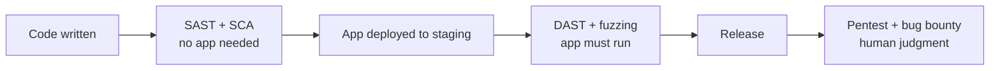

import Scenario from "../../../components/Scenario.astro";
import LevelIntro from "../../../components/LevelIntro.astro";
import PracticeCheck from "../../../components/PracticeCheck.astro";

export const unit = { track: "security", unitSlug: "security-testing" };

<Scenario label="You fitted a new lock on your shop door. How do you find out whether it is any good before a burglar does?">
  <Fragment slot="facts">
    

      
📐 <strong>Read the plans</strong> — check the lock's design drawings for known weak spots (no door involved)

      
🚪 <strong>Try the real door</strong> — push, pull and rattle the fitted lock from outside

      
📋 <strong>Check the recall list</strong> — is your lock model on a published list of faulty ones?

      
🔨 <strong>Hammer it blindly</strong> — thousands of odd keys and shoves, watching for a jam

      
🕵️ <strong>Hire a locksmith</strong> — someone paid to think like a burglar and break in

    

    

      
The catch

      All four mechanical checks pass. The locksmith still walks in, because
      the shop's own rule says "open the back door for anyone carrying a
      parcel."
    

  </Fragment>

You fitted a new lock. You read its plans, rattled the door, checked the
lock model against a recall list and even hammered it with odd keys. All
clean. Then a hired locksmith walks straight in through the back door,
because the shop's own habit is to let in anyone who holds a parcel.
**If every check on the lock itself passed, why was the shop still open
to a stranger?**

The checks looked at the lock. None of them looked at the _rule the shop
follows_. A tool can compare things against shapes it already knows; only
a person trying on purpose to get in can ask "what did this place intend
to allow, and where does reality differ?" Software teams hit the same gap:
that gap between "no tool flagged it" and "it is safe" is this unit.

</Scenario>

<LevelIntro
  items={[
    "Five ways to test your own system",
    "What each one looks at",
    "Why automated checks never replace a human attacker",
  ]}
/>

## The five checks, in software terms

| Lock analogy          | Software name | What it looks at                                     | Needs the app running? |
| --------------------- | ------------- | ---------------------------------------------------- | ---------------------- |
| Read the plans        | **SAST**      | Source code, scanned for known-dangerous patterns    | No                     |
| Try the real door     | **DAST**      | A running app, attacked from outside like a stranger | Yes                    |
| Check the recall list | **SCA**       | Your dependencies, compared to known-flawed versions | No                     |
| Hammer it blindly     | **Fuzzing**   | One input or parser, fed huge volumes of odd data    | Yes                    |
| Hire a locksmith      | **Pentest**   | The whole system, attacked by a human with a goal    | Yes                    |

<PracticeCheck
  track={unit.track}
  unitSlug={unit.unitSlug}
  topicId="five-kinds-of-testing"
/>

## The shape of the problem

- **Pattern-matching tools are fast and cheap, but only recognize shapes
  they were built for.** A scanner can flag a database query built by gluing
  text together, because that shape is known. It cannot flag "the checkout
  accepts a negative quantity", because nothing about that line looks
  dangerous.
- **A human attacker is slow and costly, but can reason about intent.** A
  skilled tester asks what the system was _supposed_ to allow, then checks
  whether it does.
- **The practical answer is layering**: cheap automated checks early, so
  obvious bugs never reach a human, and expensive human judgment
  periodically, so the bugs no tool could see are found by your side first.
- Two error words show up in every tool report: a **false positive** is a
  flag on something harmless; a **false negative** is silence about
  something real.

<PracticeCheck
  track={unit.track}
  unitSlug={unit.unitSlug}
  topicId="why-tools-are-not-enough"
/>

## Key terms

| Term               | Plain meaning                                                                         |
| ------------------ | ------------------------------------------------------------------------------------- |
| **SAST**           | Static Application Security Testing: scans source code without running it             |
| **DAST**           | Dynamic Application Security Testing: attacks a running instance from the outside     |
| **SCA**            | Software Composition Analysis: checks dependencies against public vulnerability lists |
| **Fuzzing**        | Feeding a function or endpoint huge volumes of malformed or random input              |
| **Pentest**        | A time-boxed, permitted attempt by a human to break a specific system                 |
| **Bug bounty**     | An open invitation for outside researchers to report real flaws for a reward          |
| **False positive** | A tool flags something that is not a real problem                                     |
| **False negative** | A tool stays silent about something that is a real problem                            |

`security-mindset` is the posture of asking "how would I break this", and
`owasp-top-10` is the catalog of what tends to go wrong. This unit is the
practice that actually goes looking. L2 shows where each check fits in a
delivery pipeline and what each structurally misses; L3 follows one set of
findings from scan report to fix.
