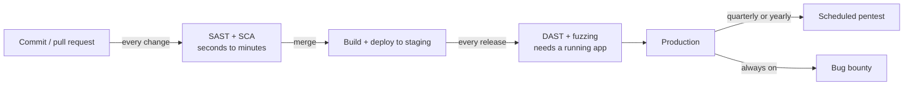

import LevelIntro from "../../../components/LevelIntro.astro";
import Checkpoint from "../../../components/Checkpoint.astro";
import PracticeCheck from "../../../components/PracticeCheck.astro";

export const unit = { track: "security", unitSlug: "security-testing" };

L1 listed five ways to test your own system. L2 answers two questions the
shop-lock story left open: what exactly can each check never see, and in
what order should they run so the cheap ones protect the expensive ones?

<LevelIntro
  items={[
    "What each check structurally cannot see",
    "Where each check sits in a delivery pipeline",
    "Why the same bug costs more the later it is found",
  ]}
/>

## What does each check never see, no matter how well it is tuned?

**A clean report from a lock-checking tool says "no known weakness found". Is that the same as "no weakness"?**
No, and the difference is built into how each check works. Each one
compares what it can observe against something it already knows. Anything
that needs knowledge of what the system was _meant_ to do sits outside its
view.

| Check       | Catches                                                           | Structurally misses                                                 |
| ----------- | ----------------------------------------------------------------- | ------------------------------------------------------------------- |
| **SAST**    | Known-dangerous code shapes: string-built queries, hardcoded keys | Runtime configuration; rules that look fine as text but misbehave   |
| **DAST**    | Runtime issues: missing headers, error messages that leak detail  | Anything behind a path it never found; intent-level rules           |
| **SCA**     | A dependency version with a _published_ flaw                      | Flaws nobody has published yet; unsafe ways of using a safe library |
| **Fuzzing** | Crashes and hangs from malformed input                            | Behavior that is wrong but never crashes                            |
| **Pentest** | Rule abuse, chained weaknesses, anything needing human intent     | Coverage: it tests only what the tester tried in the time available |

Read down the "misses" column: every automated row's blind spot is some
version of "needs to know what the system was supposed to do". A better
ruleset does not close that gap. It is the reason the pentest row exists.

<Checkpoint question="A DAST scan of your staging site comes back with zero findings. What can you conclude, and what can you not?">

You can conclude that none of the attack patterns DAST knows to try
worked against the paths it discovered. You cannot conclude the app is
safe. DAST has no model of rules like "an order quantity must be
positive"; that is a statement about intent, not about the shape of a
request. A clean scan means "no known pattern worked", which is why a
person reasoning about intent can still find what the scanner could not.

</Checkpoint>

<PracticeCheck
  track={unit.track}
  unitSlug={unit.unitSlug}
  topicId="blind-spots-per-layer"
/>

## Where does each check sit in the delivery pipeline?

**If you could only afford to run one check on every single change, which would it be, and why not all of them?**
The cost of a check decides how often it can run. Checks that need
nothing but text are nearly free per run, so they go first. Checks that
need a deployed app wait until one exists. The human check is the most
expensive per finding, so it runs on a schedule.

| Speed and cost       | Checks        | Why they sit there                                             |
| -------------------- | ------------- | -------------------------------------------------------------- |
| Fast, cheap, shallow | SAST, SCA     | Need only text, so they can run on every change                |
| Slower, deeper       | DAST, fuzzing | Need something running, so they cannot fire on every keystroke |
| Slowest, deepest     | Pentest       | A person reasons about what the system is _for_                |

Speed, cost, and depth are one trade-off, not three: the checks that see
more cost more per run, so you run them less often. No layer replaces
another. A pipeline missing one has a predictable kind of bug it will
never catch.

<Checkpoint question="A team skips SCA because 'we do not write the vulnerable code, our dependencies do'. Why is that reasoning wrong, and which other check would not cover for it?">

Your app ships its dependencies, so a flaw in one is a flaw in your
product. SAST reads _your_ source and never opens the packages you
install, so it cannot stand in for SCA. DAST might trip over the effect
at runtime, but only if its patterns happen to reach it. SCA is the one
check that compares the exact versions you use against published flaw
lists, which is why it earns its own slot at build time.

</Checkpoint>

<PracticeCheck
  track={unit.track}
  unitSlug={unit.unitSlug}
  topicId="pipeline-placement"
/>

## Why does it matter how early a bug is caught?

The demo on this page lets you move how many stages a bug survives. It
uses an **illustrative assumption**: the fix cost multiplies by ten at each
stage, starting from a base you choose. Ten is a teaching round number, not
a measured industry figure, so treat the shape (cost compounds) as the
lesson, not the exact dollars.

| Stages survived | Caught at           | Cost with a base of 10 and a ×10 step |
| --------------- | ------------------- | ------------------------------------- |
| 0               | Commit (SAST)       | 10                                    |
| 1               | Build (SCA)         | 100                                   |
| 2               | Staging (DAST)      | 1,000                                 |
| 3               | Pentest             | 10,000                                |
| 4               | Production incident | 100,000                               |

The mechanism behind the compounding is real even if the multiplier is
invented: later fixes involve more people, more rework on code built on
top of the bug, and, in production, real users affected.
