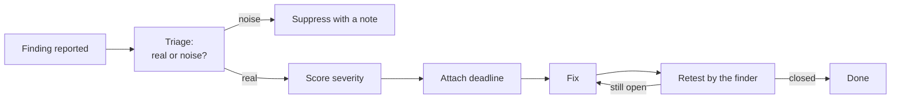

import Scenario from "../../../components/Scenario.astro";
import LevelIntro from "../../../components/LevelIntro.astro";
import Checkpoint from "../../../components/Checkpoint.astro";
import PracticeCheck from "../../../components/PracticeCheck.astro";

export const unit = { track: "security", unitSlug: "security-testing" };

<Scenario label="Five reports land on your desk on the same Monday. Which one do you fix first, and which one is not even a bug?">
  <Fragment slot="facts">
    <div class="not-prose flex flex-col gap-1.5 text-sm text-slate-700 dark:text-slate-300">
      <div class="flex items-center gap-1.5"><span>📐</span> <strong>Plans scan (SAST)</strong> — 2 flags on query-building lines</div>
      <div class="flex items-center gap-1.5"><span>📋</span> <strong>Recall list (SCA)</strong> — 1 flagged dependency</div>
      <div class="flex items-center gap-1.5"><span>🚪</span> <strong>Door test (DAST)</strong> — 1 missing protective header</div>
      <div class="flex items-center gap-1.5"><span>🕵️</span> <strong>Locksmith (pentest)</strong> — 1 finding no tool raised</div>
    </div>
    <div class="not-prose mt-3 rounded border border-amber-300 bg-amber-50 p-1.5 text-xs dark:border-amber-800 dark:bg-amber-950">
      <p class="font-semibold text-amber-600 dark:text-amber-400">Illustrative scenario</p>
      The counts are invented for teaching, not statistics from any real system.
    </div>
  </Fragment>

Imagine the online order page of a small shop has produced five reports:
two flags from a code scanner on lines that build database queries, one
flagged dependency, one missing protective header from a staging scan, and
one finding from a hired tester that no tool had raised. Each report
arrives with the same urgent tone. Only some are real, and the real ones
are not equally serious. **How do you decide what to fix first, and what
should the person who found the last one have been given in advance?**

The answer has two halves. First, every report must be triaged: is it real,
and how bad is it? Second, a human tester can only be useful if the rules
of the engagement were agreed before anyone touched the system.

</Scenario>

<LevelIntro
  items={[
    "Triaging real versus noisy findings",
    "Severity, deadlines, and gating thresholds",
    "The parts of a pentest engagement",
  ]}
/>

## Which of the five reports is a real problem?

**A scanner flags a line. What do you check before you call it a bug?**
You ask whether untrusted input can actually reach that line, and what the
worst outcome would be if it did. Walk the five reports of the worked
example through those two questions.

| #   | Source  | What it reported                                        | Real? | Why                                                            |
| --- | ------- | ------------------------------------------------------- | ----- | -------------------------------------------------------------- |
| 1   | SAST    | Query built by gluing in a search term from the page    | Yes   | Visitor-controlled text reaches the query                      |
| 2   | SAST    | Query built by joining two fixed text constants         | No    | False positive: no outside input ever reaches the line         |
| 3   | SCA     | Dependency version has a published flaw                 | Maybe | Depends on whether the shop's code calls the flawed feature    |
| 4   | DAST    | One protective response header is missing               | Yes   | Real, but needs a victim to be tricked first                   |
| 5   | Pentest | A negative order quantity produces a refund at checkout | Yes   | No tool had a pattern for it: every automated check was silent |

Of the five, tools raised four and a human found the fifth. One of the four
was a false positive. The fifth is a case where all four automated checks
produced a false negative at once, which is precisely the gap L1 opened
with.

For finding 1, the textbook shape is small enough to read and is the point
of the lesson:

```js
// Flagged: the visitor's text becomes part of the query itself.
const q = "SELECT * FROM books WHERE title = '" + term + "'";

// Fixed: the query is fixed text, the term travels separately as data.
const rows = db.query("SELECT * FROM books WHERE title = ?", [term]);
```

<PracticeCheck
  track={unit.track}
  unitSlug={unit.unitSlug}
  topicId="triaging-findings"
/>

<Checkpoint question="Finding 2 is a false positive. Should the team weaken the scanner rule so it stops flagging that shape, or do something else?">

Do something else: mark that single line as reviewed and suppressed, with
a note explaining why. Weakening the rule would also silence finding 1,
the real bug with the same shape. A false positive is a cost you pay once
per line; a loosened rule is a cost you pay every time a real one slips
through.

</Checkpoint>

## How urgent is each finding, and what blocks a release?

**Finding 5 can refund money to anyone with a browser; finding 4 needs a victim to be fooled first. Should they carry the same deadline?**
No. Severity is judged from impact and ease of exploitation, not from
which stage found the bug. Teams therefore score every finding on one scale
before attaching a deadline.

| Severity | Example for this shop                        | Example fix deadline (an illustrative policy) |
| -------- | -------------------------------------------- | --------------------------------------------- |
| Critical | Finding 5: anyone can extract money          | 7 days                                        |
| High     | Finding 1: visitor text reaches the database | 30 days                                       |
| Medium   | Finding 4: missing header                    | 90 days                                       |

These deadlines are an example policy, not a standard; each organisation
sets its own. Gating works the same way: the pipeline can block a merge on
"high and above" while "medium and below" becomes a ticket. Block on
everything and every change drowns in noise until people ignore the bot;
block on nothing and the scanner is decoration.



<PracticeCheck
  track={unit.track}
  unitSlug={unit.unitSlug}
  topicId="severity-and-gating"
/>

## What has to be agreed before a human is allowed to attack?

**Finding 5 came from a person trying to break in. What stopped that person from breaking something real, or from testing the wrong system?**
A written agreement fixed before the first test.

| Part                    | What it settles                                                                  |
| ----------------------- | -------------------------------------------------------------------------------- |
| **Scope**               | Which systems are in bounds, and which are explicitly out                        |
| **Rules of engagement** | What is allowed: denial-of-service, tricking staff, testing live or only staging |
| **Timeline**            | Start and end dates, plus an emergency contact if something breaks               |
| **Severity scale**      | One scoring system, so "critical" means the same in every report                 |
| **Remediation terms**   | How fast each severity must be fixed once reported                               |
| **Retest**              | The finder verifies each fix really closes the finding                           |

A **bug bounty** is the always-on cousin: a company publishes a standing
scope and reward table, and any outside researcher who reports a real
flaw responsibly gets paid. It adds continuous attention but offers no
guarantee that any particular part of the system gets looked at, so it
complements a scheduled pentest instead of replacing it.

<PracticeCheck
  track={unit.track}
  unitSlug={unit.unitSlug}
  topicId="pentest-engagement"
/>

<Checkpoint question="A tester finds a flaw on a server that was not listed in the agreed scope. What should they do, and why does it matter even though the flaw is real?">

They should stop, report the discovery to the contact named in the
agreement, and wait for the scope to be extended before testing further.
Scope is what turns an attack into a permitted test; outside it, the same
action may be unauthorised and could damage a system the owner never
agreed to expose. A real flaw does not change who gave permission.

</Checkpoint>

## This is one case, not the whole territory

The five reports above are a single worked example for a single small shop.
Change one fact and the right answer changes with it.

**Extend the example yourself:** suppose finding 3, the flagged dependency,
sits in a feature the shop's code calls on every order. How does its
priority change, and which check would have told you? Now suppose the shop
handles payment cards instead of book orders: which of the five findings
rises in severity, and would your deadlines still be sensible? Finally,
suppose the pentest budget is cut to nothing for a year. Which of the five
findings would you have lost, and what cheaper practice could partly make
up for it?

Together these answer L1's question: no single tool finds your own
vulnerabilities. Automated checks run on every change and release, and
paid human attention runs on top of them, so that a stranger at the back
door is met by your own tester first.
