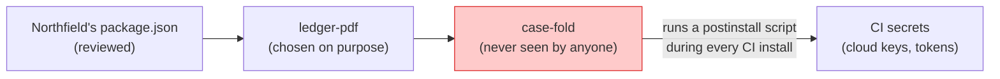

import Scenario from "../../../components/Scenario.astro";
import LevelIntro from "../../../components/LevelIntro.astro";
import PracticeCheck from "../../../components/PracticeCheck.astro";

export const unit = {
  track: "security",
  unitSlug: "supply-chain-security",
};

<Scenario label="You approved the sauce. Who approved the spice inside it?">
  <Fragment slot="facts">
    

      
☕ <strong>The café</strong> — checks one supplier, the sauce maker, and approves the sauce

      
🥫 <strong>The sauce maker</strong> — buys a spice from a farm the café has never heard of

      
🌶️ <strong>The spice farm</strong> — changes owner; the next batch is swapped, the label stays the same

      
📋 <strong>The café's checklist</strong> — still says "sauce: approved"

    

    

      

        
Names in the chain the café actually reviewed1 of 3

        

      

    

  </Fragment>

A café buys a ready-made sauce from a supplier it checked carefully: clean
kitchen, good references. What the café never saw is that the sauce maker
buys one spice from a small farm two steps away. One day the farm is sold,
and the new owner swaps the spice in the next batch. The jar looks the same,
the label is the same, the supplier is the same.
**The café vetted exactly one name in that chain. So what did its approval
actually cover, and who is responsible for the other two?**

</Scenario>

Software has the same shape. When you install a library, you also install
everything that library depends on, and you run some of it automatically.
Your approval covers the name you typed, not the names behind it.

<LevelIntro
  items={[
    "Trust you never chose, inherited through dependencies",
    "Four ways a trusted package turns hostile",
    "The defence stack and what each piece covers",
  ]}
/>

## Where does the kitchen story land in a real build?

**If the café is your company, who are the sauce maker and the spice farm?**
Meet **Northfield Ledger**, an invented invoicing app. Its team chose a PDF
library, `ledger-pdf`, on purpose. That library depends on a small helper,
`case-fold`, which the team has never heard of. (Both names are made up.)

| Kitchen                 | Software                                     | Who picked it                 |
| ----------------------- | -------------------------------------------- | ----------------------------- |
| The sauce maker         | `ledger-pdf`, a direct dependency            | Northfield's team, on purpose |
| The spice farm          | `case-fold`, a transitive dependency         | Nobody at Northfield          |
| The jar looks unchanged | A routine patch version number               | The new publisher             |
| The checklist says fine | A scanner with no known-problem entry for it | Nobody; it is just silent     |

The step that makes software worse than the kitchen: a package can run code
**by itself at install time**, through a `postinstall` script. In the story
below, that is the moment the swapped spice does its damage.

Assume the hostile `case-fold` version sat in Northfield's lockfile for 14
days before an unrelated audit noticed an odd outbound network call. Assume
(a made-up figure for this unit) that 40 CI jobs per day each ran an install.
That is 40 × 14 = 560 runs of the hostile script, each one a fresh chance to
send a secret out. L2 lets you drag both numbers.

<PracticeCheck
  track={unit.track}
  unitSlug={unit.unitSlug}
  topicId="trust-boundary"
/>

## How does a trusted package turn hostile?

**If nobody wrote a bug, what changed?** The package, or the way you reach
it. Four patterns recur across ecosystems:

  

    
🤝

    

      Maintainer takeover
    

    

      the real name, a new hand
    

  

  

    
🔤

    

      Typosquatting
    

    
a look-alike name

  

  

    
🌐

    

      Dependency confusion
    

    

      the wrong registry wins
    

  

  

    
🏭

    

      Compromised build
    

    

      clean source, dirty output
    

  

| Pattern              | What the attacker controls                           | Example with invented names                                       |
| -------------------- | ---------------------------------------------------- | ----------------------------------------------------------------- |
| Maintainer takeover  | Publish rights to the real package                   | A volunteer is handed `case-fold` and ships a new patch           |
| Typosquatting        | A new package whose name looks like a popular one    | `csae-fold` published, hoping for a typing slip                   |
| Dependency confusion | A public package with the same name as a private one | Public `acme-auth-lib` at a higher version beats the internal one |
| Compromised build    | The machine that builds the published artifact       | The repository is clean, the uploaded package is not              |

Priya's Northfield incident is the first row. The fix for each row is
different, which is why one tool is never the answer.

<PracticeCheck
  track={unit.track}
  unitSlug={unit.unitSlug}
  topicId="attack-patterns"
/>

## What does the defence stack look like at a glance?

Four ideas, each closing a gap the others leave:

| Defence                   | Protects against                                        | Blind spot                                     |
| ------------------------- | ------------------------------------------------------- | ---------------------------------------------- |
| Lockfile + integrity hash | Different bytes served under a version you already have | Locks in a bad version just as firmly          |
| SBOM                      | Not knowing what is inside what you shipped             | Lists contents; does not judge them            |
| Dependency scanning       | Versions with a known, published problem                | Silent about a brand-new hostile release       |
| Pinning + bump review     | A new release changing behaviour unnoticed              | Only works if a person actually reads the diff |

L2 explains why each blind spot exists. L3 puts the four together in one
worked incident.

## Key terms

- **Direct dependency** — a package you chose and listed yourself.
- **Transitive dependency** — a package pulled in by something you chose.
- **Lockfile** — a record of the exact versions (and content hashes) an install resolved to.
- **SBOM** — a machine-readable list of every component inside a built artifact.
- **`postinstall` script** — code a package asks the installer to run automatically.

Compare with `security/secrets-management`: that unit is about your own
credentials leaking from your own code. This one is about someone else's code
becoming the thing that leaks them.
