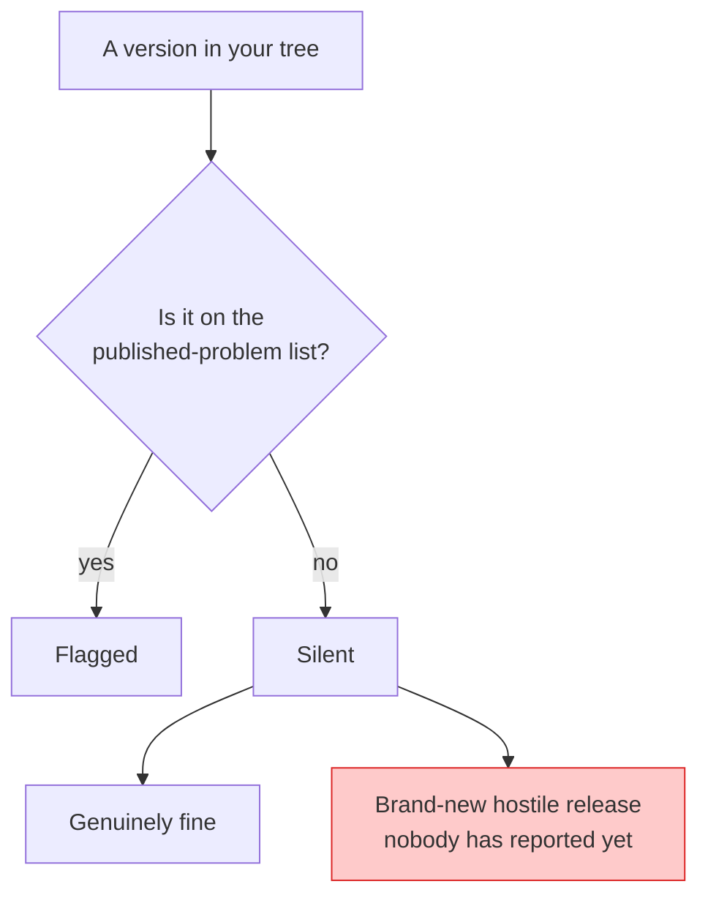
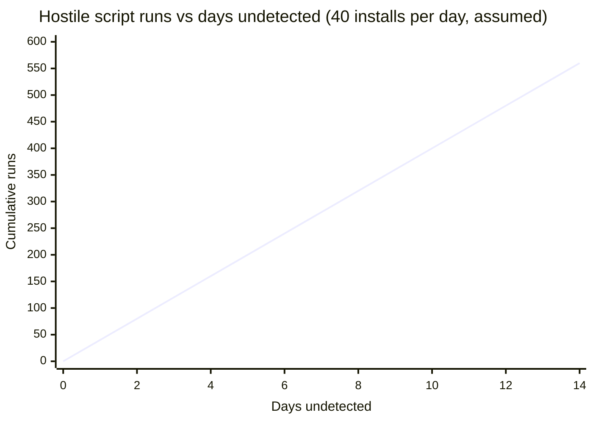
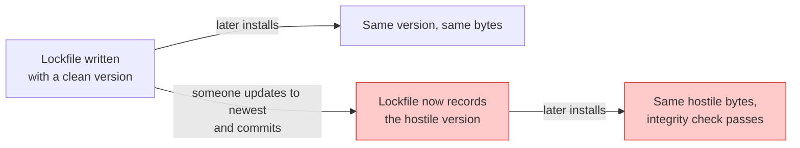
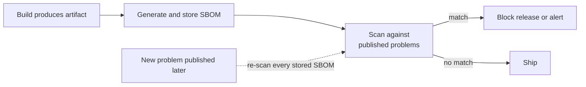

import LevelIntro from "../../../components/LevelIntro.astro";
import Checkpoint from "../../../components/Checkpoint.astro";
import PracticeCheck from "../../../components/PracticeCheck.astro";

export const unit = {
  track: "security",
  unitSlug: "supply-chain-security",
};

L1 showed that Northfield Ledger approved `ledger-pdf` and never saw
`case-fold` behind it. L2 asks where each defence sits along that chain, and
why each one has a gap the next must cover.

<LevelIntro
  items={[
    "What a vulnerability scanner can and cannot see",
    "What a lockfile pins, and what it never judges",
    "How an SBOM turns a hunt into a lookup",
  ]}
/>

## Why was the scanner silent for 14 days?

**Northfield ran `npm audit` and it stayed clean the whole time. If the
dependency was hostile, what was the scanner actually checking?**

A scanner compares the versions in your tree against a database of problems
somebody has already **published**. It answers "is this version on the known
list?" and nothing else.

The silent branch holds two very different cases, and the scanner cannot tell
them apart. A new release from a hijacked publisher is simply not on any list
yet.

Under the assumption from L1 (40 CI installs per day, a figure invented for
this unit), the cost of that silence grows in a straight line:

Fourteen days at 40 per day is 560 runs. Halving detection time halves the
exposure, and so does halving the number of installs. The demo below lets you
drag both.

<Checkpoint question="If Northfield ran the scanner every hour instead of occasionally, would it have caught the hostile version sooner?">

Not by itself. More frequent scanning only helps when the database already
contains an entry for the version. The hostile release had no entry until
someone noticed and reported it, so an hourly scan would have returned the
same silence an occasional scan did. Scanning shortens the time between "a
problem is published" and "we notice it", not the time between "the problem
exists" and "it is published". That earlier gap is the one pinning and bump
review address.

</Checkpoint>

<PracticeCheck
  track={unit.track}
  unitSlug={unit.unitSlug}
  topicId="audit-gap"
/>

## What does a lockfile actually pin?

**If the lockfile fixes versions, why didn't it stop the bad one?** Because a
lockfile does two separate jobs, and neither is "decide what is safe".

| Job            | What it fixes                                     | What it stops                                                       |
| -------------- | ------------------------------------------------- | ------------------------------------------------------------------- |
| Exact version  | Every install resolves to the same version number | Silent drift to a newer release between two installs                |
| Integrity hash | A fingerprint of the package's actual bytes       | A registry or mirror serving different bytes under the same version |

A lockfile entry is three lines of data: the version, where it came from, and
the fingerprint. The fingerprint is checked on install; a mismatch aborts.

The limit is the moment the lockfile is written. If someone runs an update to
the newest version and commits the result, the lockfile now records the
hostile release as faithfully as it recorded the clean one. A lockfile
preserves a decision. It does not review one.

<Checkpoint question="The integrity check passes on every one of those later installs of the hostile version. Is that a bug in the check?">

No, it is the check working exactly as designed. The fingerprint answers "are
these the same bytes that were recorded?", and they are. Whether the recorded
bytes were trustworthy is a different question that the fingerprint never
asks. That question belongs to a person reviewing the update before it is
merged.

</Checkpoint>

<PracticeCheck
  track={unit.track}
  unitSlug={unit.unitSlug}
  topicId="lockfile-scope"
/>

## How does an SBOM turn a hunt into a lookup?

**When the news says a package you have never heard of was compromised, how
fast can you say whether you ship it?**

A **Software Bill of Materials (SBOM)** is a machine-readable inventory of
every component inside a built artifact: name, version, and usually a hash. It
is generated at build time and kept, one per released artifact, in a common
format such as CycloneDX or SPDX.

| Question during an incident            | Without SBOMs                           | With stored SBOMs           |
| -------------------------------------- | --------------------------------------- | --------------------------- |
| "Do we ship `case-fold` anywhere?"     | Open each repository's lockfile by hand | Search the stored SBOMs     |
| "Which version, in which release?"     | Rebuild or dig through old tags         | Read it from the match      |
| "Does last year's release include it?" | Hope the old lockfile still exists      | The old SBOM is still there |

The SBOM is only half of a pipeline. The other half is scanning it, and the
scan is repeated, because new problems are published about versions you
shipped long ago:

The dashed arrow is the point. A scan at build time is a snapshot; keeping the
SBOMs lets you re-run the same question when the world learns something new.
That is also why customers and regulators ask vendors for one: they can run
the lookup themselves.

<Checkpoint question="A problem is published today about a package version Northfield shipped six months ago. What does Northfield need on file to answer 'which releases are affected' in minutes?">

The stored SBOM for each release from that period. The scan input is the
list of components that were actually inside the shipped artifact, and that
list was fixed at build time. Without it, someone has to reconstruct what each
old release contained, which for a transitive package nobody remembers
choosing is the same hunt as the original incident.

</Checkpoint>

<PracticeCheck
  track={unit.track}
  unitSlug={unit.unitSlug}
  topicId="sbom-rescan"
/>

## What closes the gap that all three leave?

The shared hole is the **new, hostile release that nobody has reported**. Two
habits address it, and both are policy more than tooling:

- **Pinning**: write an exact version in `package.json` itself, so an upgrade
  needs a visible edit, not a quiet re-resolve on a fresh machine.
- **Bump review**: before merging an update, read what changed. Did the
  publisher change? Is there a new `postinstall` script? A new script means
  new code that runs before any of your own, which is the loudest red flag a
  diff can carry.

Pinning turns a silent risk into a reviewable one. Review is what makes the
review real. L3 walks one incident through all four defences.
