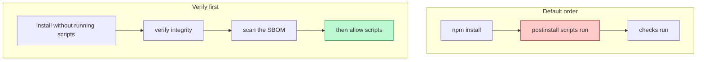

import Scenario from "../../../components/Scenario.astro";
import LevelIntro from "../../../components/LevelIntro.astro";
import Checkpoint from "../../../components/Checkpoint.astro";
import PracticeCheck from "../../../components/PracticeCheck.astro";

export const unit = {
  track: "security",
  unitSlug: "supply-chain-security",
};

<Scenario label="The pull request that changed one line, and the package that changed underneath it">
  <Fragment slot="facts">
    <div class="not-prose flex flex-col gap-2 text-sm text-slate-700 dark:text-slate-300">
      <div class="flex items-center gap-1.5"><span>🌳</span> <strong>The tree</strong> — 340 transitive dependencies (assumed for this unit)</div>
      <div class="flex items-center gap-1.5"><span>🔓</span> <strong>Loose ranges</strong> — 85% of them, so 289 packages may drift on a fresh install</div>
      <div class="flex items-center gap-1.5"><span>👀</span> <strong>What review sees</strong> — the PR diff shows the direct dependency, never the 289</div>
    </div>
    <div class="not-prose mt-3 flex flex-col gap-1.5 text-xs text-slate-700 dark:text-slate-300">
      <div>
        <div class="flex justify-between"><span>Dependencies free to drift without a diff</span><span>289 of 340</span></div>
        <div class="h-2 w-full overflow-hidden rounded-full bg-slate-200 dark:bg-slate-700"><div class="h-full rounded-full bg-orange-500 animate-fill-bar" style="--target-width: 85%"></div></div>
      </div>
    </div>
  </Fragment>

Priya opens a pull request that bumps `ledger-pdf` from one patch version to
the next. The diff is one line in a lockfile and it looks harmless. What the
diff cannot show is that Northfield's tree has 340 transitive dependencies
(an assumed figure) and that 85% of them are declared with a loose range, so
a fresh install may quietly pick a newer version of any of them.
**Which of the four defences would have noticed a hostile `case-fold`, at
what moment, and which would have stayed silent?**

</Scenario>

<LevelIntro
  items={[
    "Reading a tree for loose ranges, by depth",
    "Install scripts and the order CI runs things in",
    "Which defence catches which attack, and which is blind",
  ]}
/>

## Which dependencies can drift without anyone seeing a diff?

**If the tree is 340 packages deep, how do you find the ones that can change
on their own?** Read each declared range. A range tells the installer how far
it may move without asking.

| Declared range | Meaning                               | Drift allowed   |
| -------------- | ------------------------------------- | --------------- |
| `1.2.0`        | Exactly this version                  | None            |
| `~1.2.0`       | Newer patch releases of 1.2           | Patch           |
| `^1.2.0`       | Newer minor and patch releases of 1.x | Minor and patch |
| `*` or empty   | Anything                              | Everything      |

Northfield's small slice of the tree, with the range each package declares and
the version the lockfile resolved:

| Package        | Declared range | Resolved | Depth | Chosen by               |
| -------------- | -------------- | -------- | ----- | ----------------------- |
| `ledger-pdf`   | `^3.1.0`       | 3.1.4    | 1     | Northfield              |
| `case-fold`    | `^2.0.0`       | 2.4.1    | 2     | `ledger-pdf`'s own file |
| `font-metrics` | `1.2.0`        | 1.2.0    | 2     | `ledger-pdf`'s own file |

`case-fold` looks loose at depth 2, and the loose range was written by
`ledger-pdf`, not by Northfield. Here is the whole check, which is the one
place in this unit where the code is the clearest way to say it: walk the
tree, report each loose range with its depth.

```js
const LOOSE = /^[\^~*]|^$/;

function findLooseRanges(node, depth = 0) {
  const own =
    node.range !== null && LOOSE.test(node.range)
      ? [{ name: node.name, range: node.range, depth }]
      : [];
  return own.concat(
    ...node.dependencies.map((child) => findLooseRanges(child, depth + 1)),
  );
}
```

Run on the slice above it returns `ledger-pdf` at depth 1 and `case-fold` at
depth 2, and skips `font-metrics` because it is an exact pin.

With the demo's numbers, 340 × 85% = 289 packages are in that list for the
whole tree. Move the slider down and the list shrinks one-for-one: each
package you pin is one fewer place a silent change can enter.

<Checkpoint question="The walker flags case-fold's range as loose. Would pinning case-fold to an exact version have prevented the incident?">

Only if it had been pinned before the hostile release existed, and only
partly. An exact pin removes the automatic part: no install moves to the new
version without someone editing a file, which creates a diff a person can
read. It does not judge the version. If a developer later updates to the
newest release and commits it, the pin faithfully holds the hostile one. Pin
to make the change visible; review to make the visibility count.

</Checkpoint>

<PracticeCheck
  track={unit.track}
  unitSlug={unit.unitSlug}
  topicId="loose-ranges"
/>

## What order should CI run things in?

**Why did the hostile script run 560 times before anyone looked?** Because
the normal order is install, which runs scripts, and only then any checking.
The script was already running before the checks ever started.



The only line of CI configuration that matters here is the flag that installs
without running install scripts:

```yaml
- run: npm ci --ignore-scripts
```

A script cannot exfiltrate anything it never gets to run. The same logic
explains why a **new `postinstall` script appearing in a version bump** is the
loudest signal a diff can give: it is new code that runs before any of yours.

Two limits to hold in mind. First, this protects CI only; a developer running
a plain install on a laptop has no such flag unless it is set in shared
project configuration. Second, ignoring scripts delays the code, it does not
make the package trustworthy once it is later imported and run.

<PracticeCheck
  track={unit.track}
  unitSlug={unit.unitSlug}
  topicId="install-scripts-ci"
/>

## Which defence catches which attack?

**If a detector is silent, is anything wrong?** Not necessarily, and that is
the trap. Each defence catches one shape of attack reliably and is blind to
the others. A silent defence means "my shape was not present".

| Attack                                | Lockfile + hash  | SBOM + scan         | Typosquat check | Bump review                    |
| ------------------------------------- | ---------------- | ------------------- | --------------- | ------------------------------ |
| Maintainer takeover (new bad release) | No (locks it in) | Only once published | No (real name)  | Yes, if someone reads the diff |
| Look-alike package name               | No               | Only once published | Yes             | Partly (new name is visible)   |
| Same bytes swapped on a mirror        | Yes              | No                  | No              | No                             |
| Dependency confusion                  | Partly           | Only once published | No              | Partly                         |

The typosquat check is a distance test between a candidate name and a list of
popular names. `csae-fold` is two edits from `case-fold`, so it is flagged.
The real `case-fold`, published by a hijacked account, is distance zero from
itself and passes. That is the lesson of the Northfield incident in one line:
the detector for look-alikes could not have fired.

<Checkpoint question="The look-alike check reports nothing about Northfield's real incident. Does that mean the check is useless?">

No. It reliably catches the one shape it was built for, a deliberately
similar name, and it said nothing here because that shape was not present. The
mistake would be reading its silence as "the dependency is safe". Defence in
depth means running several checks for several shapes at once, since no one
check covers every shape.

</Checkpoint>

<PracticeCheck
  track={unit.track}
  unitSlug={unit.unitSlug}
  topicId="detector-blind-spots"
/>

## Worked end to end: the Northfield incident

1. `ledger-pdf` pulls in `case-fold` with a loose range. **Review** sees only
   the direct dependency.
2. A volunteer, handed publish rights, ships a new patch with a `postinstall`
   script. **Scanning** is silent: nothing is published about it yet.
3. CI installs with default behaviour. The **lockfile and hash** pass; the
   bytes match what the registry now serves.
4. The script runs about 40 times a day. **No defence in the stack has
   fired**; it runs 560 times over 14 days (assumed rate, and the day count
   from L1).
5. An audit spots the outbound call. The team searches the **stored SBOMs** for
   `case-fold` and gets the list of affected releases in minutes.
6. They rotate every secret CI could read, pin `case-fold`, add
   `--ignore-scripts` to the install step, and require review for any bump
   that adds an install script.

Notice what each defence did, and when: the SBOM did its best work **after**
detection, the others only help if configured **before**.

**This is one case, not the whole territory.** Change one fact and the answer
shifts. What if the hostile release shipped inside a build tool that never
appears in the runtime tree? What if the transitive package had been pinned,
but the pin lived in a file the update tool rewrites automatically? What
changes if Northfield had 40 services instead of one: where would the SBOM
searches live, and who would own the response? Work out which defence moves
from useful to essential in each variation.
