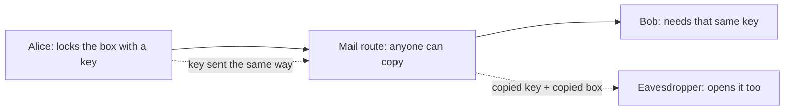

import Scenario from "../../../components/Scenario.astro";
import LevelIntro from "../../../components/LevelIntro.astro";
import PracticeCheck from "../../../components/PracticeCheck.astro";
import Compare from "../../../components/viz/Compare.astro";

export const unit = {
  track: "security",
  unitSlug: "symmetric-asymmetric-encryption-basics",
};

<Scenario label="A locked box is only as private as the key's trip">
  <Fragment slot="facts">
    

      
📦 <strong>The box</strong> — Alice locks a box with one padlock and mails it to Bob

      
🔑 <strong>The key</strong> — the only key that opens the padlock is still in Alice's pocket

      
🕵️ <strong>The courier</strong> — anyone along the route can open the mail and copy whatever is inside

      
❓ <strong>The gap</strong> — Bob cannot open the box until the key reaches him

    

  </Fragment>

Alice wants to mail Bob a private letter. She puts it in a box, snaps a
padlock shut, and sends the box off. The box is now safe from anyone who
handles it on the way. But Bob needs the key to open it. **If Alice puts
the key in the mail too, what has the padlock actually protected?**

Nothing, because whoever can copy the box can copy the key beside it. The
lock was never the hard part. Getting the key to Bob safely is.

</Scenario>

<LevelIntro
  items={[
    "The key distribution problem",
    "One shared key vs. a key pair",
    "Why real systems combine both",
  ]}
/>

## The shape of the problem

Online, the box is a file or a message, the lock is encryption, and the
mail route is any network you do not control. Everything below is about
one question: how does the right person get the power to open it, while
nobody else does?

## Two ways to lock a box

<Compare
  left={{
    title: "Symmetric: one shared key",
    items: [
      "Same key locks and unlocks",
      "Both sides must hold a copy",
      "Fast, even for large data",
      "Needs a safe way to share the key",
    ],
  }}
  right={{
    title: "Asymmetric: a key pair",
    items: [
      "Public key locks, private unlocks",
      "Public half can be shown to anyone",
      "Private half never leaves owner",
      "Much slower per operation",
    ],
  }}
  neutral
  caption="Symmetric encryption uses one shared secret key. Asymmetric encryption uses a public and a private key."
/>

The padlock story maps directly. **Symmetric** is one key that both locks and
unlocks, so a copy has to reach Bob. **Asymmetric** is Bob handing out open
padlocks to anyone, keeping the only key that opens them. Alice snaps one
shut on her box. Nobody, including Alice, can open it again. Only Bob can.

## Key terms

- **Symmetric encryption**: the same single key encrypts and decrypts. Fast,
  but that key has to reach every party securely.
- **Asymmetric encryption**: two mathematically related keys, a public one and
  a private one. Whatever the public key encrypts, only the matching private
  key decrypts.
- **Public/private key pair**: the public key can be shared openly. The
  private key must never leave its owner.
- **Key distribution problem**: getting a shared secret key to everyone who
  needs it without exposing it on the way. Asymmetric encryption removes the
  need to send a secret at all.
- **Hybrid encryption**: encrypt the data with a fast symmetric key, then
  lock only that small key with the recipient's public key.

<PracticeCheck
  track={unit.track}
  unitSlug={unit.unitSlug}
  topicId="key-distribution"
/>

## What this unit covers

L2 explains how a key pair avoids sending a secret, what that costs in speed,
and how hybrid encryption gets the best of both. L3 puts measured timings and
a worked example behind the same ideas and lists how each approach fails in
practice. On the web, the same pattern protects every HTTPS connection, which
`/security/tls-https/` covers.
