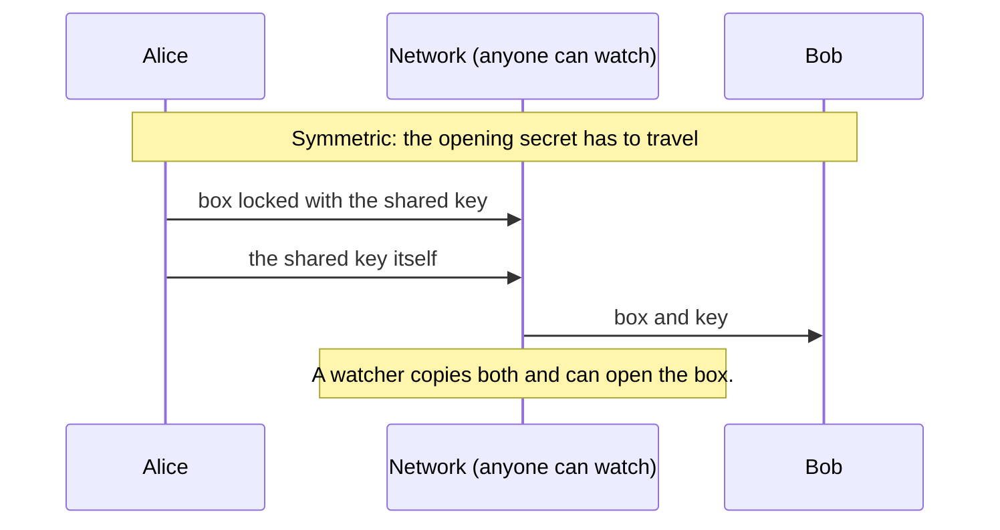
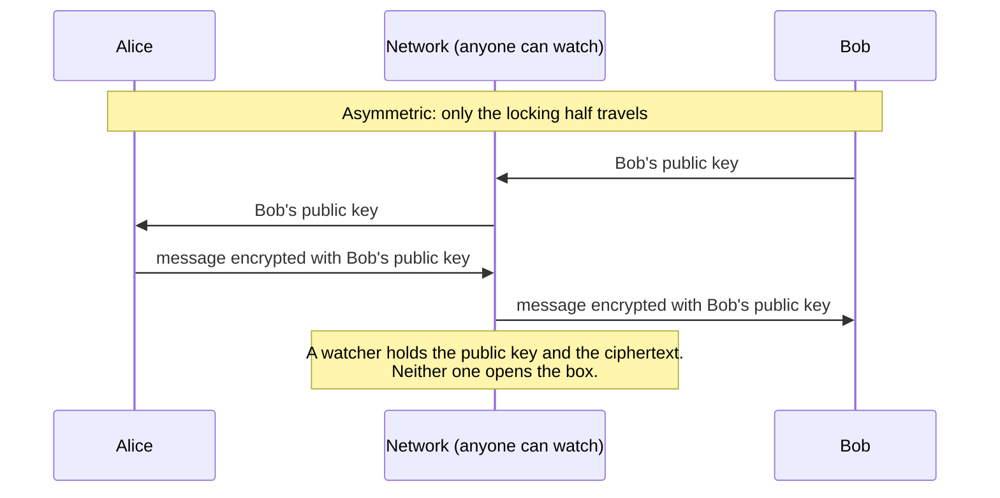
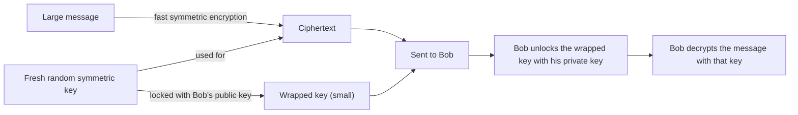

import LevelIntro from "../../../components/LevelIntro.astro";
import Checkpoint from "../../../components/Checkpoint.astro";
import PracticeCheck from "../../../components/PracticeCheck.astro";

export const unit = {
  track: "security",
  unitSlug: "symmetric-asymmetric-encryption-basics",
};

L1 showed that a padlock is useless if its key travels in the same mail as
the box. L2 works out how a key pair avoids ever mailing a secret, what that
costs, and why real systems use both kinds of encryption together.

<LevelIntro
  items={[
    "How a key pair avoids sending a secret",
    "What the second key costs in speed",
    "How hybrid encryption combines both",
  ]}
/>

## If the key cannot travel safely, what could Bob send instead?

**What if Bob mailed Alice something that can only close a lock, never open
one?** That is the padlock trick. Bob makes a pair of keys that belong
together. The **public key** is like an open padlock he hands to anyone. The
**private key** is the only key that opens a box closed with that padlock,
and it stays with Bob.

Compare the two. In the second diagram the only key that crosses the network
is the public one, and by design it can only lock. Bob's private key, the
only thing that opens the box, never moves.

<Checkpoint question="An eavesdropper copies every message in the second diagram, including Bob's public key. Can they read Alice's message? Can they send Bob a message only he can read?">

They cannot read Alice's message: the public key only encrypts, and the
private key that decrypts never appeared on the network. They can, however,
use the public key to lock a message for Bob, exactly as Alice did, because
anyone is allowed to. That is the point of a public key: it hands the whole
world the ability to lock, and only the owner the ability to unlock.

</Checkpoint>

<PracticeCheck
  track={unit.track}
  unitSlug={unit.unitSlug}
  topicId="key-pair-roles"
/>

## How badly does a shared key scale as a group grows?

**Suppose every pair of people in a group needs a private channel using symmetric
encryption. How many keys have to be shared safely?** One for every pair, which
is `n × (n − 1) / 2` for `n` people. Asymmetric encryption needs one key pair
per person, so the count grows by one pair per newcomer instead.

| People in the group | Shared symmetric keys (one per pair) | Asymmetric key pairs (one per person) |
| ------------------- | ------------------------------------ | ------------------------------------- |
| 5                   | 10                                   | 5                                     |
| 10                  | 45                                   | 10                                    |
| 100                 | 4,950                                | 100                                   |

Each symmetric key in that middle column also has to be delivered safely, the
very problem from L1. Those numbers come straight from the pair-counting
formula. They assume every pair has its own key, which is the strictest case.

## If a key pair is so convenient, why not use it for everything?

**What does the second key cost?** Speed. The mathematics that lets a public
key lock and only a private key unlock is far heavier than the mathematics of
one shared key. L3 measures the gap.

|                  | Symmetric encryption                  | Asymmetric encryption                           |
| ---------------- | ------------------------------------- | ----------------------------------------------- |
| Keys involved    | One shared secret key                 | A public/private key pair                       |
| Key distribution | Needs a safe channel to share the key | No secret ever needs to be sent                 |
| Speed            | Fast, even for large amounts of data  | Much slower per operation (about 20x in L3)     |
| Data size        | Handles messages of any length        | Each operation carries only a small amount      |
| Typical use      | Encrypting the actual bulk data       | Locking a small secret, such as a symmetric key |

<PracticeCheck
  track={unit.track}
  unitSlug={unit.unitSlug}
  topicId="speed-cost-tradeoff"
/>

## So how do real systems get the benefit without the cost?

**If the slow tool is only good for small things, and the fast tool needs a
safe way to share its key, can they cover for each other?** Yes. That is
**hybrid encryption**: the fast tool does the heavy lifting, and the slow tool
protects only the tiny key the fast tool needs.

The slow, asymmetric step touches only the small key, however long the message
is. This is the pattern behind HTTPS, covered in `/security/tls-https/`.

<Checkpoint question="A team wants to encrypt a 2 GB backup before uploading it. They plan to encrypt the whole file with a public key. What is wrong with that, and what should they do instead?">

Each public-key operation carries only a small amount of data and is much
slower than a symmetric one, so pushing 2 GB through it is both impractical
and needlessly slow. Instead they should generate a random symmetric key,
encrypt the backup with it, and lock only that small key with the public key.
The slow step then handles a few dozen bytes instead of two billion.

</Checkpoint>

<PracticeCheck
  track={unit.track}
  unitSlug={unit.unitSlug}
  topicId="hybrid-pattern"
/>

## Does this only apply to mail and messages?

No. Anywhere two parties who have never met need a private channel, the
question is the same: does a secret have to travel, and can a key pair avoid
that? This unit covers confidentiality. Proving who sent a message is a second
question, taken up in `/security/authentication-fundamentals/` and
`/security/tls-https/`.
