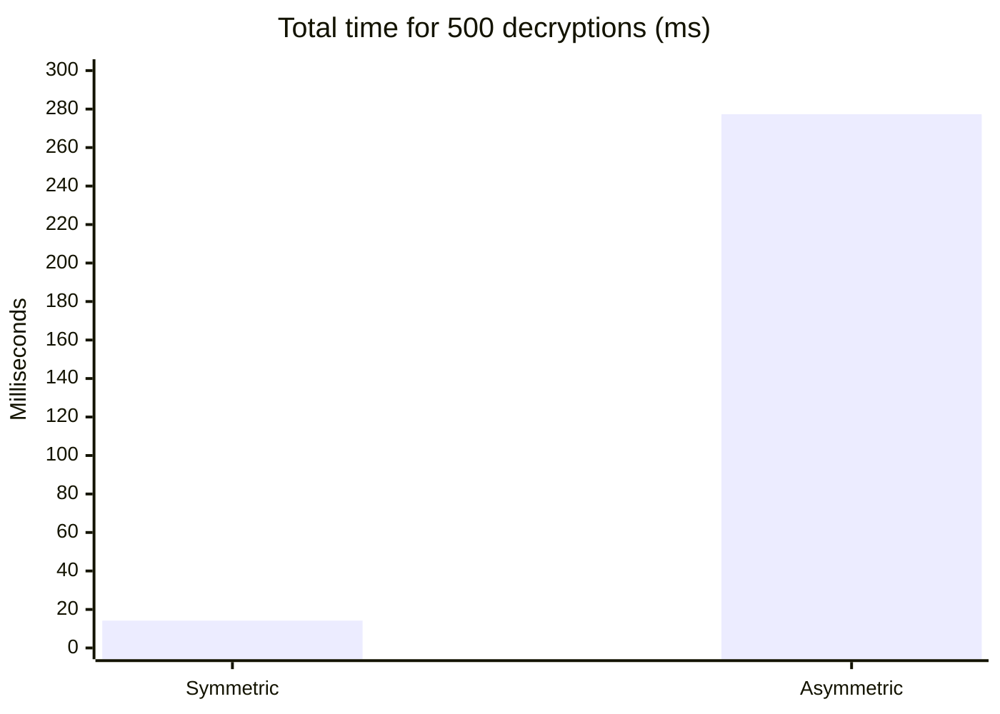
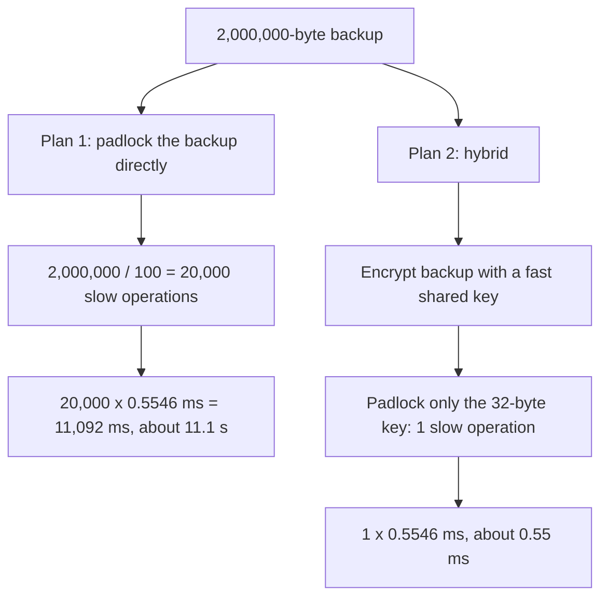

import Scenario from "../../../components/Scenario.astro";
import LevelIntro from "../../../components/LevelIntro.astro";
import Checkpoint from "../../../components/Checkpoint.astro";
import PracticeCheck from "../../../components/PracticeCheck.astro";

export const unit = {
  track: "security",
  unitSlug: "symmetric-asymmetric-encryption-basics",
};

<Scenario label="Mailing a two-megabyte backup, one padlock at a time">
  <Fragment slot="facts">
    

      
🗄️ <strong>The payload</strong> — a 2,000,000-byte backup that must reach Bob

      
🔑 <strong>The slow tool</strong> — public-key locking, which carries only a small piece per operation

      
⚡ <strong>The fast tool</strong> — a shared key, which handles any length

      
🎯 <strong>The question</strong> — how many slow operations does each plan need?

    

  </Fragment>

Picture a padlock that can only close around a very small parcel. Bob has
published that padlock for everyone. Alice has a backup far too big for it. She
could cut the backup into small parcels and padlock each one, or she could put
the whole backup in an ordinary box with its own key and padlock only that
tiny key. **Which plan needs fewer slow operations, and by how much?**

</Scenario>

<LevelIntro
  items={[
    "Measured cost of symmetric vs. asymmetric",
    "A hybrid plan worked end to end",
    "How each approach fails in practice",
  ]}
/>

## How big is the speed gap, really?

**L2 said asymmetric is "much slower". What does that look like in numbers?**
In one run on a single machine, each approach decrypted the same 32-byte
payload 500 times. Each decryption is one attempt to open an encrypted message.
The per-operation times below are what the interactive demo uses. Treat them as
one measurement, not a benchmark: another machine will give different numbers.

| Approach (500 decryptions of 32 bytes) | Per operation | Total for 500 |
| -------------------------------------- | ------------- | ------------- |
| Symmetric (AES-256-GCM)                | 0.0284 ms     | 14.2 ms       |
| Asymmetric (RSA-2048 private key)      | 0.5546 ms     | 277.3 ms      |

The ratio is `0.5546 / 0.0284`, about 19.5. If the fast path took one second
the slow one would take about twenty. The cost sits in the **private-key**
operation. The public key uses a small, cheap number, so locking is quick and
unlocking is the slow half. That suits the hybrid design: the slow half runs
once per message, not once per byte.

<Checkpoint question="The slow operation is the private-key unlock, and it costs about the same whether the wrapped item is a tiny key or a bigger one. What does that suggest about what you should ever give it to unlock?">

Only something small and fixed in size, like a 32-byte symmetric key. The
unlock cost does not shrink for smaller payloads, so you pay it once and want
that payment to buy as much as possible. A key that then unlocks a message of any
length is the best possible use of one slow operation.

</Checkpoint>

<PracticeCheck
  track={unit.track}
  unitSlug={unit.unitSlug}
  topicId="measured-cost"
/>

## Worked example: how many slow operations does a 2 MB backup need?

**Back to the scenario. How many slow operations does each plan need?** Two
assumptions, both stated so you can change them. First, each slow operation can
carry at most 100 bytes. Real limits depend on the key size and padding, so
this is a round number for the arithmetic. Second, each slow operation costs
about the same as the measured 0.5546 ms, which was timed on a 32-byte payload.

| Plan                                  | Slow operations | Slow-operation time (assumed) |
| ------------------------------------- | --------------- | ----------------------------- |
| Padlock the backup in 100-byte pieces | 20,000          | about 11,092 ms               |
| Hybrid: padlock one 32-byte key       | 1               | about 0.55 ms                 |

The hybrid plan also pays for one fast symmetric pass over the 2 MB. That cost
is small next to the slow operations it replaced, and the per-operation timing
above cannot extrapolate it, since a 32-byte test mostly measures fixed overhead.
Doubling the backup doubles the direct plan's slow operations and leaves
the hybrid plan's at one.

<PracticeCheck
  track={unit.track}
  unitSlug={unit.unitSlug}
  topicId="hybrid-cost-model"
/>

## Where does each approach go wrong in practice?

**Both approaches can be used correctly and still fail. What does each failure
look like?**

| Failure mode                                   | What goes wrong                                                                                                                                                              |
| ---------------------------------------------- | ---------------------------------------------------------------------------------------------------------------------------------------------------------------------------- |
| Padlocking large data directly with a key pair | Each operation carries little and is slow, so cost grows with the data. The hybrid plan avoids it.                                                                           |
| Reusing one shared key for everything, forever | If that key ever leaks, every message ever locked with it opens, not just one.                                                                                               |
| Trusting a public key that arrived unchecked   | An attacker who swaps in their own public key receives the secrets meant for Bob. Authenticity of the key matters, which `/security/tls-https/` addresses with certificates. |
| Treating the public key as a secret            | Hiding it adds effort with no security gain. It is public by design.                                                                                                         |
| Assuming a key pair proves who sent a message  | Anyone can lock a message with Bob's public key. Proving the sender needs a separate signature.                                                                              |
| Skipping the integrity check on symmetric data | Modern shared-key modes attach a tamper-detection tag. If it is not verified, altered data can be accepted.                                                                  |

Notice the third row. A key pair removes the need to send a secret, but not the
need to know that the public key really belongs to Bob. The padlock only helps if
the open padlock Alice picked up really came from him.

<Checkpoint question="Alice receives an open padlock claiming to be Bob's, but it was actually forged by an attacker on the route. She locks her message with it. Who can open that message?">

The attacker, who holds the matching private key, and Bob cannot. The math worked
exactly as designed. What failed was Alice's belief about whose public key it
was. This is why public keys are usually delivered with some proof of
ownership, not just handed over.

</Checkpoint>

<PracticeCheck
  track={unit.track}
  unitSlug={unit.unitSlug}
  topicId="failure-modes"
/>

## Extend it: this worked example is a case, not the whole territory

The 2 MB backup, the 100-byte limit, and the single recipient were all choices.
Try changing one at a time and predict the effect before computing:

- **Three recipients.** Alice wants Bob, Carol, and Dave to read the same
  backup. How many symmetric encryptions of the 2 MB does she do, and how many
  slow operations? (One pass of the backup under a single shared key, plus one
  key-lock per recipient, so three slow operations.)
- **A smaller limit.** If each slow operation carried only 50 bytes, what would
  happen to the direct plan, and to the hybrid plan? (The direct plan doubles to
  40,000. The hybrid plan still needs just one for a 32-byte key.)
- **A leaked shared key.** If the key from one hybrid message leaks, what is
  exposed? (Only that message, because a fresh key was made for it.)

Which of those changes would you make first if the backup had to reach
a thousand people?
