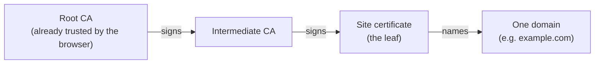

import Scenario from "../../../components/Scenario.astro";
import LevelIntro from "../../../components/LevelIntro.astro";
import PracticeCheck from "../../../components/PracticeCheck.astro";
import Compare from "../../../components/viz/Compare.astro";

export const unit = { track: "security", unitSlug: "tls-https" };

<Scenario label="A sealed envelope, a stamped ID card, and a stranger at the door">
  <Fragment slot="facts">
    

      
✉️ <strong>The envelope</strong> — sealed, so nobody on the road can read it

      
🪪 <strong>The ID card</strong> — stamped by the city office, which only checked that the name on the card matches the name on the door

      
🚪 <strong>The stranger</strong> — holds a perfectly valid card for a shop called "Bakery R0sa", not "Bakery Rosa"

    

  </Fragment>

You hand a sealed envelope to a courier for delivery to "Bakery Rosa".
At the door, the person who takes it shows a printed ID card stamped by
the city office. The seal means nobody on the road could read your
letter. The stamp means the city office checked that the name on the
card matches the name on the door. **Now the sign above the door reads
"Bakery R0sa", with a zero. The seal is intact, the stamp is genuine,
and you are still handing your letter to the wrong shop. How can every
guarantee be true and you still be in trouble?**

Because the seal and the stamp each promise something narrow. The seal
protects the road. The stamp says "this person controls this exact
name". Neither says the name is the one you meant. A website's padlock
works the same way: it vouches for the connection and the exact domain
in the address bar, not for whether that domain belongs to the company
you have in mind.

</Scenario>

<LevelIntro
  items={[
    "What the padlock does and doesn't promise",
    "Certificates, CAs, and the chain of trust",
    "Why the handshake exists",
  ]}
/>

## The padlock's two promises

**What did the padlock check, and what did it leave to you?**

<Compare
  left={{
    title: "The padlock promises",
    items: [
      "Traffic is encrypted in transit",
      "Certificate matches the domain",
      "A trusted CA signed it",
      "Nobody on the path edits it",
    ],
  }}
  right={{
    title: "The padlock never promises",
    items: [
      "The site is honest",
      "The domain is the brand you mean",
      "The owner was identity-checked",
      "The server will treat data well",
    ],
  }}
  neutral
  caption="Left column: what TLS can prove. Right column: what still depends on you."
/>

- **TLS (Transport Layer Security)** encrypts the connection between a
  browser and a server, so someone watching the network sees scrambled
  bytes. HTTPS is simply HTTP running inside TLS.
- A **certificate** binds a public key to a domain name and carries a
  signature from a **certificate authority (CA)**. The browser shows
  the padlock when that signature chains back to a CA it already
  trusts, for the exact domain in the address bar.
- **Domain validation is not identity validation.** A CA that issues a
  certificate for `paypa1-secure-login.com` is saying "this requester
  controls that domain", not "this is PayPal".

<PracticeCheck
  track={unit.track}
  unitSlug={unit.unitSlug}
  topicId="padlock-promise"
/>

## Key terms

| Term                       | Plain meaning                                                                         |
| -------------------------- | ------------------------------------------------------------------------------------- |
| TLS                        | The protocol that encrypts and authenticates a connection; HTTPS is HTTP over TLS     |
| Certificate                | A signed document binding a public key to a domain name                               |
| Certificate authority (CA) | An organization whose signing key browsers and operating systems already trust        |
| Chain of trust             | Signatures from the site's own certificate, through intermediates, up to a root       |
| Domain validation (DV)     | The lightest certificate type: proves the requester controls the domain, nothing more |

**If the certificate only holds a public key, who vouches for it?** The
chain of trust answers that, and it can be drawn as three links:

The browser never has to know the site. It only has to recognize the
root, then check that each signature below it is intact.

<PracticeCheck
  track={unit.track}
  unitSlug={unit.unitSlug}
  topicId="certificate-ca-chain"
/>

## What the handshake adds

A certificate only hands over a _public_ key, which is too slow to
encrypt a whole page load. **So where does the key that actually
protects your traffic come from?** From the **TLS handshake**: a short
negotiation before any page data moves, where both sides agree on a
**cipher suite** (the bundle of algorithms they will use) and arrive at
a shared symmetric key without ever sending that key across the
network.

## What this unit covers

L2 shows how a chain is verified link by link, why domain validation is
deliberately light, and how the handshake and forward secrecy work. L3
walks one worked case, where a real brand and its lookalike both pass
every check, then looks at what a passive observer can and can't see,
and ends with a small hostname-matching function.
