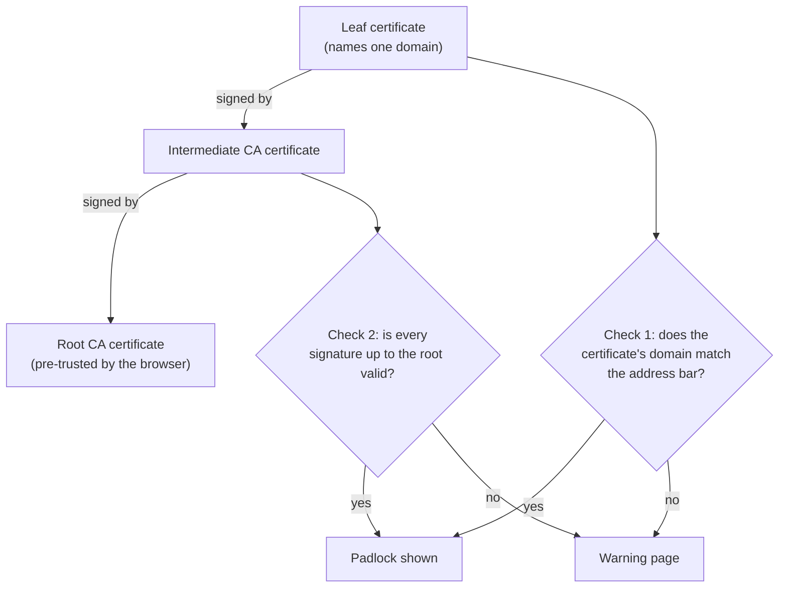
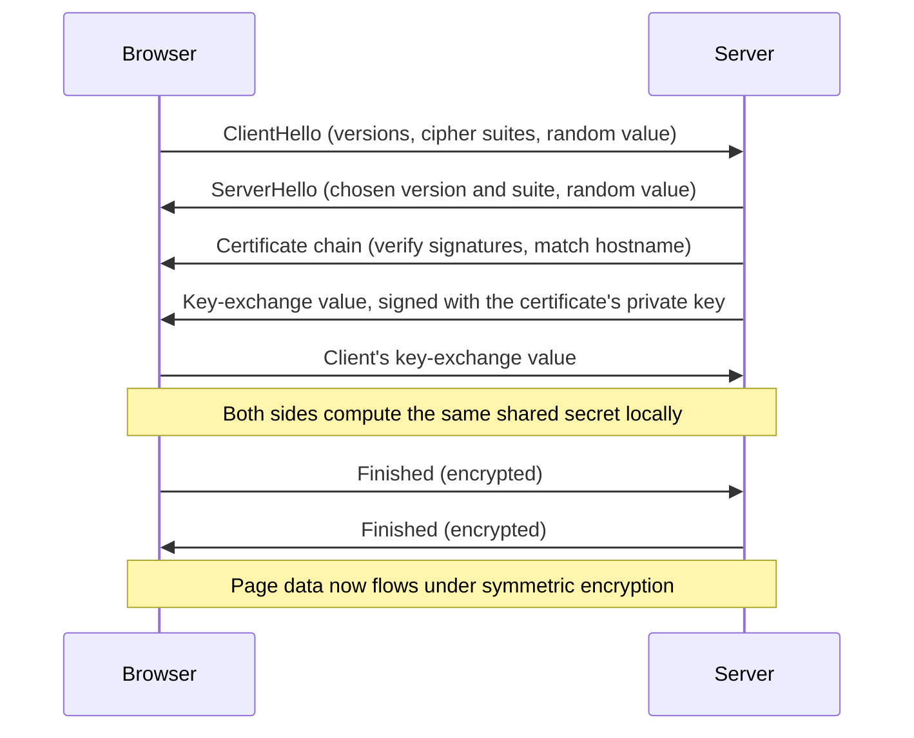

import LevelIntro from "../../../components/LevelIntro.astro";
import Checkpoint from "../../../components/Checkpoint.astro";
import PracticeCheck from "../../../components/PracticeCheck.astro";
import Compare from "../../../components/viz/Compare.astro";

export const unit = { track: "security", unitSlug: "tls-https" };

L1 established that a padlock proves an encrypted connection to the
exact domain in the address bar, not that the domain is the brand you
meant. L2 opens the box: what the browser actually checks, why those
checks stay narrow on purpose, and how the handshake turns a
certificate into a key.

<LevelIntro
  items={[
    "The checks behind a padlock",
    "How the handshake produces a key",
    "Forward secrecy: ECDHE versus RSA key exchange",
  ]}
/>

## Verifying a chain, link by link

**When the padlock appears, what exactly did the browser just check?**
Not whether the site is trustworthy. It checked whether a chain of
signatures, starting at the site's own certificate, leads to a root
the browser already trusts, and whether the certificate names the
domain in the address bar:

Real browsers also check expiry dates, revocation signals, and policy
rules. None of those extra checks turns a lookalike domain into the
real brand: every one of them asks "is this certificate valid for this
name?", never "is this name the one you meant?".

<PracticeCheck
  track={unit.track}
  unitSlug={unit.unitSlug}
  topicId="chain-verification"
/>

<Checkpoint question="A certificate has a valid signature chain up to a trusted root, and its domain is paypa1-secure-login.com, which is also what the address bar shows. Do both checks pass, and did the verifier make a mistake?">

Both checks pass, and the verifier made no mistake. It answered the
only question it was ever asked: does this exact domain string have a
certificate that chains to a trusted CA. Whether the domain is a
legitimate business depends on facts about the world, such as who
registered it and what they intend, that no signature chain encodes.

</Checkpoint>

## Why domain validation is deliberately light

**If a CA refused any suspicious-looking domain, wouldn't that close the
gap?** It would also break the thing that made HTTPS universal.
**Domain validation (DV)** is automated: the requester proves control by
answering a challenge, such as publishing a specific value at a
specific web address on the domain or in its DNS records, and a
certificate is issued in minutes with no human review. A job that
needs judgment ("does this name resemble a brand?") cannot run at that
speed and scale.

| Certificate type         | What the CA checks                        | Human review | Typical speed |
| ------------------------ | ----------------------------------------- | ------------ | ------------- |
| Domain validated (DV)    | Requester controls the domain             | None         | Minutes       |
| Extended validation (EV) | Domain control plus organization identity | Yes          | Longer        |

Browsers no longer display EV certificates differently, so even when
the extra checking happened, most users never see it. The burden of
noticing a lookalike falls on the reader of the address bar, or on a
separate anti-phishing system, not on the certificate chain.

<PracticeCheck
  track={unit.track}
  unitSlug={unit.unitSlug}
  topicId="dv-lightweight"
/>

<Checkpoint question="A CA issued a certificate for paypa1-secure-login.com in minutes, with no human asking whether the name sounds like PayPal. Did the CA fail at its job?">

No. DV's whole contract is "prove you control this domain", checked by
an automated challenge. Expecting the CA to catch lookalikes holds it
to a job it was never scoped to do, and that narrow scope is exactly
why it can issue certificates at web scale.

</Checkpoint>

## From a certificate to a shared key: the handshake

**A certificate holds only a public key, and public-key math is too
slow to encrypt a whole page load. So where does the real key come
from, and what stops an attacker from slipping in their own?** The
handshake, a negotiation that runs before any page data moves:

The certificate's job here is narrow but critical. The server signs
its key-exchange value with the private key that matches its
certificate. An attacker on the wire can swap bytes but cannot forge a
signature that verifies against the certificate, so they cannot
substitute their own key unnoticed. In TLS 1.3 the messages after
ServerHello, including the certificate, are already encrypted; the
diagram shows what is exchanged, not who can read it.

**Why negotiate a cipher suite at all instead of hard-coding one?**
Algorithms age. Negotiating lets both sides offer what they support and
pick the strongest option they share, so TLS survives weak algorithms
being retired without breaking every older client at once.

**What does the handshake cost?** Time. The handshake needs whole
network round trips before the first encrypted byte of the page can
move. In this unit's demo (counting only the TLS round trips and
ignoring the TCP connection setup before it):

| Network round trip | TLS 1.3 (1 round trip) | TLS 1.2 (2 round trips) |
| ------------------ | ---------------------- | ----------------------- |
| 10 ms              | 10 ms                  | 20 ms                   |
| 80 ms              | 80 ms                  | 160 ms                  |
| 300 ms             | 300 ms                 | 600 ms                  |

Drag the slider in the demo to see the same relationship across the
whole range: handshake time is round trips multiplied by the network's
round-trip time, so a distant server pays more for every extra round
trip.

<PracticeCheck
  track={unit.track}
  unitSlug={unit.unitSlug}
  topicId="handshake-cipher-suite"
/>

## Forward secrecy: why the key exchange method matters

<Checkpoint question="The diagram calls the key-exchange values ephemeral: generated fresh for one connection, then discarded. Why does that matter if the server's long-term private key is stolen a year later?">

If past sessions' keys had been derived from that long-term key, the
thief could decrypt every recording they had saved. An ephemeral value
exists only in memory for one handshake and is never reused, so
stealing the long-term key later reveals nothing about a secret that no
longer exists. That property is called **forward secrecy**.

</Checkpoint>

**How do the two key exchange styles differ in practice?**

<Compare
  left={{
    title: "RSA key exchange (old)",
    items: [
      "Client picks the secret",
      "Wraps it in the server's cert key",
      "Secret travels, only wrapped",
      "Stolen key opens old recordings",
    ],
  }}
  right={{
    title: "ECDHE (modern)",
    items: [
      "Both sides make throwaway pairs",
      "Swap only the public halves",
      "Secret is never transmitted",
      "Stolen key opens nothing old",
    ],
  }}
  caption="Same certificate, very different exposure if its private key leaks later."
/>

With **ECDHE** (Elliptic-Curve Diffie-Hellman, Ephemeral), each side
combines its own temporary private value with the other's public value
and arrives at the same secret. The certificate key only signs, which
proves who the server is; it never protects the secret. TLS 1.3 removed
plain RSA key exchange entirely.

<PracticeCheck
  track={unit.track}
  unitSlug={unit.unitSlug}
  topicId="forward-secrecy"
/>

## Failure modes at this level

- **Treating "HTTPS" as a synonym for "trustworthy".** It answers "is
  this connection private", not "should I trust the other end".
- **Assuming the CA vetted the organization.** For domain-validated
  certificates it checked domain control only.
- **Skipping the domain string because a padlock is present.** The
  match is strict about the exact string, but telling `paypa1` from
  `paypal` is still the reader's job.
- **Thinking the certificate is the encryption key.** It carries a
  public key used to authenticate the handshake; the traffic key is
  derived fresh during key exchange.
