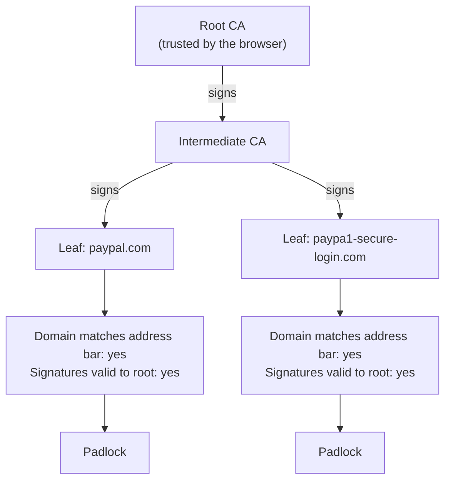

import Scenario from "../../../components/Scenario.astro";
import LevelIntro from "../../../components/LevelIntro.astro";
import Checkpoint from "../../../components/Checkpoint.astro";
import PracticeCheck from "../../../components/PracticeCheck.astro";

export const unit = { track: "security", unitSlug: "tls-https" };

<Scenario label="The same city office stamped both shop cards">
  <Fragment slot="facts">
    <div class="not-prose flex flex-col gap-2 text-sm text-slate-700 dark:text-slate-300">
      <div class="flex items-center gap-1.5"><span>🏛️</span> <strong>One office</strong> — the same intermediate CA signs both certificates</div>
      <div class="flex items-center gap-1.5"><span>🏪</span> <strong>Shop A</strong> — paypal.com, the real brand</div>
      <div class="flex items-center gap-1.5"><span>🎣</span> <strong>Shop B</strong> — paypa1-secure-login.com, a lookalike built to steal logins</div>
      <div class="flex items-center gap-1.5"><span>🔒</span> <strong>Result</strong> — both pass every check the browser runs</div>
    </div>
  </Fragment>

Picture the city office from L1 stamping two ID cards on the same
afternoon. One goes to the real PayPal, for `paypal.com`. The other goes
to someone who registered `paypa1-secure-login.com` an hour earlier.
Both people proved they control the name on their card, and the office
stamped both. **A visitor walks up to each door and checks the
stamp. Does any step of that check separate the real shop from the
fake one?**

This is a single case, worked end to end. It is not the whole
territory: the same shape appears with different brands, different CAs,
and different mechanisms, and the questions at the end of each section
ask you to push it beyond what is shown.

</Scenario>

<LevelIntro
  items={[
    "Two chains that both verify",
    "What a passive watcher can see",
    "Matching hostnames, wildcards included",
  ]}
/>

## The worked case: tracing both chains

**Where, step by step, could the browser tell the two sites apart?**



| Check the browser runs                            | paypal.com | paypa1-secure-login.com |
| ------------------------------------------------- | ---------- | ----------------------- |
| Certificate domain equals address bar             | Pass       | Pass                    |
| Leaf signature verifies against the intermediate  | Pass       | Pass                    |
| Intermediate signature verifies to a trusted root | Pass       | Pass                    |
| Certificate not expired                           | Pass       | Pass                    |
| "Is this the brand the visitor meant?"            | Not asked  | Not asked               |

The last row is the whole story. The first four rows are cryptographic
facts that can be checked from the certificate data alone. The last is
a fact about the world, and nothing in the chain encodes it. The result
is correct for both sites: the verifier is telling the truth twice.

<Checkpoint question="A security engineer proposes fixing this by making the chain verifier reject any domain that looks similar to a well-known brand. What would that change do to the verifier's contract?">

It would quietly widen the verifier's job from "does this domain own a
certificate signed by a trusted root" to "is this domain a legitimate,
non-impersonating business". The first is a fact you can check offline
from signatures. The second needs outside knowledge: a list of brands,
fuzzy matching, and constant upkeep as new brands and lookalikes
appear. Mixing them blurs "this domain owns this name" with "this
domain is trustworthy", the exact conflation that lets the phishing
site succeed. A lookalike check is worth building, but as a separate,
explicit step.

</Checkpoint>

**What does verification catch, then?** Tampering after issuance. A
signature covers the exact contents of the certificate:

| Scenario                                                    | Hostname check | Signature check | Why                                               |
| ----------------------------------------------------------- | -------------- | --------------- | ------------------------------------------------- |
| Genuine certificate for `paypal.com`, visited at `evil.com` | Fail           | Pass            | The certificate names a different domain          |
| Genuine certificate, subject edited after signing           | Depends        | Fail            | The stored contents no longer match the signature |
| Lookalike with its own genuine certificate                  | Pass           | Pass            | Nothing was altered and the name matches          |

The tampered certificate fails for a mechanical reason: its contents
no longer match what was signed. The lookalike fails nothing, because
what is wrong with it is entirely about what the name means to a human.

<PracticeCheck
  track={unit.track}
  unitSlug={unit.unitSlug}
  topicId="lookalike-passes"
/>

**Try extending the case.** Suppose a company adds a rule that flags any
domain within a small edit distance (the number of letter changes
needed to turn one string into another) of a list of high-value
domains. Would that rule belong inside the chain verifier, or
somewhere else? What would break if the list went stale? And would it
catch `paypal-support-center.com`, which is far from `paypal.com` by
edit distance?

## What a passive watcher can and can't see

**If someone records every packet of a connection, with no
interference, what do they learn?** The answer depends on which parts of
the handshake travel before encryption starts:

| Visible to a passive observer                                                 | Not visible to a passive observer                 |
| ----------------------------------------------------------------------------- | ------------------------------------------------- |
| Server address and approximate data volume and timing                         | Request and response contents after the handshake |
| The offered versions and cipher suites in ClientHello                         | The shared traffic key (it is never transmitted)  |
| The hostname the client asks for (SNI), unless Encrypted Client Hello is used | The URL path, query string, cookies, form fields  |
| The certificate chain, in TLS 1.2 (TLS 1.3 encrypts it)                       | Anything inside the encrypted application data    |

Two details matter. First, TLS 1.3 encrypts the server's certificate,
so the certificate row changes with the protocol version. Second, the
hostname is a separate leak: the client names the server it wants in
the clear so that one address can host many sites. Encrypted Client
Hello (ECH) is the effort to close that gap. TLS was never meant to hide
who talks to whom, only what they say.

<Checkpoint question="A network operator logs every connection for a year but never breaks any encryption. Name two things they can still report about a user's browsing, and one thing they cannot.">

They can still report which servers the user connected to (the address,
and usually the hostname through SNI) and when, plus roughly how much
data moved. They cannot report which pages were requested or what any
page contained, since paths, cookies, and bodies sit inside the
encrypted data. This is metadata versus content: TLS protects the
second and was never designed to hide the first.

</Checkpoint>

<PracticeCheck
  track={unit.track}
  unitSlug={unit.unitSlug}
  topicId="observer-visibility"
/>

**Try extending the case.** If both servers' long-term private keys were
stolen a year later, and the observer had recorded today's handshake
with each, for which server could they decrypt it if one used ECDHE and
the other plain RSA key exchange? What would change if a third server
reused its ephemeral value across many connections?

## Matching the hostname: where reading the code is the point

**What does "the certificate's domain matches the address bar" mean when
a certificate says `*.example.com`?** A wildcard covers exactly one label
(one dot-separated piece) in the position of the asterisk, which is
easy to get wrong:

| Certificate name  | `www.example.com` | `example.com` | `a.b.example.com` |
| ----------------- | ----------------- | ------------- | ----------------- |
| `www.example.com` | Match             | No            | No                |
| `*.example.com`   | Match             | No            | No                |
| `example.com`     | No                | Match         | No                |

Here is the whole rule in a few lines; the point is the two guards, not
the syntax:

```js
function matchesName(certName, host) {
  const name = certName.toLowerCase();
  const target = host.toLowerCase();
  if (!name.startsWith("*.")) return name === target;
  const rest = name.slice(2);
  const labels = target.split(".");
  return (
    labels.length > 1 && labels[0] !== "" && labels.slice(1).join(".") === rest
  );
}
```

The guard is that the wildcard stands for exactly one label: removing
the first label of the host must leave exactly the rest of the pattern.
That is why `*.example.com` does not cover the bare `example.com` and
does not cover two extra labels. The exercise below asks you to write
this logic yourself.

<PracticeCheck
  track={unit.track}
  unitSlug={unit.unitSlug}
  topicId="hostname-match"
/>

**Try extending the case.** Real certificates list several names. How
would you change the function to accept a list of names? What should
happen if the list is empty, and why must an empty list never match?

## Failure modes

| Failure mode                                                             | What it gets wrong                                                                                           |
| ------------------------------------------------------------------------ | ------------------------------------------------------------------------------------------------------------ |
| Treating a valid chain as proof the site is the brand it resembles       | The chain proves domain control, nothing about resemblance                                                   |
| Assuming a CA manually reviewed the domain before issuing                | Domain-validated certificates are issued after an automated challenge                                        |
| Folding lookalike detection into the chain verifier                      | It mixes a cryptographic fact with a judgment about the world and hides the separate check that should exist |
| Assuming tampering after issuance goes unnoticed                         | An edited certificate fails its signature check immediately                                                  |
| Believing a stolen long-term key opens past ECDHE sessions               | The long-term key only signs the handshake; the traffic secret was ephemeral and no longer exists            |
| Believing everything in the handshake is encrypted from the first packet | ClientHello and ServerHello travel in the clear, and in TLS 1.2 so does the certificate                      |
| Letting a wildcard stand for more than one label                         | `*.example.com` covering `a.b.example.com` would hand out names the certificate owner never proved           |
