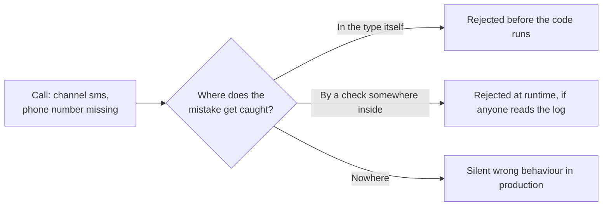

import Scenario from "../../../components/Scenario.astro";
import LevelIntro from "../../../components/LevelIntro.astro";
import PracticeCheck from "../../../components/PracticeCheck.astro";

export const unit = { track: "software-design", unitSlug: "api-design" };

<Scenario label="A function that accepted a call that could never work">
  <Fragment slot="facts">
    

      

        📟 <strong>The function</strong> — `sendAlert` takes a channel name plus 3 optional contact fields and 1 boolean
      

      

        🐛 <strong>The call</strong> — channel `"sms"`, but only a push-notification token supplied
      

      

        🔇 <strong>The result</strong> — accepted without complaint, nothing sent, nothing logged loudly
      

      

        ❓ <strong>Question</strong> — whose job was it to reject that call?
      

    

    

      
The signature allowed it

      a shape that can express a nonsense call will eventually receive one
    

  </Fragment>

Picture a toaster with a single dial that has two other switches beside
it: "bagel" and "defrost". Someone sets the dial to zero, flips both
switches, and walks away. The toaster does something, or nothing, and
nobody finds out until the bread is cold.

Now the software version. Maya is the on-call engineer at Alertly, an
imaginary company whose only product is paging people. A script calls
`sendAlert` with `channel: "sms"` but forgets the phone number, passing a
push-notification token instead. The function accepts the call, sends
nothing, and Maya's phone stays silent during an outage. (The incident is
invented for teaching; no real company or figures are involved.)
**Whose job was it to refuse that call, the caller's or the function's?**

</Scenario>

<LevelIntro
  items={[
    "Illegal states unrepresentable, and parse, don't validate",
    "Fail fast, minimal surface, least astonishment",
    "Boolean and stringly-typed traps",
  ]}
/>

## The core idea: make the bad call impossible to write

An interface is a contract: a function signature, a class's public
methods, a REST request body. **Illegal states unrepresentable** means
shaping that contract so a caller cannot build an invalid combination at
all. The type system rejects it before the code runs, instead of a
comment or a scattered `if` catching it later, or not at all.

<PracticeCheck
  track={unit.track}
  unitSlug={unit.unitSlug}
  topicId="illegal-states"
/>

The companion technique is **parse, don't validate**. Validating checks a
loose input and carries on with the same loose input. Parsing converts
that input once, at the edge, into a type that can only hold valid data.

| Approach              | What continues downstream               | Who must remember the rules        |
| --------------------- | --------------------------------------- | ---------------------------------- |
| Validate              | The same loose input, still unproven    | Every function that touches it     |
| Parse at the boundary | A new type that proves its own validity | Only the one parsing function      |
| Do nothing            | The loose input, unchecked              | Nobody, until production finds out |

<PracticeCheck
  track={unit.track}
  unitSlug={unit.unitSlug}
  topicId="parse-dont-validate"
/>

## Defensive design in four moves

- **Fail fast at the boundary**: reject bad input at the edge, loudly,
  instead of letting it travel inward and fail quietly far from its cause.
- **Minimal surface area**: expose the fewest knobs that solve the real
  problem. Every extra optional parameter is another way to get it wrong.
- **Least astonishment**: a call should do what its name and shape
  suggest, with no surprise interactions between parameters.
- **Safe defaults**: when something is optional, the default should be the
  safe behaviour, never the dangerous one made convenient.

<PracticeCheck
  track={unit.track}
  unitSlug={unit.unitSlug}
  topicId="defensive-moves"
/>

## Two traps that invite misuse

- **The boolean-parameter trap**: `sendAlert(id, msg, true, false)`. At
  the call site nobody can tell which flag is which, and some combinations
  (urgent and silent?) make no sense.
- **Stringly-typed arguments**: a bare `string` where a fixed set of
  options exists. A typo like `"sm"` is accepted exactly as happily as
  `"sms"`.

| Trap            | What the caller writes          | What the compiler says |
| --------------- | ------------------------------- | ---------------------- |
| Two booleans    | `send(id, msg, true, false)`    | Fine                   |
| Bare string     | `channel: "sm"`                 | Fine                   |
| Closed set type | `channel: "sm"` (not an option) | Error, caught early    |

<PracticeCheck
  track={unit.track}
  unitSlug={unit.unitSlug}
  topicId="boolean-string-traps"
/>

L2 explains why a typed boundary catches what a deep runtime check only
might, and L3 rebuilds `sendAlert` so Maya's exact call no longer
compiles.

## Key terms

- **Illegal states unrepresentable**: designing types so an invalid
  combination of data cannot be constructed at all.
- **Parse, don't validate**: convert loose input into a self-proving type
  once, at the boundary.
- **Fail fast**: reject bad input immediately and loudly.
- **Minimal surface area**: the fewest parameters and methods that solve
  the real problem.
- **Boolean-parameter trap**: several booleans that hide meaning and
  allow nonsense combinations.
- **Stringly-typed**: a bare string standing in for a closed set of values.
