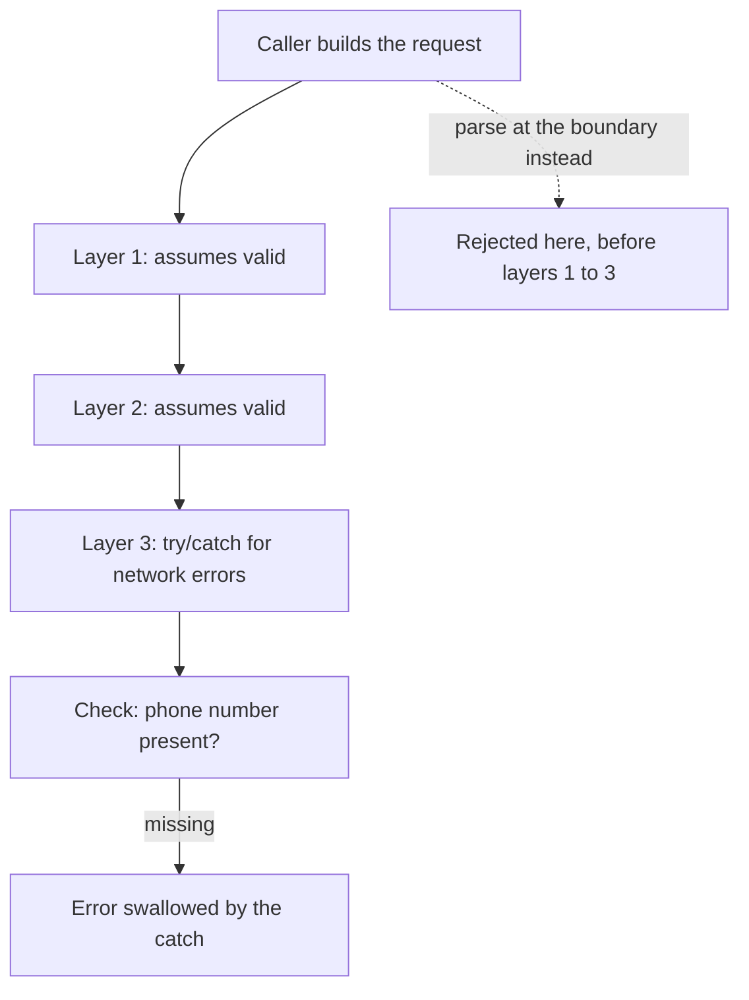
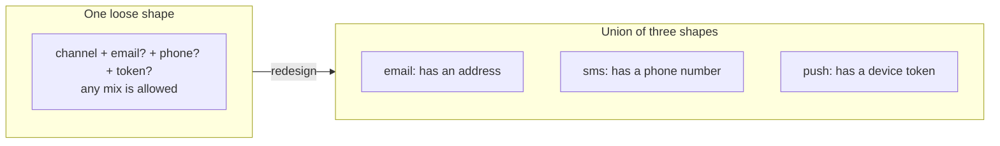

import LevelIntro from "../../../components/LevelIntro.astro";
import Checkpoint from "../../../components/Checkpoint.astro";
import PracticeCheck from "../../../components/PracticeCheck.astro";

export const unit = { track: "software-design", unitSlug: "api-design" };

L1 ended on a call that the function accepted and could never fulfil.
This level explains why the usual fix, a runtime check, is weaker than it
looks, and what a stronger placement and a stronger type buy you.

<LevelIntro
  items={[
    "Why a runtime check can be powerless",
    "How a discriminated union removes the bad shape",
    "Counting what a permissive signature allows",
  ]}
/>

## Why doesn't a runtime check just fix this?

Suppose the sending code does contain `if channel is sms and no phone
number, raise an error`, buried a few calls down. **Then why would the
page still get lost?**

Because that code sits inside a broad `try/catch` written for something
else: swallowing flaky network errors so one failed send does not crash
the pipeline. The missing-number error is caught by the same handler,
logged quietly and dropped. The check was real. Its placement made it
powerless.

Every layer between the caller and a deep check either re-validates or
trusts that someone upstream did. Trust is exactly what failed.

<Checkpoint question="If the same check had run in a parse step at the entry point, before the data reached the layer with the broad try/catch, could that catch still have swallowed it?">

No. The parse step runs and rejects before the data is ever handed to the
code containing that catch, so the catch is simply not on the path between
the bad input and the failure. Moving the check earlier does not make it
more thorough, it makes it unavoidable.

</Checkpoint>

<PracticeCheck
  track={unit.track}
  unitSlug={unit.unitSlug}
  topicId="where-caught"
/>

## How does a type make a bad shape impossible?

**What does "unrepresentable" mean mechanically, and not just "harder"?**
The tool is a **discriminated union**: a type that is exactly one of a
fixed set of shapes, each carrying the fields that shape needs, with a tag
field saying which shape it is.

In the loose shape, "sms with no phone number" is a perfectly legal
value. In the union there is no such value: an `sms` shape always has a
phone number because that is what the shape is, and there is no slot for a
token to sit in by mistake. An `enum` restricts which value you may pick; a
union goes one step further and restricts which other fields exist.

<PracticeCheck
  track={unit.track}
  unitSlug={unit.unitSlug}
  topicId="union-mechanism"
/>

## How big is the misuse surface?

**Does adding "just one more optional field" really matter?** Count the
combinations. If each optional or boolean field is either present or not,
every added field doubles the number of calls a caller could write. The
safe design's count depends only on how many real shapes exist.

| Optional or boolean fields | Combinations a permissive signature allows | Valid shapes in a 3-channel union |
| -------------------------- | ------------------------------------------ | --------------------------------- |
| 2                          | 4                                          | 3                                 |
| 4                          | 16                                         | 3                                 |
| 6                          | 64                                         | 3                                 |
| 10                         | 1,024                                      | 3                                 |

This is a simplified model (it treats each field as on or off and ignores
value ranges), but the doubling is exact for that model. The interactive
demo on this page lets you drag both numbers. It also shows why the first
two defensive moves from L1, minimal surface and safe defaults, are not
style preferences: they shrink the number of wrong calls that exist.

<Checkpoint question="A permissive signature has 4 on/off fields and a union has 3 valid shapes. A teammate adds 2 more fields to the permissive one. How many combinations now, and how many valid shapes in the union?">

The permissive count goes from 16 to 64, because 2 to the power of 6 is 64.
The union still has 3 valid shapes, because adding a field inside a shape
does not add a new shape. Most of the 64 permissive combinations were never
intended or tested.

</Checkpoint>

<PracticeCheck
  track={unit.track}
  unitSlug={unit.unitSlug}
  topicId="surface-and-defaults"
/>

## The trade-off this unit doesn't get to skip

A parsed, union-typed API is safer and costs more: more to define, and a
caller must choose a shape up front. **Is that always worth it?** No. A
helper called from three places you control carries less risk than a public
library called from code you will never see. L3 works the full redesign and
shows where the cost starts to outweigh the benefit.

## Key terms

- **Discriminated union**: a type that is exactly one of a fixed set of
  shapes, each identified by a tag and carrying only its own data.
- **Boundary**: where loosely typed input first enters the system, and the
  right place for a parse step.
- **Combinatorial misuse**: the way wrong calls multiply as optional or
  boolean parameters are added.
