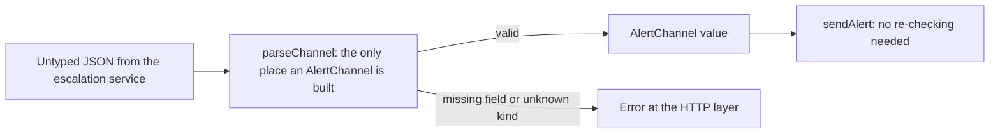
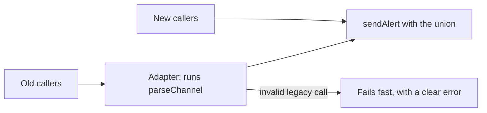

import Scenario from "../../../components/Scenario.astro";
import LevelIntro from "../../../components/LevelIntro.astro";
import Checkpoint from "../../../components/Checkpoint.astro";
import PracticeCheck from "../../../components/PracticeCheck.astro";

export const unit = { track: "software-design", unitSlug: "api-design" };

<Scenario label="The fix is clear. Can it ship to people who already call the old version?">
  <Fragment slot="facts">
    <div class="not-prose flex flex-col gap-2 text-sm text-slate-700 dark:text-slate-300">
      <div class="flex items-center gap-1.5">
        <span>🧩</span> <strong>Old shape</strong> — one request type, every contact field optional
      </div>
      <div class="flex items-center gap-1.5">
        <span>✅</span> <strong>New shape</strong> — three channel shapes, each with its required field
      </div>
      <div class="flex items-center gap-1.5">
        <span>📞</span> <strong>Callers</strong> — existing code written against the old shape
      </div>
      <div class="flex items-center gap-1.5">
        <span>❓</span> <strong>Question</strong> — how do you tighten without breaking them overnight?
      </div>
    </div>
  </Fragment>

Alertly's redesign is obviously better, and it is also a breaking change:
every existing caller passes the old loose request. **How do you get the
safe shape in place without a flag day, and where does the safe shape
stop being the right answer at all?** This level walks the redesign of
`sendAlert`, one small code mechanism, and the trade-offs.

</Scenario>

<LevelIntro
  items={[
    "The redesign and its single construction point",
    "Why the type does not test the parser",
    "Migration, open-ended sets and the cost of ceremony",
  ]}
/>

## The redesign, and the one call it removes

The old request let any channel carry any field. The new one makes the
channel a union, so each shape holds exactly what it needs:

```typescript
type AlertChannel =
  | { kind: "email"; emailAddress: string }
  | { kind: "sms"; phoneNumber: string }
  | { kind: "push"; deviceToken: string };
```

Maya's exact call, `{ kind: "sms", deviceToken: "..." }`, no longer fits
any of those three shapes, so the compiler rejects it before it can be
merged. Inside `switch (channel.kind)`, the branch for `"sms"` can read
`phoneNumber` with no non-null assertion, because the tag proves it exists.



The compiler protects code written in this codebase. Real input arrives as
untyped JSON, so the boundary needs a parser. This is the part where code
is the clearest vehicle, because the point is one concrete rule: each kind
must carry its own field.

```typescript
function parseChannel(raw: Record<string, unknown>): AlertChannel {
  switch (raw.kind) {
    case "sms":
      if (typeof raw.phoneNumber !== "string")
        throw new Error("sms needs phoneNumber");
      return { kind: "sms", phoneNumber: raw.phoneNumber };
    // email and push follow the same pattern
    default:
      throw new Error("unknown kind");
  }
}
```

There is no path past this function that carries `sms` without a phone
number, because it is the only place that builds the value.

<PracticeCheck
  track={unit.track}
  unitSlug={unit.unitSlug}
  topicId="parse-channel"
/>

<Checkpoint question="Suppose the sms branch accidentally checked raw.deviceToken instead of raw.phoneNumber. Would the union type catch that mistake by itself?">

No. The type guarantees that any `sms` value has a phone number, but it
cannot know that the code producing the value checked the right input. It
verifies shape, not the correctness of the function that builds the shape.
Illegal states unrepresentable shrinks the space of bugs sharply, and the
parser itself still deserves direct tests: one for a valid sms, one for
Maya's missing-number case, one for an unknown kind.

</Checkpoint>

## Tightening a live API: what goes wrong, what to do

**When is the safe shape not worth it, and how do you roll it out
anyway?** Each situation below has a different answer.

| Situation                                           | What goes wrong                                                  | What to do                                                               |
| --------------------------------------------------- | ---------------------------------------------------------------- | ------------------------------------------------------------------------ |
| A throwaway script used by two people               | The union plus parser is ceremony the next manual run would beat | Match investment to the cost of being wrong                              |
| A shipped public API with many callers              | Requiring the union breaks every existing caller                 | Add the safe shape as a new function or major version, deprecate the old |
| Channels that third parties register at run time    | A closed union cannot name a kind nobody has thought of yet      | Use a runtime registry of validated handlers, not a bigger union         |
| The union grows from 3 kinds to many over the years | A `switch` that missed the new kind silently does nothing        | Exhaustiveness checking turns the missed case into a compile error       |

For migration, the usual path is a temporary **adapter**: the old function
stays, but internally calls the new parser, so a legacy call with `sms`
and no phone number now fails immediately instead of silently. Callers
migrate on a published schedule and the adapter is deleted on a stated
date. The adapter must never bypass the parse step, or the safety is only
cosmetic.



<PracticeCheck
  track={unit.track}
  unitSlug={unit.unitSlug}
  topicId="tradeoffs"
/>

<Checkpoint question="A plugin system lets outside teams register brand-new notification channels while the service is running. Why is a closed union the wrong tool, and what replaces it?">

A closed union lists every shape at compile time, so it cannot describe a
channel that does not exist yet. The safety has to move to run time: each
registered handler supplies its own validator, and the registry only
accepts input a handler has accepted. You keep the idea (reject invalid
input at the boundary) and change the mechanism.

</Checkpoint>

**Extend it yourself.** This worked example is a case, not the whole
territory. It assumed the danger was a missing field for the chosen
channel. What changes if the real incident had been someone sending one
alert through all three channels at once because they did not realise
`channel` was exclusive? How would you reshape the type if "email and sms
and push together, on purpose" had to become a legitimate, well-typed
option? And what would you do about the old callers who relied on the
exclusive behaviour?

## Key terms

- **Discriminated union**: a closed set of shapes distinguished by a tag,
  each carrying only its own data.
- **Parsing boundary**: the single function where untyped input becomes a
  self-proving type.
- **Exhaustiveness checking**: the compiler flags a `switch` that does not
  handle every member of a union.
- **Adapter**: a temporary bridge that lets old call sites keep working
  while still passing through the new parse step.
