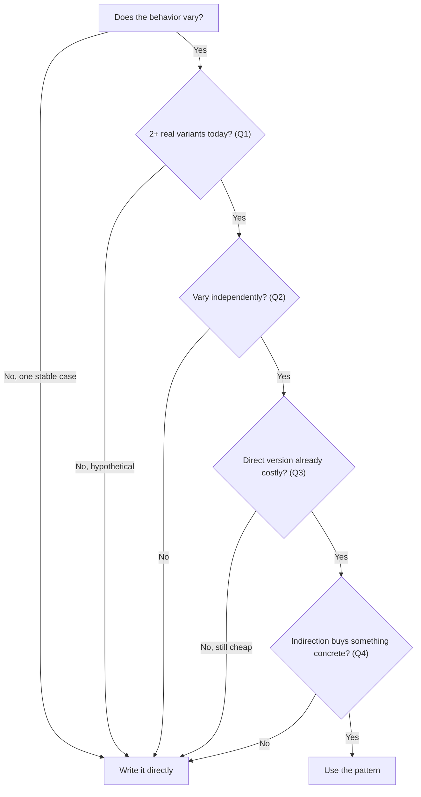
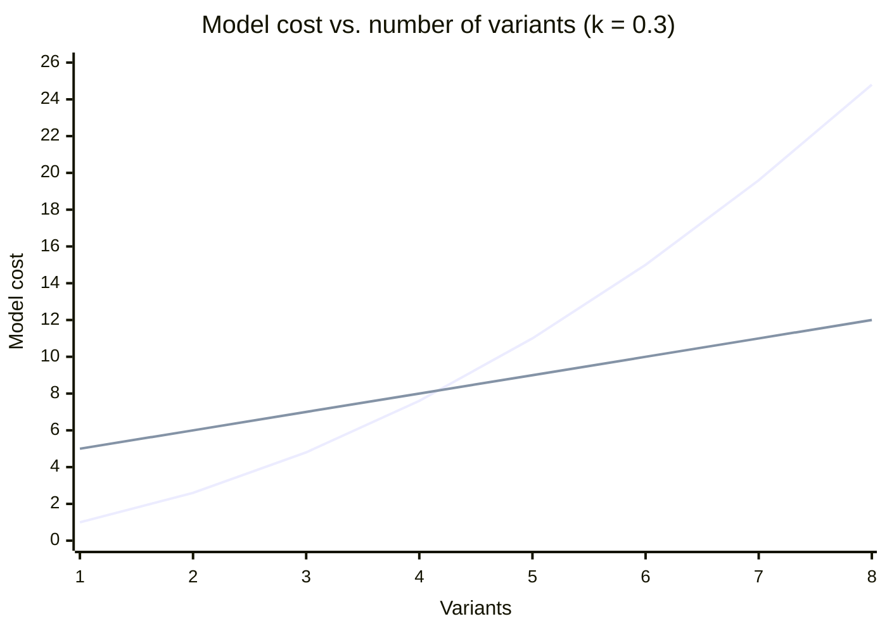

import LevelIntro from "../../../components/LevelIntro.astro";
import Checkpoint from "../../../components/Checkpoint.astro";
import PracticeCheck from "../../../components/PracticeCheck.astro";

export const unit = {
  track: "software-design",
  unitSlug: "classic-design-patterns",
};

L1 named the trap: reaching for a pattern because it sounds like best
practice. This level builds the test that replaces the gut feeling, then
sketches what five common patterns buy and cost, so a review comment can point
at something concrete.

<LevelIntro
  items={[
    "The four-question test a pattern must pass",
    "What five common patterns solve and cost",
    "The cost curves behind the verdict",
  ]}
/>

## What must be true before a pattern earns its cost?

**Is "the code has conditional logic" a reason to add a pattern?** It cannot
be: nearly all code has conditionals, so the sentence filters nothing. The
useful question is narrower: does this behavior vary along a real axis,
independently, more than once, in practice rather than in imagination?

| #   | Question                                                                                           | Why it matters                                         |
| --- | -------------------------------------------------------------------------------------------------- | ------------------------------------------------------ |
| Q1  | Do 2 or more real variants exist today, not imagined future ones?                                  | A pattern for a hypothetical case is a bet             |
| Q2  | Do the variants get added or swapped independently of the surrounding code?                        | If everything changes together, there is no seam       |
| Q3  | Is the direct version already costing something (repeated, growing, hard to test one branch)?      | A short stable if/else has nothing to repay            |
| Q4  | Does the indirection buy something concrete: runtime swap, adding a case without editing old code? | If it is the same logic in more files, it is pure cost |

Mostly "yes" is the signal to use a pattern. Mostly "no" means the plain
version is the right size.

<Checkpoint question="The reviewer's argument was 'it has conditional logic, so it should be a pattern.' Which of the four questions does that argument actually answer?">

None of them. Having conditional logic is not one of the four questions; it
describes almost all code. Q1 is technically satisfied (domestic and
international are two variants), but Q2 and Q3 are not: both branches were
written together, nobody expects them to change independently, and six lines
of if/else cost no one anything. An argument that cannot distinguish this code
from any other code is not a reason to restructure it.

</Checkpoint>

<PracticeCheck
  track={unit.track}
  unitSlug={unit.unitSlug}
  topicId="earn-checklist"
/>

## What does each common pattern buy, and what does it always charge?

**If a pattern's name is shorthand for a problem, which problem does each
common name stand for?** Five that appear constantly in reviews:

| Pattern            | Solves                                                         | Always charges                                  | Good sign                                              | Cargo-cult sign                        |
| ------------------ | -------------------------------------------------------------- | ----------------------------------------------- | ------------------------------------------------------ | -------------------------------------- |
| **Strategy**       | Swapping among interchangeable algorithms                      | 1 interface + 1 class per variant               | 2+ variants, chosen at runtime or config, growing      | 1–2 branches, fixed at compile time    |
| **Factory Method** | Centralizing non-trivial construction that varies by type      | An extra layer over `new`                       | Complex construction reused at many call sites         | A factory that only calls `new Foo()`  |
| **Decorator**      | Adding combinable responsibilities without a subclass per mix  | 1 wrapper per responsibility, deeper call stack | 2+ cross-cutting behaviors combined in different mixes | One behavior applied in one place      |
| **Observer**       | Notifying a changing set of listeners the source does not know | Harder to trace who runs when an event fires    | Several, changing subscribers                          | One hardcoded listener; just call it   |
| **Singleton**      | Exactly one shared instance                                    | Global state, hidden dependencies, hard tests   | A true hard limit of one instance                      | Used only for convenient global access |

Every row has a real problem on the left and an always-paid cost on the right.
The pattern earns its place only when the left column is true of the code in
front of you.

<PracticeCheck
  track={unit.track}
  unitSlug={unit.unitSlug}
  topicId="catalog-cost-buy"
/>

## Same pattern, opposite verdicts: how does the test decide?

Run both of the unit's scenarios through the four questions. The second one
(payment processing at the same company) is worked in L3.

| Question                        | Shipping calculator (2 branches) | Payment processing (5 processors)                   |
| ------------------------------- | -------------------------------- | --------------------------------------------------- |
| Q1: 2+ real variants today?     | Yes (2)                          | Yes (5, still growing)                              |
| Q2: Vary independently?         | No, both added in one change     | Yes, different teams add processors on own schedule |
| Q3: Direct version costing?     | No, 6 stable lines               | Yes, a 40-line chain edited constantly (assumed)    |
| Q4: Indirection buys something? | No, nothing to swap or isolate   | Yes, add a processor without touching others        |
| **Verdict**                     | **Write it directly**            | **Use Strategy**                                    |

Why does the verdict flip? The pattern is the same; the cost curves are not.
The teaching model in this unit's demo counts the direct version as `n + n(n−1)×k`
(each branch costs 1, each interacting pair adds a coupling penalty `k`) and
the Strategy version as `4 + n` (a fixed upfront cost of 4 for the interface and
factory, then 1 per variant). These are modeling numbers, not measurements.
With `k = 0.3` they give:

| Variants `n` | Direct if/else | Strategy |
| ------------ | -------------- | -------- |
| 2            | 2.6            | 6        |
| 4            | 7.6            | 8        |
| 5            | 11             | 9        |
| 8            | 24.8           | 12       |

The lines cross between 4 and 5 variants. Below the crossover the fixed
upfront cost dominates; above it the interaction penalty does. Raise `k` and
the crossover moves left, because tangled branches get expensive sooner.

<Checkpoint question="Suppose the shipping calculator grows to 6 regions, each with different tax rules owned by a different regional team. Does the verdict change, and which question flips it?">

Yes, it likely flips to "use the pattern", and the question that moves first is
Q2. At 2 branches written together there is nothing independent to isolate. At
6 regions changed by separate teams on their own schedules the axis of
variation is real, and a shared if/else block starts costing exactly what Q3
asks about: merge conflicts, one region's change breaking another, no way to
test one region's rule alone. The test reads the code's current shape, so it
has to be re-run when that shape changes.

</Checkpoint>

## What's next

L3 works both scenarios end to end: the right-sized direct version next to the
over-applied one, then payment processing where Strategy and Decorator are
earned, then what the test misses once a pattern outlives its reason.
