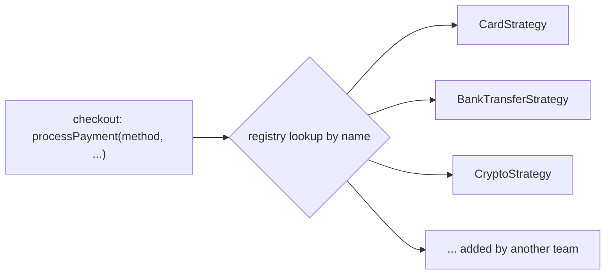
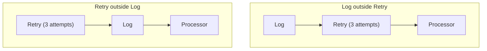

import Scenario from "../../../components/Scenario.astro";
import LevelIntro from "../../../components/LevelIntro.astro";
import Checkpoint from "../../../components/Checkpoint.astro";
import PracticeCheck from "../../../components/PracticeCheck.astro";

export const unit = {
  track: "software-design",
  unitSlug: "classic-design-patterns",
};

<Scenario label="Eighteen months later, the same pattern review comment is right">
  <Fragment slot="facts">
    <div class="not-prose flex flex-col gap-2 text-sm text-slate-700 dark:text-slate-300">
      <div class="flex items-center gap-1.5"><span>💳</span> <strong>Payment processors</strong> — 5 live: card, wallet, bank transfer, crypto, buy-now-pay-later</div>
      <div class="flex items-center gap-1.5"><span>👥</span> <strong>Owners</strong> — a different team per processor, separate release schedules</div>
      <div class="flex items-center gap-1.5"><span>📜</span> <strong>Checkout function</strong> — a 40-line if/else chain (assumed size for this example)</div>
      <div class="flex items-center gap-1.5"><span>🔥</span> <strong>Pain</strong> — every new processor edits the same function, so teams collide</div>
    </div>
  </Fragment>

At the same fictional company, Widgetly, the payments code looks nothing like
the shipping calculator. Five processors are live, each added by a different
team. Every addition edits one shared checkout function, and teams keep
colliding in it. **The same reviewer says "use Strategy" again. Last time that
was wrong. What changed about the code, and how do you prove it is right this
time rather than just repeating the slogan?**

</Scenario>

<LevelIntro
  items={[
    "The right-sized shipping version, and where it stops being enough",
    "Strategy and Decorator earned by payment processing",
    "Failure modes: patterns that outlive their reason",
  ]}
/>

This level is a worked case, not the whole territory: two scenarios and two
patterns. The closing question asks you to extend it to a third.

## What does the right-sized shipping version look like?

Over-applied, the review comment produces an interface, two classes, a factory
and a function that calls them: five declarations for what a lookup does. The
right-sized version is the same behavior as data:

```ts
const SHIPPING_COST = { domestic: 5.99, international: 5.99 + 12.5 };
const getShippingCost = (region: "domestic" | "international") =>
  SHIPPING_COST[region];
```

A third region is a one-line addition. The direct version is not "less
extensible"; it is exactly as extensible as the problem currently needs.

<Checkpoint question="A reviewer objects: 'what if international later needs weight-based pricing? A plain object cannot hold logic.' Does that force the Strategy pattern?">

It exposes a limit of a lookup of numbers, not of staying pattern-free. A
lookup of functions, one per region, already gives per-region logic of any
complexity, because functions are values. That gets most of what Strategy buys
(swappable behavior per key) with no interface or factory. The honest reason to
move to full class-based Strategy is when each variant needs state or lifecycle
a closure holds badly: open connections, multi-step setup, injected
collaborators. A calculation getting somewhat harder is not one of the four
questions.

</Checkpoint>

<PracticeCheck
  track={unit.track}
  unitSlug={unit.unitSlug}
  topicId="right-sized-first"
/>

## Payment processing: do all four questions pass?

Run the test against what the payments code actually looks like:

| Question | Evidence in this scenario                                               | Result |
| -------- | ----------------------------------------------------------------------- | ------ |
| Q1       | 5 variants live in production                                           | Yes    |
| Q2       | The crypto team ships on a schedule unrelated to the bank-transfer team | Yes    |
| Q3       | The shared chain is the most conflict-prone function in the service     | Yes    |
| Q4       | Each processor must be unit-tested against a fake, alone                | Yes    |

All four pass, so Strategy is earned. The part that earns it is not the
interface; it is the registry that lets a team add a variant without editing a
shared file:

```ts
interface PaymentStrategy {
  charge(amountCents: number, customerId: string): Promise<{ ok: boolean }>;
}
const registry = new Map<string, PaymentStrategy>();
registry.set("card", new CardStrategy());
registry.set("bank", new BankTransferStrategy());
// the crypto team adds one line in their own change, touching nobody else's code
```



The difference from the shipping version is not the code shape. It is that each
variant has its own owner, schedule and test, so Q2 and Q4 are facts here, not
hopes.

## Decorator: when are layered behaviors earned?

Once payments sit behind one interface, a second need appears: some processors
should retry on transient failure and all should log, but the crypto gateway
must not auto-retry a failed charge. Decorator's problem is exactly this:
combinable behaviors applied to some implementations of one interface, without
a class per combination.

| Processor     | Retry | Log | Wrapping (inside to outside) |
| ------------- | ----- | --- | ---------------------------- |
| Card          | Yes   | Yes | Card, then Retry, then Log   |
| Bank transfer | Yes   | Yes | Bank, then Retry, then Log   |
| Crypto        | No    | Yes | Crypto, then Log             |

Without Decorator the alternatives are a class per combination (three classes
for two behaviors, and the count doubles per added behavior) or a `shouldRetry`
flag copied into every processor. Decorator is earned here because the
behaviors genuinely combine in different mixes. It would not be earned if every
processor ended up in the same fixed stack: the independent combination the
pattern exists for would have stopped being true.

Order matters, and it is a classic undocumented decision:



With Log outside, one log line describes the whole charge, however many retries
happened. With Retry outside, each attempt is logged separately (up to 3 lines
for one charge). Neither is wrong; an unwritten choice is.

<Checkpoint question="If Log wraps Retry, and a charge fails twice then succeeds, how many log entries describe the charge, and what can you no longer see?">

One entry, for the final outcome. You can no longer see from the logs that two
attempts failed first, which is exactly the signal an on-call engineer wants
when a processor is flaky. Whether that is the right trade depends on what the
logs are for, which is why the intended order should be written down at the
place where the wrappers are assembled.

</Checkpoint>

<PracticeCheck
  track={unit.track}
  unitSlug={unit.unitSlug}
  topicId="earned-in-practice"
/>

## Failure modes: when does a correct pattern become a wrong one?

| Failure mode                                   | What it looks like                                                                 | How to catch it                                                    |
| ---------------------------------------------- | ---------------------------------------------------------------------------------- | ------------------------------------------------------------------ |
| Adopted correctly, outlived its reason         | Payments drop to 2 stable processors; the registry now serves two fixed cases      | Re-run the four questions on long-lived code, not only at adoption |
| Interface built for imagined variants          | A shipping interface created "just in case" before a second region exists          | Q1 fails honestly: wait for the second real case                   |
| Decorator order is load-bearing, undocumented  | Log-outside and Retry-outside behave differently and nobody wrote which is meant   | State the intended order where wrappers are composed               |
| Registration hides what actually runs          | Stepping through a charge requires knowing the registry was filled in another file | Keep registration in one visible place, run eagerly                |
| Pattern used to avoid a file another team owns | A wrapper added to dodge a shared file, not because behavior is independent        | Ask Q2 honestly: independent ownership versus avoidance            |

The first row is the one to dwell on: the test is a snapshot, not a license. If
Widgetly later consolidates to 2 permanent processors, the unchanged code has
quietly become the over-applied case from the shipping calculator, and nobody's
review comment will say so unless someone re-asks the questions of the code as
it stands now.

<Checkpoint question="Payments consolidate permanently from 5 processors to 2. What is the honest verdict now, and is deleting the interface the right immediate move?">

The verdict matches the shipping calculator's: Q1 still technically passes
(2 is at least 2) but Q2 and Q3 no longer do, because no independent variation
is left to isolate. Deleting the interface at once is a migration with its own
cost (every call site and test), weighed against how long the team expects to
stay at 2. The usual realistic move is smaller: stop pretending new processors
are coming, and collapse to the direct version the next time this code needs a
substantial change anyway.

</Checkpoint>

<PracticeCheck
  track={unit.track}
  unitSlug={unit.unitSlug}
  topicId="outlive-and-order"
/>

## Extend it yourself

This case covered two scenarios and two patterns, not the whole territory.
Try a third on your own. Widgetly's checkout must notify three unrelated
systems whenever an order completes: a confirmation email, a fraud-scoring
service and an analytics feed. All three calls are hardcoded, in order, inside
`completeOrder()`, and three different teams own them.

- Run the four questions. Which pass today, and what would make Q3 pass next
  quarter?
- Which pattern in L2's table fits "notify a changing set of listeners the
  source does not know"? Sketch its interface.
- What would make that the wrong call: say all three must run in a fixed order,
  and a failure in any of them must roll back the whole order. Does that change
  which pattern fits, or whether any pattern fits?
