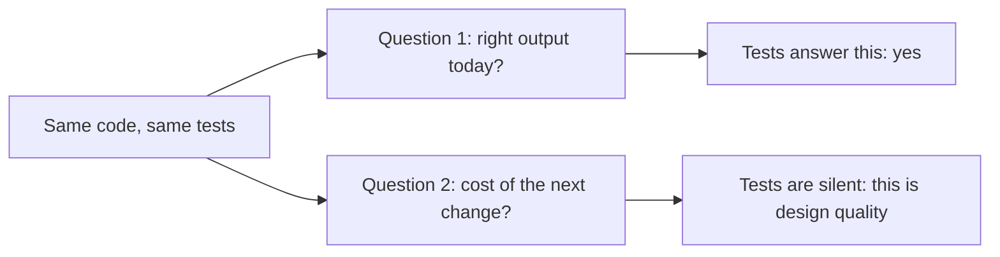

import Scenario from "../../../components/Scenario.astro";
import LevelIntro from "../../../components/LevelIntro.astro";
import PracticeCheck from "../../../components/PracticeCheck.astro";

export const unit = { track: "software-design", unitSlug: "cost-design" };

<Scenario label="The six-month bill">
  <Fragment slot="facts">
    

      
✅ <strong>Month 1 test result</strong> — passes

      
✅ <strong>Month 6 test result</strong> — still passes

      
⏱️ <strong>Cost of a small change</strong> — 2 hours, then 3 weeks

    

    

      Illustrative numbers for the story, not measurements from a real team.
    

  </Fragment>

A checkout function ships in month one. It passes every test, and the team
moves on. In month six, two requests of the same size arrive. Adding a
currency field takes the two hours everyone expected. Adding a
discount-code field takes three weeks, and two people are afraid to touch the
function at all. (The numbers are made up to show the shape of the problem.)

| Month | Change requested          | Expected | What happened |
| ----- | ------------------------- | -------- | ------------- |
| 1     | Add a currency field      | 2 hours  | 2 hours       |
| 6     | Add a discount-code field | 2 hours  | 3 weeks       |

**The request is the same size and the tests are still green. What changed,
and why does no test report it?**

</Scenario>

<LevelIntro
  items={[
    "Correctness versus design quality",
    "Coupling and cohesion in one line each",
    "Why bad design is a cost that compounds",
  ]}
/>

## What do the tests measure, and what do they miss?

**If the tests pass in month 1 and in month 6, what are they telling you?**
Only that the code produces the right output for the inputs tested. They
ask nothing about how much work the _next_ change will take.

| Question                                | Name           | Who notices, and when                     |
| --------------------------------------- | -------------- | ----------------------------------------- |
| Is the output right for tested inputs?  | Correctness    | The test suite, immediately               |
| What does the next change cost to make? | Design quality | The person making that change, much later |

The cost of poor design is invisible at write time. The person who skips the
design work rarely pays for it right away, which is exactly why it is easy to
under-invest in.

<PracticeCheck
  track={unit.track}
  unitSlug={unit.unitSlug}
  topicId="design-vs-correctness"
/>

## What is design quality made of?

Two properties explain most of it:

| Property     | High means                                             | Low means                                   |
| ------------ | ------------------------------------------------------ | ------------------------------------------- |
| **Coupling** | Changing module A forces changes in module B (bad)     | They talk through a small, stable interface |
| **Cohesion** | One module bundles several unrelated reasons to change | One module has exactly one reason to change |

- **Coupling** is how entangled two pieces are. High coupling is bad.
- **Cohesion** is how well a piece's jobs belong together. Low cohesion is bad.
- **Technical debt** is the useful metaphor: a deliberate shortcut can be a
  fair trade, but left alone it accrues interest, because every change built
  on top costs a little more than the last.

## The trade this unit examines

Careful design costs more time now in return for cheaper changes later. It
is a real trade, not a free lunch, and it pays off only if the code is going
to be changed again. Over-engineering for changes that never come is its own
cost (covered in L3). The skill is judging how much design a piece of code is
worth, given how often and how unpredictably it will change.
