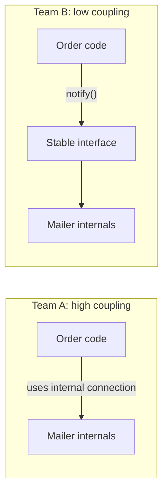
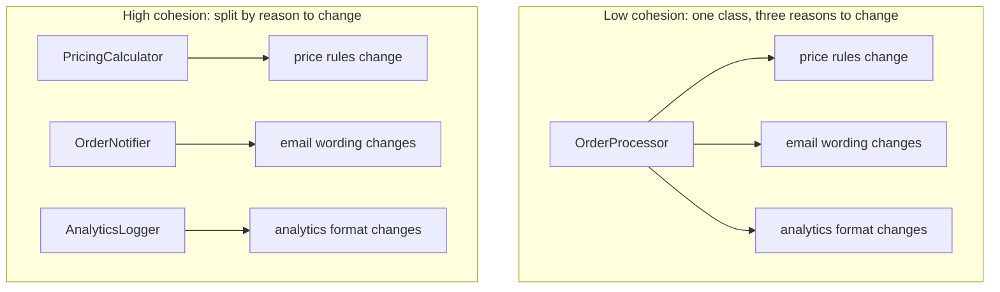
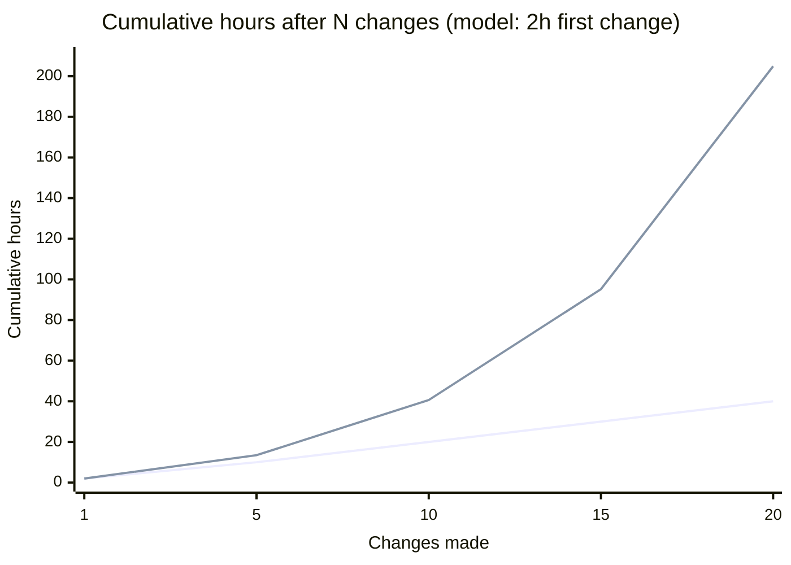

import Scenario from "../../../components/Scenario.astro";
import LevelIntro from "../../../components/LevelIntro.astro";
import Checkpoint from "../../../components/Checkpoint.astro";
import PracticeCheck from "../../../components/PracticeCheck.astro";

export const unit = { track: "software-design", unitSlug: "cost-design" };

<Scenario label="Two teams, same requirement">
  <Fragment slot="facts">
    <div class="not-prose flex flex-col gap-1.5 text-sm text-slate-700 dark:text-slate-300">
      <div class="flex items-center gap-1.5"><span>🔗</span> <strong>Team A</strong> — reaches into the mailer's internals directly</div>
      <div class="flex items-center gap-1.5"><span>🧩</span> <strong>Team B</strong> — calls one stable <code>notify()</code> method</div>
    </div>
    <div class="not-prose mt-3 rounded border border-amber-300 bg-amber-50 p-1.5 text-xs dark:border-amber-800 dark:bg-amber-950">
      Both ship the identical feature today. The difference only shows when something else changes.
    </div>
  </Fragment>

Two teams build the same order-confirmation feature. Team A's order code
reaches into the mailer's internal connection object and sends the message
itself. Team B's order code just calls `notifier.notify(order)` on whatever it
was given. Both pass review, both pass every test, both ship this week.

**If both do the same thing today, what question would tell you which design
is better, and why can't "does it work" answer it?**

</Scenario>

<LevelIntro
  items={[
    "Coupling: the size of the breakage surface",
    "Cohesion: one reason to change",
    "How both bend the cost curve",
  ]}
/>

## What actually makes Team A riskier than Team B?

Neither has a bug today. The difference is the **surface a future, unrelated
change could break**.



In pseudocode, the whole difference is one line:

```text
Team A:  mailer.connection.send_raw(build_message(order))   # depends on internals
Team B:  notifier.notify(order)                             # depends on a promise
```

Team B is not better because it is shorter. The set of mailer changes that
could break the order code shrank from "almost anything" to "changing what
`notify()` means", a small and deliberate surface.

<Checkpoint question="Team C's order code calls only notify(order), but the class behind notify() imports and calls into three unrelated internal services. Has Team C achieved low coupling?">

Between the order code and the notifier, yes. But coupling is a property of
every relationship in the system, not just the one you checked. The notifier
reaching into three unrelated services is Team A's mistake one layer deeper:
a change to any of those services can still ripple outward, passing through
the notifier first. A narrow interface at one boundary says nothing about the
boundaries behind it.

</Checkpoint>

<PracticeCheck track={unit.track} unitSlug={unit.unitSlug} topicId="coupling" />

## Is a module cohesive just because its parts touch the same data?

**Two methods both read the same order. Does that make them belong together?**
No. The test is whether they would ever change for the same reason.



Pricing, email wording and analytics format are three independent reasons to
change code. Bundled in one file, an edit for any one of them risks breaking
the other two, purely because they share a file.

<Checkpoint question="A developer splits OrderProcessor into three classes, but each one still reaches into the other two to share state. Did the split help?">

It raised cohesion inside each class, since each now has one reason to
change. But reaching across the new classes brought coupling back, the same
kind Team A had. The two are separate measurements, not opposites you trade:
a real improvement splits by reason to change and then lets the pieces talk
through narrow interfaces.

</Checkpoint>

<PracticeCheck track={unit.track} unitSlug={unit.unitSlug} topicId="cohesion" />

## How do the two properties bend the cost curve?

**Why do early changes cost the same under both designs, and later ones
don't?** Every future change must (1) work out what else it might affect, and
(2) touch only what is relevant.

| A change must…                 | Harder under… | Because…                                           |
| ------------------------------ | ------------- | -------------------------------------------------- |
| Find out what else might break | High coupling | Dependents reach past the interface into internals |
| Touch only what is relevant    | Low cohesion  | Unrelated logic is tangled into the same unit      |

Here is the effect as a model, using the unit's own demo formula: the first
change costs 2 hours, and under the coupled design each later change costs 15%
more than the one before (an assumed penalty, not a measurement).



The lines are almost together at the start, which is why bad design is easy
to miss. Coupling and cohesion do not cause bugs directly; they multiply the
cost and risk of every later change.
