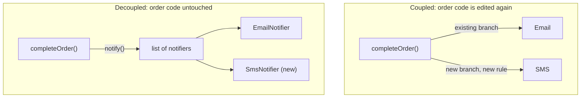

import Scenario from "../../../components/Scenario.astro";
import LevelIntro from "../../../components/LevelIntro.astro";
import Checkpoint from "../../../components/Checkpoint.astro";
import PracticeCheck from "../../../components/PracticeCheck.astro";

export const unit = { track: "software-design", unitSlug: "cost-design" };

<Scenario label="Channel number four">
  <Fragment slot="facts">
    <div class="not-prose flex flex-col gap-1.5 text-sm text-slate-700 dark:text-slate-300">
      <div class="flex items-center gap-1.5"><span>📧</span> <strong>Today</strong> — orders send an email</div>
      <div class="flex items-center gap-1.5"><span>💬</span> <strong>Request</strong> — also send a text for big orders</div>
      <div class="flex items-center gap-1.5"><span>📈</span> <strong>Later</strong> — push, chat alert, a new text vendor…</div>
    </div>
    <div class="not-prose mt-3 rounded border border-amber-300 bg-amber-50 p-1.5 text-xs dark:border-amber-800 dark:bg-amber-950">
      Compare how much of the existing order code each design must edit.
    </div>
  </Fragment>

L2's two designs shipped the same feature and could not be told apart by
behaviour. Now a second requirement arrives: also send a text message for
high-value orders. **Both designs can ship it. So what is being measured?**
Not whether it ships, but how much existing code each one has to touch to
make it happen.

</Scenario>

<LevelIntro
  items={[
    "Where the edit lands in each design",
    "How per-change cost compounds",
    "When design investment is not worth it",
  ]}
/>

## Where does the new requirement land?



In the coupled design the order code gains an edge and a business rule
("only above a value") that has nothing to do with completing an order. In
the decoupled design the new class attaches to the list, and the rule lives
inside it, where text-message policy belongs.

The decoupled shape is only a few lines, which is why it is worth showing:

```js
class OrderService {
  constructor(notifiers) {
    this.notifiers = notifiers; // anything with notify(order)
  }
  completeOrder(order) {
    for (const n of this.notifiers) n.notify(order);
  }
}
```

Adding channel four means writing one small class and adding it to the list.
`OrderService` is never edited again.

<Checkpoint question="If a fourth channel is added to the coupled design the same way SMS was, does review and test effort grow by the same amount SMS added, or more?">

More. Each new branch adds its own logic and also a possible interaction with
every branch already in the method: a reviewer must reason about whether the
new rule collides with the others, and tests must cover a growing set of
combinations. That is why the coupled line in L2's chart curves upward rather
than staying straight: each channel lands in a method more tangled than the
last one did.

</Checkpoint>

<PracticeCheck
  track={unit.track}
  unitSlug={unit.unitSlug}
  topicId="compounding-cost"
/>

## How big does the compounding get?

**A 15% growth per change sounds small. How small is it really?** Using the
demo's model (2 hours for the first channel, each later one 15% costlier),
checked in Node:

| Channels added | No penalty (hours) | 15% penalty (hours) | Ratio |
| -------------- | ------------------ | ------------------- | ----- |
| 4              | 8                  | 9.99                | 1.2x  |
| 10             | 20                 | 40.61               | 2.0x  |
| 20             | 40                 | 204.89              | 5.1x  |

At four channels the gap is easy to shrug off (about 2 hours). At twenty, the
same small penalty has turned 40 hours into about 205. The 10th channel alone
costs 7.04 hours against a flat 2. The percentage is an assumption you can
change in the slider demo; the compounding shape is the point, not the
specific number.

## When is the investment not worth it?

**If decoupling is cheaper over the long run, why not do it everywhere?**
Because it costs something up front, and the saving exists only if a change
actually arrives.

| Failure mode                          | What it actually costs                              |
| ------------------------------------- | --------------------------------------------------- |
| Over-engineering ahead of need        | Time on an abstraction that is never used           |
| "More files" mistaken for cohesion    | Navigation overhead with none of cohesion's benefit |
| Technical debt treated as all-or-none | Paid too eagerly, or left to compound               |
| Refactoring with no change driving it | Bug risk for a benefit that may never arrive        |

- **Over-engineering.** If there will only ever be one channel, a list of
  notifiers is pure cost. The decoupled design earned its complexity because a
  second channel was a concrete requirement, not a hypothetical one.
- **More files is not cohesion.** Splitting code that still changes together
  adds navigation work and no benefit. The metric is independent reasons to
  change, not file count.
- **Debt is a spectrum.** A quick coupled version shipped for a real deadline,
  with a plan to revisit, is a fair trade. The same code left for two years
  while more channels pile on has accrued interest, and the refactor is far
  larger than it would have been at the second channel.
- **Refactoring without a driver.** Rewriting working, rarely touched code
  spends real time and bug risk for a payoff that needs a future change to
  show up.

<Checkpoint question="A module has not changed in two years and nothing on the roadmap touches it. Its coupling is high. Should it be refactored this quarter?">

Probably not. The cost of high coupling is paid on _changes_, and no change is
coming, so the refactor spends effort and risks new bugs for no scheduled
benefit. If a requirement that touches it appears, that is the moment the
investment starts paying back, and the right time to do it.

</Checkpoint>

<PracticeCheck
  track={unit.track}
  unitSlug={unit.unitSlug}
  topicId="invest-judgment"
/>

## This was one worked example, not the whole territory

Channels with one `notify(order)` method is a small, legible case.
**What changes if the next requirement is "retry the text three times with
increasing delay, only for large orders"?** The decoupled design still leaves
`OrderService` alone, because that is text-specific policy. But `SmsNotifier`
is no longer a two-line class, and its own cohesion becomes the next
question, using L2's test: do building the message, timing the retries and
deciding who qualifies change for the same reason? And what if the news were
worse, for example the notifiers must run in a strict order and one failure
must cancel the rest? Try the same questions on a case of your own.
