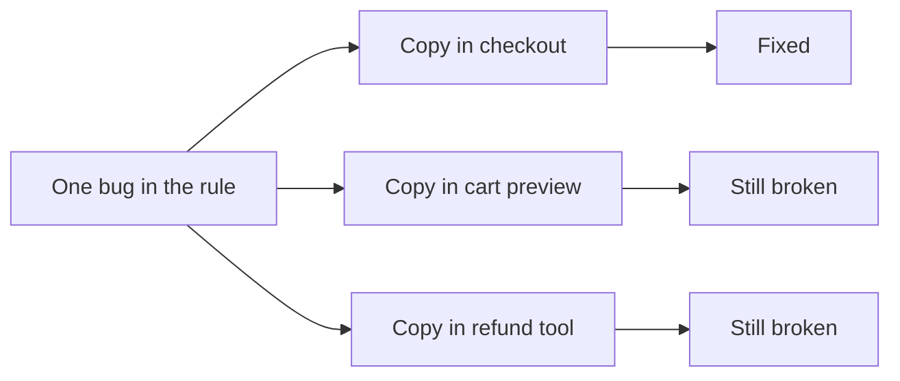

import Scenario from "../../../components/Scenario.astro";
import LevelIntro from "../../../components/LevelIntro.astro";
import PracticeCheck from "../../../components/PracticeCheck.astro";

export const unit = {
  track: "software-design",
  unitSlug: "dry",
};

<Scenario label="One typo in the recipe, fixed on only one of three cards">
  <Fragment slot="facts">
    

      
📇 <strong>The copies</strong> — the same cake recipe on 3 index cards, one per kitchen drawer

      
✏️ <strong>The typo</strong> — "2 cups of salt" instead of "2 pinches"

      
🔧 <strong>Fixed on</strong> — 1 card; the other 2 still say cups

    

    

      

        
Cards corrected1 of 3

        

      

    

  </Fragment>

A family copies one cake recipe onto three index cards and keeps one in each
kitchen drawer. Someone notices the card says "2 cups of salt" and corrects it
on the card in their hand. Next week the cake is ruined again, from a different
drawer. **The mistake was "already fixed". Why did it bite twice more?**

</Scenario>

The fix only reached the card the person happened to be holding. Nothing
linked the three cards except the fact that someone once copied them. Code
pasted in several places behaves the same way: one bug, living in three
places, corrected in one.

<LevelIntro
  items={[
    "Why pasted copies keep a fixed bug alive",
    "True versus coincidental duplication",
    "Premature abstraction as the opposite mistake",
  ]}
/>

## What does a pasted copy cost you later?

**Pasting feels free, so where does the bill arrive?** Not when you paste. It
arrives the day the logic has to change: every copy must be found and changed,
correctly, and a copy nobody remembers is a bug waiting to be reported again.

**DRY (Don't Repeat Yourself)** is the rule that answers this: each piece of
knowledge should live in exactly one place, so a change happens once.

<PracticeCheck
  track={unit.track}
  unitSlug={unit.unitSlug}
  topicId="copy-paste-cost"
/>

## Is all duplication the same problem?

**If two pieces of code look alike, must they be merged?** No, and this is the
catch. Imagine two cards that both say "bake for 30 minutes": one for a cake,
one for a casserole. They look identical today. If the cake recipe changes to
35 minutes, the casserole must not follow. Same text, unrelated rules.

| Kind of duplication | What it means                                  | Right move                                |
| ------------------- | ---------------------------------------------- | ----------------------------------------- |
| True                | Same rule; a change must hit every copy        | Extract one shared function               |
| Coincidental        | Different rules that look alike today          | Leave them separate                       |
| Wrong move for each | Leaving true copies to drift; merging the rest | Missed copies drift; forced merges tangle |

<PracticeCheck
  track={unit.track}
  unitSlug={unit.unitSlug}
  topicId="two-kinds"
/>

## Key terms

- **DRY** — every piece of knowledge has one unambiguous home.
- **True duplication** — copies of the _same underlying rule_, which must always change together.
- **Coincidental duplication** — code that looks alike now but exists for different reasons and will change independently.
- **Premature abstraction** — extracting a shared function before there is evidence the duplication is the true kind; the result is often more tangled than the copies it replaced.

## What the next levels cover

L2 gives the test for telling the two kinds apart, the rule of three, and the
concrete warning sign of a forced abstraction. L3 works one full example:
three pasted discount functions, a justified extraction, and a new rule that
tempts the same trap.
