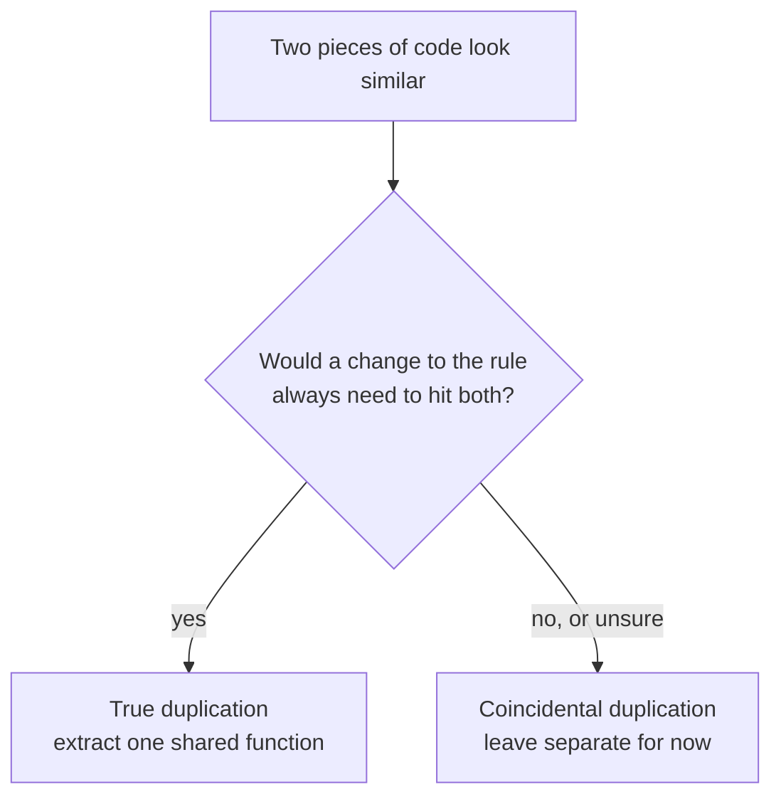
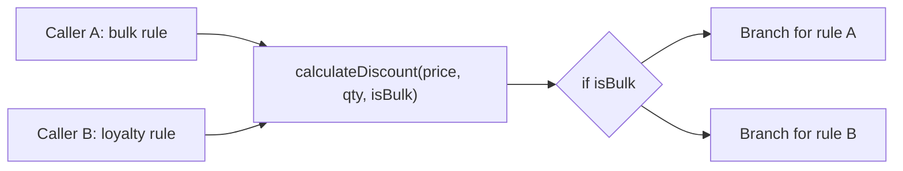

import LevelIntro from "../../../components/LevelIntro.astro";
import Checkpoint from "../../../components/Checkpoint.astro";
import PracticeCheck from "../../../components/PracticeCheck.astro";

export const unit = {
  track: "software-design",
  unitSlug: "dry",
};

L1 named two kinds of duplication and warned that merging the wrong kind
produces a forced abstraction. L2 gives the test for telling them apart, an
evidence rule for when to extract, and the concrete sign that you extracted
too early.

<LevelIntro
  items={[
    "The same-reason-to-change test",
    "The rule of three as evidence",
    "The flag that stitches two rules together",
  ]}
/>

## Do these two pieces change for the same reason?

**Two cards both say "bake for 30 minutes". Is that proof they are one rule?**
No. DRY does not ask "do these look the same?". It asks "do these express the
same underlying rule, so that a change to the rule must hit both places?" A
tax calculation and a discount calculation might both multiply by a
percentage and round to two decimals. Same shape, two rules.

**Why does merging coincidental code hurt if it was identical anyway?**
Identical today is not identical tomorrow. When one rule changes and the
other does not, the shared function must grow a branch or a parameter to
serve both callers. The second change did not disappear; it moved inside the
shared function, where it must avoid breaking the first caller too.

<PracticeCheck
  track={unit.track}
  unitSlug={unit.unitSlug}
  topicId="same-reason-test"
/>

## When is it safe to extract?

**How many copies are enough evidence?** A common heuristic is the **rule of
three**: tolerate duplication the first two times, extract on the third. The
number is not magic. It is a proxy for evidence: a third case shows which parts
are constant and which vary.

| Occurrences | What to do                             | Why                                                |
| ----------- | -------------------------------------- | -------------------------------------------------- |
| 1           | Nothing                                | One instance cannot be duplicated                  |
| 2           | Usually leave it, and take note        | Cannot yet tell same rule from coincidence         |
| 3 or more   | Extract once the shared shape is clear | Enough cases to see what is constant versus varied |

<Checkpoint question="Two near-identical pieces of code exist today. Per the rule of three, should you extract a shared function right now?">

Not yet. Two cases cannot tell you whether the matching part is the rule or
just how each copy was first written. Extracting now means guessing where the
abstraction's boundary belongs. Leave them, note them, and extract when a third
case shows what actually varies.

</Checkpoint>

<PracticeCheck
  track={unit.track}
  unitSlug={unit.unitSlug}
  topicId="rule-of-three"
/>

## What does a forced abstraction look like?

**What is the concrete warning sign that you extracted too early?** A
parameter, usually a boolean, that exists only so one function can behave
differently for two callers that never shared a rule. `calculateDiscount(price,
qty, isBulk)` is not one rule with a variation; it is two rules joined by an
`if`, and every future caller must understand both branches to use either.

<Checkpoint question="A function formatPrice(amount, isRefund) adds a minus sign when isRefund is true. Does the flag alone prove a forced abstraction?">

No, the flag is a prompt to check, not a verdict. If both cases really are "format this number, optionally negated" and nothing else will ever differ, the
flag is a narrow variation on one rule. If refunds will later need their own
symbol, rounding or layout, the flag is the same warning sign as `isBulk`:
two rules stitched together before there was evidence they change together.

</Checkpoint>

<PracticeCheck
  track={unit.track}
  unitSlug={unit.unitSlug}
  topicId="flag-warning-sign"
/>

## DRY is about knowledge, not text

**Does DRY mean never writing similar-looking code twice?** No. Two pieces of
code can look completely different and still violate DRY if they encode one
business rule twice, for example "never discount more than the full price"
written as `100` in one file and `1.0` in another. And identical-looking code
can be perfectly fine if the rules are separate. The judgment is always about
the underlying knowledge.
