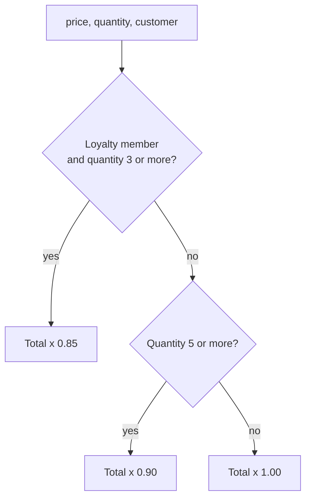

import Scenario from "../../../components/Scenario.astro";
import LevelIntro from "../../../components/LevelIntro.astro";
import Checkpoint from "../../../components/Checkpoint.astro";
import PracticeCheck from "../../../components/PracticeCheck.astro";

export const unit = {
  track: "software-design",
  unitSlug: "dry",
};

<Scenario label="A shared function, a new rule, and an order nobody chose">
  <Fragment slot="facts">
    <div class="not-prose flex flex-col gap-2 text-sm text-slate-700 dark:text-slate-300">
      <div class="flex items-center gap-1.5"><span>📋</span> <strong>Start</strong> — 10% off at quantity 5 or more, pasted into 3 places</div>
      <div class="flex items-center gap-1.5"><span>🔧</span> <strong>Extraction</strong> — one shared function, earned by 3 real copies</div>
      <div class="flex items-center gap-1.5"><span>⚠️</span> <strong>The trap</strong> — a loyalty rule (15% off at quantity 3 or more) added as a flag</div>
      <div class="flex items-center gap-1.5"><span>🧮</span> <strong>The overlap</strong> — 5 units at $10 for a loyalty customer fit both rules</div>
    </div>
  </Fragment>

A shop gives 10% off when you buy 5 or more. Management adds a loyalty rule:
members get 15% off from 3 units. A member buys 5 units at $10 each, so both
rules apply. **What should the total be, and who decided?**

</Scenario>

L2 gave the test (same reason to change?) and the rule of three (evidence
before extracting). This case applies both: a justified extraction first, then
a new requirement that tempts the trap.

<LevelIntro
  items={[
    "An extraction that earned its place",
    "How a flag hides a priority decision",
    "Ordered rules as the explicit fix",
  ]}
/>

## Step 1: three copies of one rule, then an earned extraction

Checkout, the cart preview and the refund tool each carry the same rule:
10% off at quantity 5 or more. That is true duplication (one rule, must change
everywhere at once) and it is the third occurrence, so the evidence is real.

```js
function applyBulkDiscount(price, quantity) {
  const total = price * quantity;
  const discounted = quantity >= 5 ? total * 0.9 : total;
  return Math.round(discounted * 100) / 100;
}
```

For price 10, quantity 5 this returns 45; for quantity 4 it returns 40.

<Checkpoint question="What made this extraction safe rather than premature?">

Two things were both true: the three copies were the same rule (not three rules
that merely looked alike), and there were three real occurrences, enough to
see what was constant. A fourth copy would change nothing; a second copy would
not have been enough.

</Checkpoint>

## Step 2: the trap, a second rule behind a flag

The shared function is right there, so the loyalty rule gets a flag:

```js
function applyDiscount(price, quantity, isLoyalty) {
  const total = price * quantity;
  let discounted = total;
  if (isLoyalty && quantity >= 3) discounted = total * 0.85;
  else if (quantity >= 5) discounted = total * 0.9;
  return Math.round(discounted * 100) / 100;
}
```

Every old bulk-only call still returns what it did. But the overlap case now
has three defensible answers, and the code silently picked one:

| Quantity | Loyalty | Total (price 10) | Rule applied                               |
| -------- | ------- | ---------------- | ------------------------------------------ |
| 2        | no      | 20               | none                                       |
| 3        | no      | 30               | none (bulk starts at 5)                    |
| 3        | yes     | 25.5             | loyalty                                    |
| 5        | no      | 45               | bulk                                       |
| 5        | yes     | 42.5             | loyalty, because its `if` is written first |

For the last row the alternatives were 45 (bulk wins) or 38.25 (both stack,
since 50 × 0.85 × 0.9). Nobody chose 42.5; it fell out of which branch came
first. You can move the quantity and loyalty sliders in the demo to see where
the answer flips.

<Checkpoint question="Why did every existing test keep passing while the priority bug shipped?">

The old tests only ever ran one rule at a time, so none exercised a call where
both rules apply. Passing tests prove the cases someone thought of still work.
They say nothing about a case that only became possible when the second rule
arrived.

</Checkpoint>

<PracticeCheck
  track={unit.track}
  unitSlug={unit.unitSlug}
  topicId="hidden-priority"
/>

## Step 3: composition makes the priority visible



In code this is an ordered list of rules, each with its own condition and
rate, and the first rule that applies wins. Results are identical to Step 2,
so this is a legibility change, not a behavior change. The list order is now
the written statement of priority, and a third rule is one more entry rather
than another branch that must know about all earlier ones.

<PracticeCheck
  track={unit.track}
  unitSlug={unit.unitSlug}
  topicId="composition-fix"
/>

## Extend it: this is a case, not the whole territory

This example assumed loyalty and bulk share only "percentage off, then round".
Now ask the question yourself: **a company policy says no discount may ever
take more than half off, whichever rule applied. Does that belong inside each
rule or somewhere else, and which kind of duplication is it?** It is true
duplication, one policy that must change everywhere at once, so it belongs in
one place applied after the rule is chosen (the multiplier is never allowed
below 0.5), not copied into each rule. Try more variations: what if stacking
were the intended behavior, or if a fourth rule came from another team?

## Failure modes

| Failure mode                                     | What it gets wrong                                                        |
| ------------------------------------------------ | ------------------------------------------------------------------------- |
| Extracting after only one or two occurrences     | No evidence yet whether the duplication is true or coincidental           |
| Adding a flag for a new, different rule          | Hides which rule wins when both could apply                               |
| Trusting that old tests still pass               | They never covered rules coexisting                                       |
| Refusing to share anything between related rules | Brings back true duplication for the parts that really are one rule       |
| Judging by how similar the code looks            | Look-alikes can be coincidental; different-looking code can repeat a rule |
