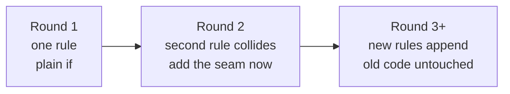

import Scenario from "../../../components/Scenario.astro";
import LevelIntro from "../../../components/LevelIntro.astro";
import PracticeCheck from "../../../components/PracticeCheck.astro";

export const unit = {
  track: "software-design",
  unitSlug: "evolutionary-design",
};

<Scenario label="A shop adds a second price rule, and the total comes out wrong">
  <Fragment slot="facts">
    

      
🧾 <strong>Round 1</strong> — one rule: 10% off orders over $500. One plain if, no problem.

      
🐛 <strong>Round 2</strong> — a $20 coupon is stacked on top, and the 10% discount vanishes.

      
🔌 <strong>Fix</strong> — give "price rules" one shared shape and keep them in a list.

      
$600 order with the coupon

      

        Expected
        

        $520
      

      

        Shipped
        

        $580
      

    

  </Fragment>

A small shop's checkout function started as two steps: add up the items,
add tax. Then came a rule: orders over $500 get 10% off. One `if` handled it
fine. Then came a second rule: a $20 coupon. The coupon was bolted on in
the same function, and for a $600 order with a coupon the customer was
charged for $580 before tax instead of $520. **The coupon code quietly
cancelled the discount, and nobody had decided that on purpose.**

Freezing the design ("no more rules") and rewriting the checkout from
scratch are both bad answers. This unit is about the third one: reshape the
code **just enough, just when the second real rule shows up**, so the third
rule costs about as much as the second.

</Scenario>

<LevelIntro
  items={[
    "Three postures toward change",
    "Open for extension, closed for modification",
    "Real signal versus speculation, and just-in-time seams",
  ]}
/>

## How can a team respond to a requirement it did not plan for?

| Posture                     | What it assumes                                         | What breaks                                                         |
| --------------------------- | ------------------------------------------------------- | ------------------------------------------------------------------- |
| **Big upfront design**      | You can guess every way the system will vary            | Some guesses are wrong, and unused flexibility still has to be kept |
| **Rewrite on every change** | Starting over is cheap each time                        | Throws away tested logic, and gets slower as the system grows       |
| **Evolutionary design**     | You cannot predict every change, but you can react well | Needs the judgment to notice when a change deserves a new structure |

**Evolutionary design** is shaping and reshaping a system's structure in
response to the requirements that actually arrive, so each new change costs
roughly what the last one did instead of more.

<PracticeCheck
  track={unit.track}
  unitSlug={unit.unitSlug}
  topicId="three-postures"
/>

## What does open-closed ask for?

- **Open for extension, closed for modification**: add behaviour without
  editing code that already works and is already tested.
- In the shop: before the fix, every new rule meant editing the body of the
  checkout function. After the fix, a new rule is a new item appended to a
  list, and the checkout function is not touched.
- It is a trade, not a free win: it costs one extra concept (the shared rule
  shape) and one extra place to read.

## When is a new structure justified?

- **YAGNI** (You Aren't Gonna Need It): do not build flexibility for a
  requirement that has not arrived.
- **Design for change**: shape the system so likely changes are cheap.
- They stop conflicting once you ask _which axis_ has real evidence of
  moving. With one rule, there was no evidence. With a second rule that
  collided with the first, there was.
- A **seam** is a place where new behaviour can be plugged in without
  touching what is already there (a shared shape plus a list). Evolutionary
  design adds it **just in time**: when the second real variant appears.

