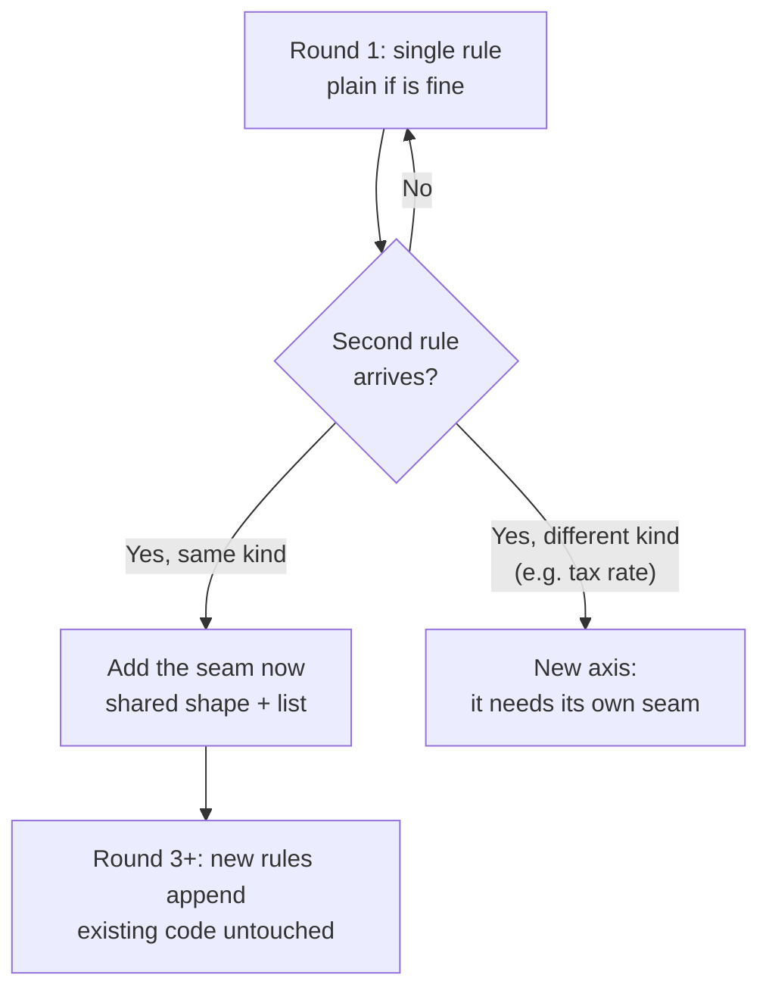
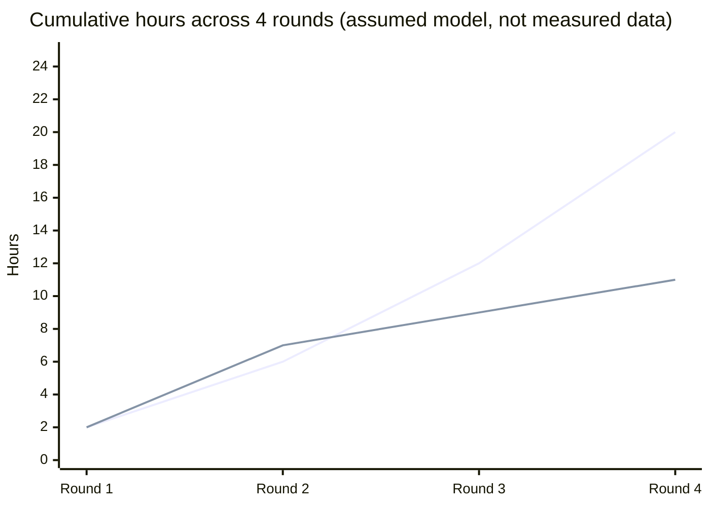

import LevelIntro from "../../../components/LevelIntro.astro";
import Checkpoint from "../../../components/Checkpoint.astro";
import PracticeCheck from "../../../components/PracticeCheck.astro";

export const unit = {
  track: "software-design",
  unitSlug: "evolutionary-design",
};

L1 followed the shop's checkout from one discount, to a coupon that cancelled
it, to a list of price rules that fixed it. This level turns that story into
a decision procedure: what the list actually buys and costs, how to tell a
real axis of change from a guess, and the exact moment to add the structure.

<LevelIntro
  items={[
    "What closed-for-modification buys and costs",
    "Evidence versus guesses about future change",
    "The just-in-time rule for adding a seam",
  ]}
/>

## What does "closed for modification" actually buy?

**If the checkout function never gets edited again after round 2, what was
gained, and what was paid?**

| Side of the ledger | In the shop's checkout                                                                                                           |
| ------------------ | -------------------------------------------------------------------------------------------------------------------------------- |
| **Bought**         | A new rule cannot disturb old rules: they are untouched and already tested. Each rule can be reviewed and tested on its own.     |
| **Paid**           | One extra concept (the shared rule shape), one extra list to read to learn "what applies", one more hop between code and result. |

The trade is worth it exactly when editing a crowded function costs more than
reading one extra interface. That crossover is the judgment this unit
teaches.

<PracticeCheck
  track={unit.track}
  unitSlug={unit.unitSlug}
  topicId="open-closed-trade"
/>

## Which axis of change has real evidence?

**At round 1 the team could imagine dozens of futures: other currencies,
other tax regions, subscriptions. Why build a seam for none of them?**

Because a seam for an axis that never moves is indirection paid every day
with no payoff. The difference is evidence:

| Axis of change        | Evidence at round 1                                   | Verdict     |
| --------------------- | ----------------------------------------------------- | ----------- |
| More price rules      | One rule exists; a second is plausible, not confirmed | Wait        |
| Other currencies      | No customer has asked                                 | Speculative |
| Tax varying by region | Every customer is in one tax region                   | Speculative |

At round 2 the first row changes: a second rule actually arrived and
collided with the first. That is evidence, not imagination.

<Checkpoint question="A teammate says the rule list should have been built at round 1 because 'we obviously knew more rules were coming'. What is wrong with that argument?">

"Obviously coming" is a guess about the future, not evidence from the
present. At round 1 there was one rule, and building the list then would
have meant carrying its cost with nothing to justify it. The same reasoning
applied to currencies or regional tax would have paid the same cost for
axes that never moved. Waiting for the second real rule is what turns the
seam's cost from a bet into a known price.

</Checkpoint>

<PracticeCheck
  track={unit.track}
  unitSlug={unit.unitSlug}
  topicId="axis-signal"
/>

## Exactly when does a seam stop being speculation?

**Not "eventually": at which concrete moment is adding the structure the
obviously right call?**

When the **second concrete variant of the same kind of thing** shows up. One
instance never needs a seam, since anything is extensible if you are willing
to edit it. At the second instance, a plain `if` starts costing more to
read than a shared shape would.

Two failure modes bracket the rule:

- **Too early**: a seam for an axis that never gets a second variant. A
  permanent indirection tax, no payoff.
- **Too late**: a third, fourth, fifth `if` stacked after the second already
  caused a bug. Each new `if` must be reasoned about against every earlier
  one.

<Checkpoint question="Round 3 brings two requirements: skip the loyalty discount for VIP customers (another adjustment to the total before tax), and charge EU orders a different tax rate. Should both go through the existing rule list?">

Only the first. The VIP rule is one more adjustment to the running total
before tax, exactly what the list was built for, so it is a plain append. The
regional tax rate changes how tax itself is computed, which the rule list
was never shaped to touch. Forcing it in as a pretend "rule" would
recreate the hidden ordering confusion that caused the round-2 bug. It gets
its own small seam, added now because this is the moment it has evidence.

</Checkpoint>

<PracticeCheck
  track={unit.track}
  unitSlug={unit.unitSlug}
  topicId="seam-timing"
/>

## Why does the gap between the two postures keep widening?

The numbers below are from this unit's interactive demo, whose assumptions
are made-up but fixed: a base cost of 2 hours per round, plus 2 hours for
each earlier rule a stacked `if` has to be reasoned about alongside; the seam
costs a one-time 5 hours when added at round 2.

| Round | Stacked ifs (hours that round) | Cumulative | With seam added at round 2 (hours that round) | Cumulative |
| ----- | ------------------------------ | ---------- | --------------------------------------------- | ---------- |
| 1     | 2                              | 2          | 2                                             | 2          |
| 2     | 4                              | 6          | 5 (one-time seam cost)                        | 7          |
| 3     | 6                              | 12         | 2                                             | 9          |
| 4     | 8                              | 20         | 2                                             | 11         |

The top line is stacked `if`s: each round's cost grows with the number of
earlier rules. The bottom line pays the seam's one-time price at round 2 and
is flat after that. The seam is slightly more expensive at round 2 and cheaper
from round 3 on, which is why the timing question matters more than any one
round. Use the demo below to change the rounds, the interaction cost and the
round at which the seam is added.
